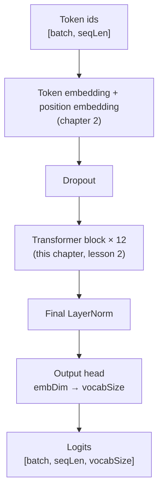
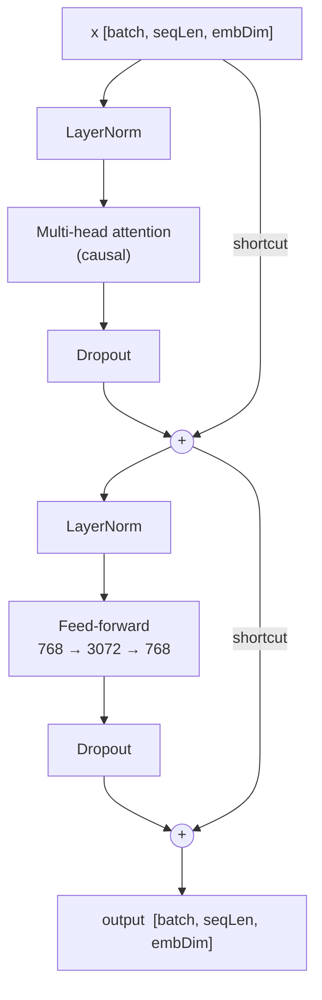

# Chapter 4 · GPT Model (companion)

> **Unofficial companion chapter.** Written while the book's [Chapter 4](https://book.humanexperiences.io/chapters/04-gpt/) lessons were marked "Soon" (as of 2026-10-26). It follows the book's lesson outline and is not the author's text. See the [companion index](README.md).

## What "GPT" means

GPT stands for **Generative Pre-trained Transformer**. Each word names one part of what this repo builds:

| Word | Meaning | Where it's built |
| --- | --- | --- |
| **Generative** | The model produces text one token at a time. It predicts the next token, appends it to the input, and repeats. | Chapter 5, lesson 3 (text generation) |
| **Pre-trained** | Before it is used for anything specific, the model learns from a large amount of unlabeled text, with a single task: predict the next token. A pre-trained model can then be fine-tuned for a particular job, such as following instructions or classifying text. | Chapter 5 (pre-training); fine-tuning is covered later in Raschka's book |
| **Transformer** | The neural network architecture introduced in *Attention Is All You Need* (Vaswani et al., 2017), built from attention and feed-forward layers stacked in blocks. | Chapter 3 (attention) and this chapter |

The original transformer had two halves: an *encoder* that reads a whole input, and a *decoder* that writes output. It was designed for translation. GPT keeps only the decoder, and its attention is causal: each token can see only the tokens before it. That's exactly what next-token prediction needs. Encoder-only models such as BERT go the other way: every token sees the whole input, which suits understanding text but not generating it.

OpenAI released GPT-1 in 2018 (117 million parameters), GPT-2 in 2019 (124 million to 1.5 billion), and GPT-3 in 2020 (175 billion). This repo builds GPT-2's smallest size. GPT-3 scaled up the same basic design. Many of today's open models, such as Llama, Mistral and Qwen, are still decoder-only transformers with this overall shape. They differ in details, for example RMSNorm instead of LayerNorm, rotary position embeddings instead of a learned position table, and a SwiGLU feed-forward network instead of GELU.

## What this chapter builds

By the end of Chapter 3 we had two working pieces. Chapter 2 turns token ids into vectors, and Chapter 3's multi-head attention lets those vectors exchange information. A GPT needs three more things to turn that into a model:

1. **Something to keep the numbers in a stable range** as vectors pass through dozens of layers: *layer normalization*.
2. **Somewhere to process each token after attention has mixed in its context**: the *feed-forward network*.
3. **A way to stack many layers without training breaking down**: *shortcut connections*.

This chapter builds those pieces, wraps them with attention into a **transformer block**, and stacks twelve blocks into a **GPT** the size of OpenAI's GPT-2 small. The model is still untrained: its weights are random, so its output is nonsense until Chapter 5.



---

## Lesson 1 · LayerNorm & GELU feed-forward

Code: [`layers.ts`](../../packages/core/src/model/layers.ts) · Run: `pnpm --filter @node-llm/chapters ch04:1`

### Layer normalization

Each layer in a deep network changes the scale of the values passing through it. Over many layers, values can drift very large or very small, and training becomes slow or unstable. **Layer normalization** fixes this by rescaling each token's vector, on its own, to mean 0 and variance 1 across its features:

```
y = scale · (x − mean) / √(variance + ε) + shift
```

- `mean` and `variance` are computed **per token, over its `embDim` features** ([`layers.ts:30-37`](../../packages/core/src/model/layers.ts#L30-L37)). Tokens in a batch never affect each other. (Batch normalization, common in image models, averages across the batch instead. That doesn't suit language models, which often generate with a batch of one.)
- `scale` and `shift` are learned and start at 1 and 0. If normalization turns out to hurt in some layer, training can undo it there.
- `ε = 1e-5` avoids dividing by zero when a vector's features are all equal.
- The variance divides by *n*, not *n − 1*. That matches PyTorch's `nn.LayerNorm` and GPT-2, which matters when Chapter 5 loads GPT-2's trained weights.

Running the lesson shows two vectors before and after:

```
before LayerNorm: { mean: [ 1.5049, 1.8791 ], variance: [ 14.7912, 8.4195 ] }
after LayerNorm:  { mean: [ -0, 0 ], variance: [ 1, 1 ] }
```

### GELU

Between its two linear layers, the feed-forward network applies a non-linearity: a function that isn't a straight line. Without one, two linear layers in a row collapse into one. GPT-2 uses **GELU** (Gaussian Error Linear Unit), in this tanh approximation ([`layers.ts:51-56`](../../packages/core/src/model/layers.ts#L51-L56)):

```
gelu(x) = 0.5 · x · (1 + tanh(√(2/π) · (x + 0.044715 · x³)))
```

Compared with the simpler ReLU, which is `max(0, x)`:

| x | gelu(x) | relu(x) |
| --- | --- | --- |
| −3 | −0.0036 | 0 |
| −1 | −0.1588 | 0 |
| −0.5 | −0.1543 | 0 |
| 0 | 0 | 0 |
| 0.5 | 0.3457 | 0.5 |
| 1 | 0.8412 | 1 |
| 3 | 2.9964 | 3 |

For large inputs the two are almost the same. Near zero, GELU is smooth and lets small negative values through, while ReLU has a sharp corner and outputs exactly 0 for every negative input. A ReLU unit that only ever sees negative inputs gets zero gradient and stops learning. GELU always passes some gradient, which tends to train better.

### The feed-forward network

Each block's feed-forward network expands every token vector to four times its width, applies GELU, and projects back ([`layers.ts:67-94`](../../packages/core/src/model/layers.ts#L67-L94)):

```
[batch, seqLen, 768] → [batch, seqLen, 3072] → GELU → [batch, seqLen, 768]
```

Attention and the feed-forward network do complementary jobs. **Attention moves information between tokens** (see the [reader notes on why attention exists](../reader-notes.md#why-do-we-need-attention-beyond-the-rnn-bottleneck)). **The feed-forward network then processes each token on its own**, with the same weights at every position. At GPT-2 small's width it holds 4,722,432 parameters. That's two thirds of each block, and the feed-forward layers are widely thought to store much of what a model learns about facts and patterns.

### PyTorch → TypeScript

| PyTorch (Raschka's book) | This repo |
| --- | --- |
| `LayerNorm(emb_dim)` module, or `nn.LayerNorm` | `new LayerNorm(embDim)` |
| `GELU()` module, or `nn.GELU(approximate="tanh")` | `gelu(x)` |
| `nn.Linear(d_in, d_out)` | a `[dIn, dOut]` weight + `[dOut]` bias, applied with `project()` |
| `nn.Sequential(Linear, GELU, Linear)` | `FeedForward.forward` calls them in order |

One difference matters later. PyTorch's `nn.Linear` stores its weight as `[dOut, dIn]` and computes `x · Wᵀ`. This repo stores `[dIn, dOut]` and computes `x · W`. The two do the same math, but GPT-2's published weights come from a framework (TensorFlow) that uses `[dIn, dOut]`, so they load here without transposing.

---

## Lesson 2 · The transformer block

Code: [`block.ts`](../../packages/core/src/model/block.ts) · Run: `pnpm --filter @node-llm/chapters ch04:2`

### Shortcut connections

Training adjusts each weight using its gradient: how much the loss would change if that weight changed. Gradients are computed backwards from the output, layer by layer (backpropagation), and each layer multiplies the gradient on its way through. If those factors are mostly below 1, the gradient shrinks layer after layer. By the time it reaches the first layers it's too small to teach them anything. This is the **vanishing gradient** problem.

A **shortcut connection** (also called a residual or skip connection) adds a layer's input to its output: `x + f(x)` instead of just `f(x)`. The gradient of `x + f(x)` with respect to `x` includes a constant 1 from the `x` term. So a copy of the gradient passes back through every shortcut without shrinking, however small `f`'s contribution is.

The first part of the lesson measures this. It runs one backward pass through a stack of five small layers, with and without shortcuts, and prints the average gradient size at each layer:

```
mean |gradient| per layer, shortcut=false        mean |gradient| per layer, shortcut=true
  layer 0: 2.72e-5                                  layer 0: 1.82e-2
  layer 1: 7.06e-5                                  layer 1: 6.44e-2
  layer 2: 4.82e-5                                  layer 2: 9.06e-2
  layer 3: 2.26e-5                                  layer 3: 2.60e-2
  layer 4: 6.35e-5                                  layer 4: 2.21e-1
```

Without shortcuts, the gradients are about a thousand times smaller. A GPT stacks 12 to over 100 blocks, so shortcuts aren't optional.

### Putting the block together

A GPT-2 block has two sub-layers. Each is wrapped the same way: normalize, transform, add the input back ([`block.ts:57-67`](../../packages/core/src/model/block.ts#L57-L67)):



Some details:

- **Normalization comes first** inside each sub-layer ("pre-LayerNorm"). The original 2017 transformer normalized *after* adding the shortcut. GPT-2 moved it to the front, which trains more reliably in deep stacks because the shortcut path stays untouched from the first block to the last.
- **Dropout** randomly zeroes a fraction of values (10% in GPT-2's configuration) **only while training**, so the model can't rely too much on any single value. Every `forward` takes a `training` flag, `false` by default, and dropout is skipped when it's off. This replaces PyTorch's `model.train()` / `model.eval()` switch.
- **The block's output has the same shape as its input.** That's what lets blocks be stacked any number of times.

### What's in a block

At GPT-2 small's size, the lesson reports 7,085,568 parameters per block:

| Part | Parameters |
| --- | --- |
| Two LayerNorms (scale + shift, 768 each) | 3,072 |
| Attention: query, key and value weights (3 × 768 × 768) | 1,769,472 |
| Attention: output projection (768 × 768 + 768 bias) | 590,592 |
| Feed-forward: expand (768 × 3072 + 3072 bias) | 2,362,368 |
| Feed-forward: contract (3072 × 768 + 768 bias) | 2,360,064 |
| **Total** | **7,085,568** |

### A change to Chapter 3's attention

Chapter 3's `MultiHeadAttention` had no bias on its output projection. Raschka's version has one (its `out_proj` is an `nn.Linear`, which includes a bias by default), and so does GPT-2 (`c_proj`). This chapter adds it ([`multiHeadAttention.ts:77`](../../packages/core/src/model/attention/multi-head/multiHeadAttention.ts#L77)). Without it, the parameter count comes out 9,216 short of the book's figure, and Chapter 5 couldn't load GPT-2's trained weights.

---

## Lesson 3 · The full GPT model

Code: [`gpt.ts`](../../packages/core/src/model/gpt.ts) · Run: `pnpm --filter @node-llm/chapters ch04:3`

### The forward pass

`GptModel.forward` ([`gpt.ts:75-95`](../../packages/core/src/model/gpt.ts#L75-L95)) follows the diagram at the top of this chapter:

1. **Embed.** Look up each token id's row in the token embedding table (`tf.gather`, as in Chapter 2). Add the position embedding for each position, which is broadcast over the batch.
2. **Dropout** on the combined embeddings, during training only.
3. **Run the 12 transformer blocks**, in order.
4. **Normalize** once more, with a final LayerNorm.
5. **Project to the vocabulary.** The output head multiplies each final 768-value vector by a `[768, 50257]` matrix, giving one score per vocabulary entry.

These scores are **logits**. Each one says how strongly the model favors a token: the higher the logit, the more likely that token is next. Chapter 5 turns them into probabilities with softmax.

The logits at position *i* are the model's prediction for the token at position *i + 1*. This is why Chapter 2's dataset uses targets that are the inputs shifted by one. Thanks to the causal mask, position *i* only ever sees tokens 0 to *i*. So one forward pass over a sequence of 1,024 tokens gives 1,024 next-token predictions at once, each made without seeing the answer. The repo's tests check this by changing the last token and confirming the earlier logits don't change ([`model.test.ts`](../../packages/core/tests/model.test.ts)).

### Running it

The lesson builds the 124M configuration and runs two four-token texts through it:

```
input shape:  [ 2, 4 ]
logits shape: [ 2, 4, 50257 ]
total parameters: 163,009,536
without a separate output head: 124,412,160
size as float32: 621.83 MB
```

These match the figures in Raschka's book exactly.

### Where the parameters are

| Part | Parameters | Share |
| --- | --- | --- |
| Token embedding (50,257 × 768) | 38,597,376 | 23.7% |
| Position embedding (1,024 × 768) | 786,432 | 0.5% |
| 12 transformer blocks (12 × 7,085,568) | 85,026,816 | 52.2% |
| Final LayerNorm | 1,536 | < 0.1% |
| Output head (768 × 50,257) | 38,597,376 | 23.7% |
| **Total** | **163,009,536** | |

### Why "124M" when it has 163M parameters?

The token embedding and the output head are both `50,257 × 768` matrices. One maps tokens to vectors and the other maps vectors back to token scores. GPT-2 uses **the same matrix for both** ("weight tying"), which removes 38.6M parameters: 163,009,536 − 38,597,376 = 124,412,160, the "124M" in the model's name.

This chapter keeps them separate, as Raschka's book does; it notes that separate matrices train better from scratch. When Chapter 5 loads GPT-2's trained weights, it will copy the embedding into the output head to reproduce the tying.

### Memory, and why Chapter 5 trains a small model

At 4 bytes per `float32` value, the weights alone take 621.83 MB. Training needs much more. It keeps a gradient for every weight, plus two running averages per weight for the Adam optimizer: four copies in all, about 2.4 GB, before counting the intermediate values stored for backpropagation. That's manageable in memory, but on a CPU each training step at this size takes a long time. Chapter 5 therefore trains a much smaller configuration from scratch, and uses the full size only to run GPT-2's pretrained weights.

---

## Differences from Raschka's PyTorch version

| Topic | Raschka (PyTorch) | This repo |
| --- | --- | --- |
| Train vs. evaluate | `model.train()` / `model.eval()` | `forward(x, training)` flag, `false` by default |
| Linear weights | `[dOut, dIn]`, computed as `x · Wᵀ` | `[dIn, dOut]`, computed as `x · W` (matches GPT-2's published weights) |
| Weight initialization | PyTorch defaults: uniform in ±1/√dIn for `nn.Linear` weights and biases, standard normal for `nn.Embedding` | The same for weights and embeddings; biases start at 0 |
| Gradients | `loss.backward()` | `tf.variableGrads` / `optimizer.minimize`; the chapters get gradient functions from `@tensorflow/tfjs-node` |
| Memory | Automatic | `tf.tidy` around each forward pass, `dispose()` for weights |

The parameter counts and shapes are identical to the book's. Matching PyTorch's initialization matters for training: [Chapter 5](ch05-training.md#differences-from-raschkas-pytorch-version) shows what happens with a wider start.

---

## Exercises

1. **GPT-2 medium.** Use `embDim: 1024`, `numLayers: 24`, `numHeads: 16` in `03-gpt-model.ts` and predict the parameter count before running it, using the tables above.
2. **Remove the shortcuts.** In `block.ts`, return `fed` instead of `tf.add(afterAttention, fed)`, and the same for attention. The tests still pass, because they check shapes and causality, not trainability. Chapter 5's training loop is where the difference should show up.
3. **Weight tying.** Change `GptModel` so the output head reuses `tokenEmbedding` (transposed) and check that the count drops to 124,412,160.
