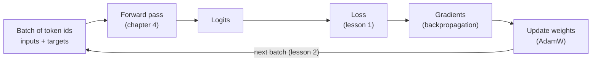
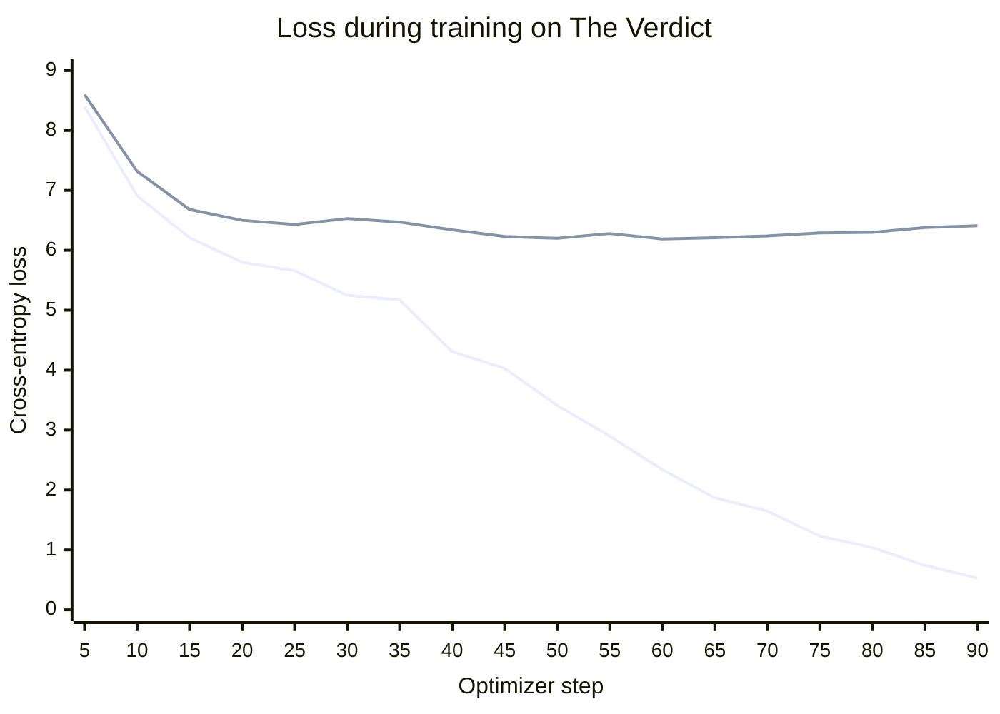
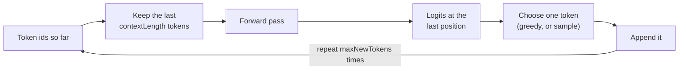

# Chapter 5 · Training (companion)

> **Unofficial companion chapter.** Written while the book's [Chapter 5](https://book.humanexperiences.io/chapters/05-training/) lessons were marked "Soon" (as of 2026-10-27). It follows the book's lesson outline and is not the author's text. See the [companion index](README.md).

Chapter 4 ended with a complete GPT whose weights are random numbers. Give it some text and it produces a score (a *logit*) for every token in the vocabulary at every position, but the scores mean nothing yet. **Training** adjusts the weights, a little at a time, so that the correct next token gets a higher score.

The three lessons follow the cycle:

1. **Measure** how wrong the model's predictions are: the *loss*.
2. **Improve** the weights to lower the loss, over and over: the *training loop*.
3. **Use** the trained model to write text: *generation*.



The training text is the one Raschka's book uses: Edith Wharton's short story *The Verdict* (1908, public domain), stored at [`fixtures/the-verdict.txt`](../../fixtures/the-verdict.txt). It's 20,479 characters, or 5,145 tokens: tiny by language-model standards, so the whole chapter runs on a laptop CPU.

---

## Lesson 1 · Loss & cross-entropy

Code: [`trainer.ts`](../../packages/core/src/train/trainer.ts) (`crossEntropyLoss`, `evaluateLoss`) · Run: `pnpm --filter @node-llm/chapters ch05:1`

### From logits to the probability of the right answer

The lesson starts with two short inputs and their targets. Each target is its input shifted one token to the left, as in Chapter 2's dataset:

| Input | Target (what should come next at each position) |
| --- | --- |
| `every effort moves` | ` effort moves you` |
| `I really like` | ` really like chocolate` |

That's 6 predictions in total: 2 sequences × 3 positions. For each one, the model outputs 50,257 logits. **Softmax** turns them into probabilities that are positive and add up to 1. We then look up the probability the model gave to the *correct* token. For the untrained model, the six numbers are tiny:

```
probability of each correct token: [ '4.82e-5', '3.72e-5', '9.06e-6', '5.66e-6', '2.29e-5', '1.08e-5' ]
```

A perfect model would give each correct token a probability of 1. Training should push these numbers up.

### Why take logs, and why negate?

We want one number that summarizes how good all the predictions are. Multiplying the probabilities would underflow to zero quickly (here it's already around 10⁻²⁹). Taking the **logarithm** turns the product into a sum, which stays well-behaved, and a higher log-probability still means a better prediction. Averaging makes the number independent of how many predictions there are. Finally, we **negate** it, because optimizers *minimize*:

```
loss = −mean( log p(correct token) )      over every position in the batch
```

This is **cross-entropy loss**. The lesson computes it by hand and then with the library function, and gets the same value:

```
their logs: [ '-9.941', '-10.198', '-11.611', '-12.083', '-10.682', '-11.439' ]
mean log probability: -10.9925
cross-entropy (negated mean): 10.9925
crossEntropyLoss(): 10.9925
```

### Reading the number

| Loss | Meaning |
| --- | --- |
| 0 | Every correct token got probability 1. A perfect, and unrealistic, score. |
| ln(50,257) ≈ 10.82 | What you'd get by guessing uniformly: equal probability for every token. |
| ≈ 10.98 | This untrained model: its random weights make some tokens look more likely than others for no reason, so it does slightly *worse* than a uniform guess. |

A related number is **perplexity**, which is `exp(loss)`. You can read it as "the model is as unsure as if it were choosing among this many tokens". The untrained model's perplexity is about 59,424, a little more than the vocabulary's 50,257 tokens. A model that has learned something has a far smaller perplexity.

Raschka's untrained model also starts at about 10.98. That match isn't automatic: it depends on starting the weights the way PyTorch does, which turned out to matter for training too (see [Differences](#differences-from-raschkas-pytorch-version)).

### Training and validation data

`makeLoaders` in [`shared.ts`](../../packages/chapters/src/ch05-training/shared.ts) splits the story 90/10 by characters. The first 90% is for training. The last 10% is held out for **validation**: text the model never trains on, used only to check how well it generalizes. Each part is cut into non-overlapping 256-token windows. Batches have 2 windows each, and only the training batches are shuffled.

```
training tokens: 4612, validation tokens: 534
training loss:   10.9804
validation loss: 10.9747
```

Raschka's book reports 4,608 and 512 tokens, because it counts only the tokens that end up inside complete windows. The split itself is the same.

### Implementation notes

- [`crossEntropyLoss`](../../packages/core/src/train/trainer.ts#L105-L123) flattens the logits from `[batch, seqLen, vocab]` to `[batch × seqLen, vocab]`, so every position is one independent prediction. It then calls `tf.losses.softmaxCrossEntropy`.
- PyTorch's `cross_entropy` takes the target ids directly. The tfjs function wants *one-hot* targets instead: a row of 50,257 zeros with a single 1 at the correct id. At the book's settings that's a temporary `[512, 50257]` array, about 100 MB per batch. It's wasteful but simple, and fine at this scale.
- [`evaluateLoss`](../../packages/core/src/train/trainer.ts#L129-L142) averages the loss over a loader's batches with dropout off. It's the equivalent of Raschka's `calc_loss_loader`.

---

## Lesson 2 · The training loop

Code: [`trainer.ts`](../../packages/core/src/train/trainer.ts) (`trainModel`) · Run: `pnpm --filter @node-llm/chapters ch05:2` (about 10 minutes on a laptop CPU)

### One step

For every batch, `trainModel` does the same four things:

1. **Forward pass with dropout on**: inputs → logits → loss (lesson 1).
2. **Backpropagation**: compute, for every one of the 162 million weights, how the loss would change if that weight were nudged. This is the weight's *gradient*.
3. **Optimizer update**: move each weight a small step in the direction that lowers the loss.
4. **Weight decay**: shrink every weight very slightly toward zero.

In PyTorch these are `optimizer.zero_grad()`, `loss.backward()` and `optimizer.step()`. In tfjs, one call to `optimizer.minimize(lossFn, true, model.weights)` does steps 1–3. It records the forward pass, computes the gradients and applies them ([`trainer.ts:61-65`](../../packages/core/src/train/trainer.ts#L61-L65)). There's nothing to reset between steps, because tfjs doesn't accumulate gradients the way PyTorch does.

### The optimizer: AdamW

Plain gradient descent moves every weight by `learningRate × gradient`. **Adam** improves on this by keeping, for each weight, a running average of its recent gradients and of their squares. Weights whose gradients are consistently large get smaller steps, and weights with small but steady gradients get larger ones. That makes training much less sensitive to the exact learning rate.

**AdamW** adds *decoupled weight decay*: after each step, every weight shrinks by a fixed fraction, here `learningRate × weightDecay = 0.0004 × 0.1 = 0.00004` of itself. This discourages very large weights, which tend to mean the model is memorizing instead of generalizing. tfjs has Adam but not AdamW, so `trainModel` applies the decay itself after each update ([`trainer.ts:68-70`](../../packages/core/src/train/trainer.ts#L68-L70)). That's exactly what "decoupled" means: the decay is applied separately from the gradient step.

### The book's settings

| Setting | Value |
| --- | --- |
| Model | GPT-2 small, context shortened to 256 tokens: 162,419,712 parameters (the position table has 256 rows instead of 1,024) |
| Optimizer | AdamW, learning rate 0.0004, weight decay 0.1 |
| Batches | 2 sequences × 256 tokens; 9 batches per epoch |
| Epochs | 10, so 90 optimizer steps in total |
| Evaluation | Every 5 steps, averaging the first 5 batches of each loader |

### What happens

The run prints the training and validation loss every 5 steps. Across the 90 steps (the numbers vary a little from run to run, because the starting weights and the batch order are random):



The upper line, which flattens out, is the validation loss; the lower line, which keeps falling, is the training loss. The final values were 0.53 (training) and 6.41 (validation). Raschka's book reports about 0.39 and 6.45 for the same setup.

After each epoch, the lesson prints the model's greedy continuation of "Every effort moves you":

| After epoch | Sample (first part) |
| --- | --- |
| 1 | `Every effort moves you,,,,,,,,,,,,,,,,,,,,,,,,,, the,,,,,,` |
| 3 | `Every effort moves you` followed only by line breaks |
| 5 | `Every effort moves you of the picture to have the picture--and--I had been the last of the fact, I had been…` |
| 7 | `Every effort moves you know," she was a little wild--as--I told Mrs.` |
| 10 | `Every effort moves you?" "Yes--quite insensible to the irony. She wanted him vindicated--and by me!"` |

Two things happen at once:

- **The model learns the language of the story.** Its first guesses are the most common tokens: commas and line breaks. Then come common words ("the", "I had been"), then grammatical phrases, and finally whole sentences.
- **It also starts to memorize.** The epoch-10 sample is a line from the story, word for word. The training loss keeps falling toward 0, but the validation loss stops improving at about 6.2 around step 50, then creeps up. The model is getting better at the text it trains on and no better at text it hasn't seen. This is **overfitting**. It's expected here: 162 million parameters and only about 4,600 training tokens, each seen 10 times.

On this run the best validation loss came around epoch 6–7. A real training run would keep the weights from that point (see the exercises).

### What real pre-training does differently

- **Far more data, each piece seen about once.** GPT-2 was trained on about 40 GB of web text, and today's models on trillions of tokens. With that much text, the model can't memorize it, so the training and validation losses fall together.
- **Learning-rate schedules.** The learning rate starts near zero, ramps up over the first steps ("warmup"), then gradually decreases (often following a cosine curve). This helps early stability and later fine-grained progress.
- **Gradient clipping.** Unusually large gradients are scaled down so one bad batch can't throw the weights off course.

Raschka's book covers these in an appendix. The loop here is deliberately the minimal version.

### Saving the result

Lesson 2 ends by saving the trained weights to `checkpoints/verdict-124m/`. Git ignores this folder, since the files are large. `weights.bin` holds all 162,419,712 values as raw float32, 649,678,848 bytes (4 bytes each, nothing else), and `config.json` records the model configuration and each weight's shape ([`saveCheckpoint`](../../packages/chapters/src/ch05-training/shared.ts)). Lesson 3 loads it back. This plays the role of PyTorch's `torch.save(model.state_dict())` / `load_state_dict`.

---

## Lesson 3 · Text generation

Code: [`gpt.ts`](../../packages/core/src/model/gpt.ts) (`generate`) · Run: `pnpm --filter @node-llm/chapters ch05:3` (after lesson 2)

### The generation loop

A GPT writes one token at a time ([`gpt.ts:122-145`](../../packages/core/src/model/gpt.ts#L122-L145)):



Only the last position's logits matter, because they predict the token *after* everything so far. The model still computes logits for every earlier position, then throws them away. Real systems avoid that repeated work with a *key-value cache*. The crop step means the model can keep generating past its context length, but it forgets anything that has scrolled out of view.

How to **choose** the token is a separate decision from the model. `generate` supports three strategies through its options.

### Greedy decoding

The default (`temperature: 0`) always picks the highest-scoring token. It's deterministic: the same prompt always gives the same text. For a model trained on one short story, greedy decoding tends to reproduce passages of the story word for word, and it easily falls into loops.

### Temperature

To get variety, the model *samples* from the probabilities instead of always taking the top one. **Temperature** controls how adventurous the sampling is. The logits are divided by the temperature before softmax ([`gpt.ts:169-172`](../../packages/core/src/model/gpt.ts#L169-L172)). The first part of the lesson shows the effect on a made-up five-word vocabulary for the next word after "The cat sat on the":

| Word | T = 0.5 | T = 1 | T = 2 |
| --- | --- | --- | --- |
| mat | 0.816 | 0.611 | 0.432 |
| sofa | 0.165 | 0.275 | 0.290 |
| roof | 0.018 | 0.091 | 0.167 |
| moon | 0.001 | 0.018 | 0.075 |
| banana | 0.000 | 0.004 | 0.035 |

A temperature below 1 sharpens the distribution toward the favorite, and as it approaches 0, sampling becomes greedy. A temperature above 1 flattens it, so unlikely words like "banana" get picked more often. The lesson also draws 1,000 samples at each temperature, and the counts match these probabilities closely.

### Top-k sampling

High temperatures make the long tail of bad choices more likely. **Top-k** cuts the tail off: only the *k* highest-scoring tokens can be chosen. Every other logit is set to −∞, which softmax turns into probability 0 ([`gpt.ts:163-167`](../../packages/core/src/model/gpt.ts#L163-L167)). With *k* = 2 on the same example, only "mat" (0.690) and "sofa" (0.310) remain.

Temperature and top-k combine well: top-k removes nonsense, and temperature controls variety among what's left.

### On the trained model

After lesson 2 has saved its checkpoint, the second part of the lesson continues "Every effort moves you" for 25 tokens. Your text will differ, because training is random, but its character should be similar:

```
greedy:                    "Every effort moves you?"  "Yes--quite insensible to the irony. She wanted him vindicated--and by me!"
temp 1.4, top-25 (seed 1): "Every effort moves you?"  " he felt? I felt nervous and. She wanted him not existed he turned, and drawn the sketch
temp 1.4, top-25 (seed 2): "Every effort moves you say," she was was followed by interesting to see his tone on fellow up all not when he wouldn, that one might be
temp 1.4, top-25 (seed 3): "Every effort moves you know," was one of their "It was the exquisite Herm good-piece, on a picture--had lent herself in his
```

(Line breaks in the output are shown as spaces here.)

Greedy decoding repeats the story exactly. Sampling with temperature 1.4 and top-25 produces new combinations, built from the story's words and rhythms, that never appear in it. They're often ungrammatical, because the model has only seen one short story. The seed makes each sample reproducible: the same seed on the same weights gives the same text.

### Stopping early

`generate` also accepts `eosId`. When every sequence in the batch produces that token, generation stops, without appending it. For GPT-2's vocabulary the natural choice is 50256, `<|endoftext|>`: the separator placed between documents during training (see the [reader notes on training data](../reader-notes.md#how-would-i-train-on-a-whole-book-or-web-articles-and-what-metadata-matters)). A model trained that way learns to emit it when a text is finished.

---

## Extra · Loading OpenAI's GPT-2 weights

Code: [`gpt2.ts`](../../packages/chapters/src/ch05-training/gpt2.ts) · Run: `pnpm --filter @node-llm/chapters ch05:gpt2`

> Not part of the book's lesson outline for this chapter. Raschka's chapter ends this way, and it's the most convincing test that Chapters 2–5 built the right thing.

Lesson 2's model learned from about 4,600 tokens. OpenAI trained GPT-2 on about 40 GB of web text, and then published the weights. Because this repo's `GptModel` has exactly GPT-2's architecture, those weights can be loaded straight into it.

### Getting the weights

The first run downloads `model.safetensors` (548 MB) from [Hugging Face's copy of OpenAI's release](https://huggingface.co/openai-community/gpt2) into `checkpoints/gpt2-124m/`. Git already ignores that folder (`checkpoints/`), as well as any `*.safetensors` file. Later runs reuse the file.

The download is **verified before use**. Hugging Face publishes a SHA-256 hash for every large file. The script fetches that hash from Hugging Face's API, hashes the bytes as they arrive, and refuses the file if the two differ. It's a small example of the supply-chain question every downloaded model raises: *are these the bytes the publisher meant to release?* A hash only shows the file matches what the hosting site lists, not who produced it or how. That's the gap model signing and provenance credentials aim to close.

### The safetensors format

A safetensors file is deliberately simple. It holds only data, never code to run, unlike older Python "pickle" checkpoints:

```
[8 bytes: header length N] [N bytes: JSON header] [raw tensor bytes]
```

The JSON header lists each tensor's name, data type (`F32` here), shape, and byte range. [`readSafetensors`](../../packages/chapters/src/ch05-training/gpt2.ts) is about 20 lines.

### Mapping GPT-2's names onto this repo

| GPT-2 tensor (per block `h.{i}`) | Shape | This repo |
| --- | --- | --- |
| `wte.weight` | [50257, 768] | token embedding |
| `wpe.weight` | [1024, 768] | position embedding |
| `ln_1.weight` / `ln_1.bias` | [768] | first LayerNorm's scale / shift |
| `attn.c_attn.weight` / `.bias` | [768, 2304] / [2304] | query, key and value, **side by side**: split into three [768, 768] parts |
| `attn.c_proj.weight` / `.bias` | [768, 768] / [768] | attention output projection (the bias Chapter 4 added) |
| `ln_2.weight` / `ln_2.bias` | [768] | second LayerNorm |
| `mlp.c_fc.weight` / `.bias` | [768, 3072] / [3072] | feed-forward expand |
| `mlp.c_proj.weight` / `.bias` | [3072, 768] / [768] | feed-forward contract |
| `ln_f.weight` / `ln_f.bias` | [768] | final LayerNorm |
| (none) | | output head = `wte` transposed ("weight tying", Chapter 4) |

Three details made this work without changes to the model:

- **GPT-2 has Q/K/V biases**, so it's loaded with `qkvBias: true`. The book's training runs leave them out.
- **GPT-2 stores linear weights as `[dIn, dOut]`**, the same layout this repo uses (Chapter 4). Raschka's PyTorch version has to transpose every one of them.
- **Each file block also contains `attn.bias`.** Despite its name, it isn't a weight: it's GPT-2's precomputed causal mask. The loader skips it.

The loader is strict. Every tensor in the file must be used, and every shape must fit, or it stops with an error. The model then reports **124,439,808 parameters** (counting the shared embedding once), which is GPT-2 small's official figure.

**Why the two checkpoint files differ in size.** Lesson 2's `weights.bin` is 650 MB, while GPT-2's `model.safetensors` is 548 MB, even though both describe "124M" models stored as float32:

| | `weights.bin` (lesson 2) | `model.safetensors` (GPT-2) |
| --- | --- | --- |
| Layout | Raw values only; names and shapes in a separate `config.json` | 8-byte length + 14 KB JSON header + raw values |
| Output head | Its own 38,597,376 values | None: reuses the token embedding |
| Position embedding | 256 rows (lesson 2's shorter context) | 1,024 rows |
| Q/K/V biases | None | 27,648 values |
| Other data | None | Twelve 1,024 × 1,024 causal masks (`attn.bias`, 50 MB), which aren't weights |
| Weight values | 162,419,712 | 124,439,808 |

### What the pretrained model can do

**Loss on *The Verdict*.** Using the same 256-token windows as lessons 1 and 2:

| Model | Training text | Validation text |
| --- | --- | --- |
| Untrained | ≈ 10.98 | ≈ 10.98 |
| Lesson 2 (trained on the story, 10 epochs) | 0.52 | 6.41 |
| GPT-2 (pretrained on web text) | 3.76 | **3.56** |

Lesson 2's model knows the training part of the story nearly by heart, but GPT-2 is far better at the part neither model trained on. That's the payoff of pre-training on a large, varied corpus: the model learns English in general, not one text.

**Next-token probabilities** show what it learned, and its limits:

```
"1, 2, 3, 4,"               →  " 5" 87.1%,  " 6" 2.7%,  " 4" 2.4%
"Every effort moves you"    →  " forward" 17.0%,  " to" 10.3%,  " along" 5.6%
"The capital of France is"  →  " the" 8.5%,  " now" 4.8%,  " a" 4.6%,  " France" 3.2%,  " Paris" 3.2%
```

It's confident about simple patterns. It knows "Paris" belongs near "France" but ranks it only fifth. A 124M-parameter model from 2019 stores far less factual knowledge than today's models, which can be hundreds or thousands of times larger and are trained on far more data.

**Generated text** is fluent, though not necessarily true:

```
greedy:  "In a shocking finding, scientists discovered that the brain of a man who had been diagnosed
          with schizophrenia had a higher level of dopamine than that of a woman who had not. The
          findings were published in the journal Nature Neuroscience."

greedy:  "Every effort moves you forward. The first step is to understand the importance of your work.
          The second step is to understand the importance of your work. The third step is to …"
```

The first is a plausible-sounding but invented news item. The model has learned what science news *sounds like*, not which findings exist. The second shows greedy decoding's tendency to loop. Sampling with `temperature: 1, topK: 40` (the settings OpenAI used for GPT-2 samples) avoids the loop and gives different text for each seed.

---

## Differences from Raschka's PyTorch version

| Topic | Raschka (PyTorch) | This repo |
| --- | --- | --- |
| Optimizer | `torch.optim.AdamW` | `tf.train.adam` plus a manual decoupled weight-decay step |
| Loss | `cross_entropy(logits, target_ids)` | `softmaxCrossEntropy(oneHot(targets), logits)` |
| One training step | `zero_grad()`, `backward()`, `step()` | `optimizer.minimize(lossFn, true, model.weights)` |
| Sampling | `torch.multinomial` with a global `torch.manual_seed` | `tf.multinomial` with a per-call `seed` option |
| Saving weights | `torch.save(model.state_dict(), …)` | `saveCheckpoint`: raw float32 file + JSON shapes |
| Initialization | PyTorch defaults | The same for linear weights (uniform in ±1/√dIn) and embeddings (standard normal); biases start at 0 instead of uniform |

Starting the weights the PyTorch way matters more than it might seem. An earlier version of this repo started linear weights about 1.7 times wider (normal, standard deviation 1/√dIn). On the same lesson 2 run, that gave an untrained loss of 11.38 instead of 10.98, and a training loss of 3.50 instead of about 0.5 after 10 epochs. The model spent several epochs stuck predicting mostly "the" and commas. The shared helper is [`linearWeight`](../../packages/core/src/model/attention/utils.ts).

---

## Exercises

1. **Change the sampling.** In `03-generation.ts`, try temperatures of 0.5 and 3, and `topK` of 1, 5 and 200. Which settings stay readable? Which ones copy the story?
2. **Stop at the best point.** Find the step with the lowest validation loss in lesson 2's output and change `epochs` so training stops there. Compare the samples. This is called *early stopping*.
3. **More data.** Add a second public-domain story (for example from Project Gutenberg) to the training text, with `<|endoftext|>` (id 50256) between the two, and watch how the gap between training and validation loss changes.
4. **Perplexity.** Print `Math.exp(evaluateLoss(model, val))` for the trained model in lesson 3 and compare it with the untrained value from lesson 1.
