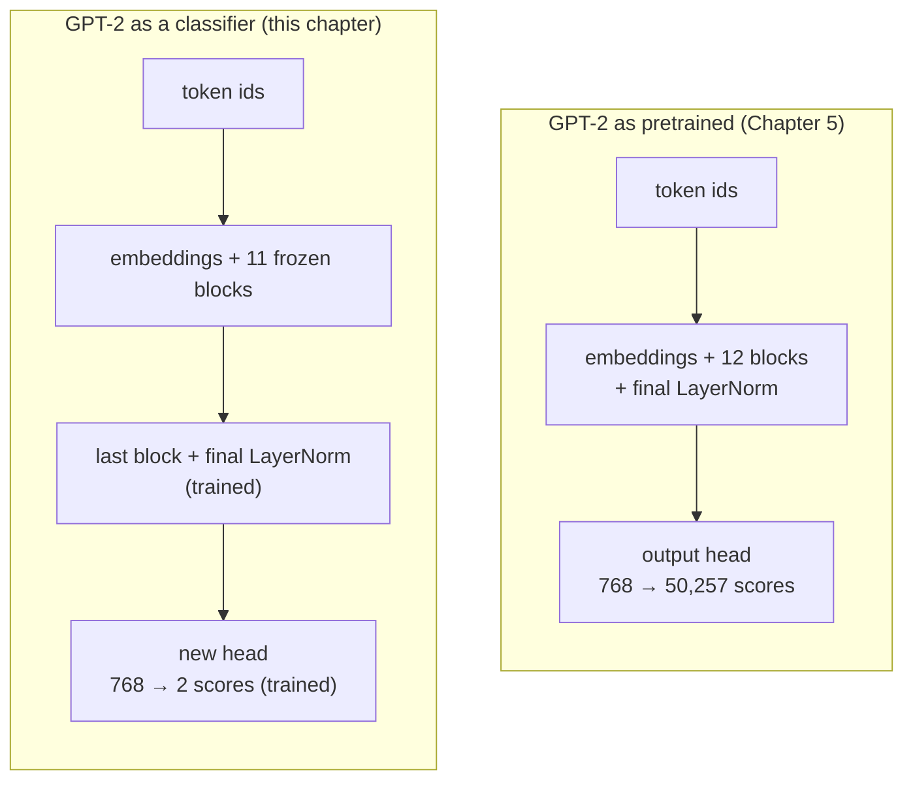
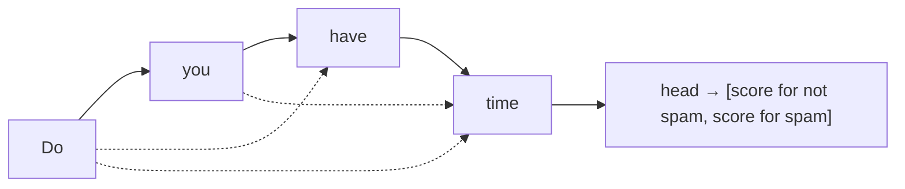
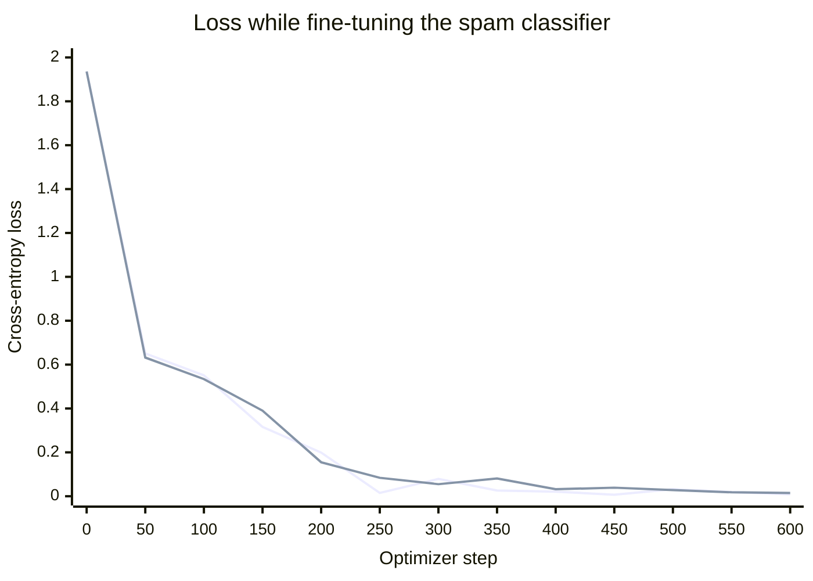

# Chapter 6 · Fine-tuning for classification (companion)

> **Unofficial companion chapter.** This repo had no Chapter 6 code or stubs (as of 2026-10-28). The chapter follows the section outline of Raschka's Chapter 6, *Fine-tuning for classification*, with one lesson script per section, and is not the author's text. See the [companion index](README.md).

Chapter 5 ended with OpenAI's GPT-2 loaded into this repo's model. It writes fluent text, but writing text is all it does. This chapter turns it into something else: a **spam classifier** that reads a text message and answers "spam" or "not spam".

The method is **fine-tuning**: take a pretrained model, change it slightly, and continue training it on a small labelled dataset for the new task. Pre-training (Chapter 5) taught the model language from unlabelled text. Fine-tuning reuses that knowledge for a specific job.

## Two kinds of fine-tuning

| | Classification fine-tuning (this chapter) | Instruction fine-tuning (Raschka's Chapter 7) |
| --- | --- | --- |
| Output | One of a fixed set of labels | Free text |
| Training data | Texts with labels: `("WINNER!! Claim your prize…", spam)` | Instructions with example responses |
| What changes in the model | The output head is replaced by a much smaller one | Nothing structural; the same head keeps predicting tokens |
| Afterwards it can | Only classify, into the labels it was trained on | Follow many kinds of instructions |
| Data and compute needed | Small | Larger |

Classification is the narrower of the two, and simpler. A model that classifies spam can't do anything else, but it does that one job reliably and cheaply.



---

## Lesson 1 · The dataset

Code: [`shared.ts`](../../packages/chapters/src/ch06-classification/shared.ts) (`ensureSpamData`, `balance`, `randomSplit`) · Run: `pnpm --filter @node-llm/chapters ch06:1`

The data is the [SMS Spam Collection](https://archive.ics.uci.edu/dataset/228/sms+spam+collection) from the UCI Machine Learning Repository: 5,574 real text messages, published in 2011, each labelled **ham** (an ordinary message) or **spam**. It's about 200 KB, downloaded once into the git-ignored `data/` folder.

```text
ham    Ok lar... Joking wif u oni...
spam   Free entry in 2 a wkly comp to win FA Cup final tkts 21st May 2005. Text FA to 87121 …
```

UCI publishes no checksum for it. The lesson records the SHA-256 of the extracted file as it was when this chapter was written and refuses a download that doesn't match, the same check Chapter 5 applied to GPT-2's weights.

### Balancing

| | Messages |
| --- | --- |
| Ham | 4,827 |
| Spam | 747 |
| **Balanced:** all spam + 747 randomly chosen ham | 1,494 |

Most messages are ham. A model trained on the full set could reach 87% accuracy by answering "ham" every time, and its accuracy would hide that. With equal numbers of each, 50% is what guessing scores, so accuracy is easy to read. The cost is that 4,080 ham messages go unused. Weighting the loss by class is the usual alternative that keeps them.

### Training, validation and test sets

The balanced set is shuffled and split 70/10/20:

| Set | Messages | Used for |
| --- | --- | --- |
| Training | 1,045 | Adjusting the weights |
| Validation | 149 | Watching for overfitting during training |
| Test | 300 | One final measurement, after all choices are made |

The **test** set is new compared with Chapter 5. Validation results guide decisions (how many epochs, which learning rate), and every decision made by looking at them fits the model slightly to that set. The test set is held back so the final number comes from data that influenced nothing.

---

## Lesson 2 · Padding and batches

Code: [`classification.ts`](../../packages/core/src/data/classification.ts) (`ClassificationDataset`, `ClassificationLoader`) · Run: `pnpm --filter @node-llm/chapters ch06:2`

A batch is a 2-D tensor, so every row must have the same number of tokens, but messages range from 1 token to well over 100. The two usual fixes are:

- **Cut** everything to the shortest message. That would lose most of the text.
- **Pad** everything to the longest message. This is what the book does.

The longest training message is 120 tokens, so every message is padded to 120 with `<|endoftext|>` (id 50256). GPT-2 has no dedicated padding token, and this one already means "nothing more here":

```text
"Ok lar... Joking wif u oni..."  →  [18690, 26371, 986, 449, 5730, 266, 361, 334, 319, 72, 986,
                                     50256, 50256, … 109 times]
```

Validation and test messages are padded to the same 120, and the rare longer one is cut. The model never sees anything longer than the training data's length.

With 8 messages per batch, the 1,045 training messages make 130 batches. The last 5 messages are dropped each epoch (`dropLast`) so every training step has a full batch. The order is reshuffled every epoch, so different messages are dropped each time. Validation and test keep their partial last batch: 19 and 38 batches.

---

## Lesson 3 · Starting from pretrained GPT-2

Code: [`03-pretrained-model.ts`](../../packages/chapters/src/ch06-classification/03-pretrained-model.ts) · Run: `pnpm --filter @node-llm/chapters ch06:3`

The lesson loads GPT-2 small with Chapter 5's [`loadGpt2`](../../packages/chapters/src/ch05-training/gpt2.ts), with dropout off as in Raschka's chapter, and checks it with two prompts. The output matches Raschka's word for word:

```text
Every effort moves you forward.

The first step is to understand the importance of your work
```

```text
Is the following text 'spam'? Answer with 'yes' or 'no': 'You are a winner you have been
specially selected to receive $1000 cash or a $2000 award.'

The following text 'spam'? Answer with 'yes' or 'no': 'You are a winner
```

The second prompt asks a question, and GPT-2 repeats it. Pre-training taught it to continue text that resembles its training data. It never learned that a question is something to answer. That takes either instruction fine-tuning (Raschka's Chapter 7) or, for a fixed set of answers, the classification fine-tuning in this chapter.

---

## Lesson 4 · A new head, and what to train

Code: [`classifier.ts`](../../packages/core/src/model/classifier.ts) (`GptClassifier`) · Run: `pnpm --filter @node-llm/chapters ch06:4`

### Replacing the head

GPT-2's output head turns each token's final 768 values into 50,257 scores, one per vocabulary token. For two classes, it's replaced by a new head with two outputs, starting from random weights:

| Part | Parameters |
| --- | --- |
| GPT-2 below its head: embeddings, 12 blocks, final LayerNorm | 124,439,808 |
| GPT-2's output head (no longer used) | 38,597,376 (768 × 50,257) |
| New head: 768 × 2 weights + 2 biases | 1,538 |

The new head has a bias, as PyTorch's `nn.Linear` does by default. GPT-2's own head has none.

[`GptModel.hiddenStates`](../../packages/core/src/model/gpt.ts) returns everything below the head, and `GptClassifier` puts its own head on top. Raschka instead replaces the attribute in place (`model.out_head = …`). The effect is the same.

### Which token classifies the message?

The new head gives two scores at every position: for `"Do you have time"`, ids `[5211, 345, 423, 640]`, the output has shape `[1, 4, 2]`. Only the **last** position's scores are used.

The reason is the causal mask from Chapter 3. Each position can attend only to itself and earlier positions, so the first token's vector knows only "Do", and the last one's has attended to the whole message:



Training then teaches the model to put what the decision needs into that last position.

With padding, the last position is usually an `<|endoftext|>` padding token, not the message's last word. That still works: the padding token attends to the whole message before it, and the model learns to use it.

Raschka's additional experiments measure both alternatives. Classifying from the **first** token, which has seen only one word, drops test accuracy to 75.00%. Classifying from the **last real token** of each message, skipping the padding, raises it to 98.33%. Exercise 2 tries the second.

### Freezing

Fine-tuning could update all 124 million weights, but the book trains only the top:

| Trained | Parameters |
| --- | --- |
| Last transformer block | 7,087,872 |
| Final LayerNorm | 1,536 |
| New head | 1,538 |
| **Total** | **7,090,946** (5.7% of the model) |

The other 11 blocks and the embeddings are **frozen**: they take part in every forward pass but are never changed. There are three reasons:

- **Less to compute.** Gradients are needed only for the top block. On a laptop CPU, a step takes about a third of the time it takes when training everything.
- **Little data.** 1,045 examples aren't enough to retrain 124 million weights without overfitting.
- **The lower layers already do their job.** They turn tokens into context-aware representations, and that's what a classifier needs. The top layers are the most specific to the old task of predicting tokens, so they benefit most from adjusting.

How much to train is a trade-off. Raschka's [additional experiments](https://github.com/rasbt/LLMs-from-scratch/tree/main/ch06/02_bonus_additional-experiments) compare the choices on this dataset (one run each, on a GPU, so the differences of a point or two are noise):

| What is trained | Test accuracy | Training time |
| --- | --- | --- |
| Only the new head | 72.00% | 0.25 min |
| Last block + final LayerNorm + head (this chapter) | 95.00% | 0.28 min |
| Last two blocks + final LayerNorm + head | 98.33% | 0.33 min |
| Everything | 96.67% | 0.69 min |

Training only the head is far worse. The pretrained representations aren't arranged for spam detection, and the head alone can't rearrange them. Training one block or more closes most of that gap.

In PyTorch, freezing means setting `requires_grad = False` on each frozen parameter. In TensorFlow.js, the optimizer is simply given the list of weights to update ([`trainableWeights`](../../packages/core/src/model/classifier.ts)), and gradients are computed for those only.

---

## Lesson 5 · Loss and accuracy

Code: [`classifierTrainer.ts`](../../packages/core/src/train/classifierTrainer.ts) (`classificationLoss`, `classificationAccuracy`) · Run: `pnpm --filter @node-llm/chapters ch06:5`

**Accuracy** (the share of messages classified correctly) is the number that matters, but it can't be trained on directly. A tiny change to a weight almost never flips a prediction, so accuracy doesn't change, and it gives no gradient to follow.

**Cross-entropy**, as in Chapter 5, does change smoothly. Softmax turns the last position's two scores into two probabilities, and the loss is −log of the probability given to the correct label. It's the same calculation as Chapter 5's, with 2 choices instead of 50,257 and one prediction per message instead of one per token.

Before training, with a random head:

| | Accuracy (first 10 batches) | Loss (first 5 batches) |
| --- | --- | --- |
| Training | 51.25% | 1.158 |
| Validation | 60.00% | 0.995 |
| Test | 48.75% | 1.212 |

That's a coin toss, as expected; Raschka's figures are 46.25%, 45.00% and 48.75%. The starting losses differ from his (2.45, 2.58, 2.32) because the new head starts from different random values. Guessing 50/50 would give a loss of −log 0.5 = 0.69, so both heads start out confidently wrong about as often as right.

---

## Lesson 6 · Fine-tuning

Code: [`classifierTrainer.ts`](../../packages/core/src/train/classifierTrainer.ts) (`trainClassifier`) · Run: `pnpm --filter @node-llm/chapters ch06:6` (about 15 minutes on an Apple M2 CPU)

### The loop

The loop is Chapter 5's, with three changes:

1. The loss compares the last position's two scores with one label per message, not every position's scores with the next token.
2. Only the 7.09 million trainable weights are passed to the optimizer.
3. After each epoch it also measures accuracy, which is what the task is judged on.

### The book's settings

| Setting | Value | Chapter 5 for comparison |
| --- | --- | --- |
| Epochs | 5 (650 steps) | 10 |
| Optimizer | AdamW, learning rate 5 × 10⁻⁵, weight decay 0.1 | AdamW, 4 × 10⁻⁴, 0.1 |
| Batch | 8 messages × 120 tokens | 2 × 256 tokens |
| Loss checked | Every 50 steps, on 5 batches of each set | Every 5 steps, on 5 batches |
| Accuracy checked | After each epoch, on 5 batches (40 messages) of each set | None |
| Dropout | 0 | 0.1 |

The learning rate is 8 times smaller than Chapter 5's. Chapter 5 started from random weights and had far to go. Here, almost everything is already right, and large steps would damage what pre-training learned.

### What happens



The two lines are the training and validation loss, each measured on 5 batches. Unlike Chapter 5, they stay together: validation loss falls as far as training loss does. The model is learning something general about spam, not memorizing the 1,045 training messages. Two things make that possible: 1,045 examples is far more labelled data per decision than one short story, and most of the model is frozen.

The per-epoch accuracies (on 40 messages each, so every message is worth 2.5 points) went from 90.00% training and 87.50% validation after epoch 1 to 100% on both by epoch 3.

### Results

After training, accuracy on every message in each set:

| | This repo | Raschka |
| --- | --- | --- |
| Training | 99.04% | 97.21% |
| Validation | 96.64% | 97.32% |
| Test | 96.33% | 95.67% |
| Training time | 14.8 min (Apple M2, CPU) | 1.07 min (Apple Silicon GPU, via PyTorch's MPS) |

The two runs agree to within about two points, which is as close as two runs can be expected to get. The messages in each split differ (see [Differences](#differences-from-raschkas-pytorch-version)), as do the new head's starting values and the order of the batches. On the 300 test messages, one point is 3 messages.

The time difference is the hardware. TensorFlow.js in Node runs on the CPU only; PyTorch on a Mac can use the GPU.

### Saving only what changed

Raschka saves the whole model, about 500 MB. This repo saves only the weights fine-tuning changed: the last block, the final LayerNorm and the new head. That's 7,090,946 values in 28 MB, written to `checkpoints/spam-classifier/trainable.bin`.

The rest are GPT-2's own weights, reloaded from its file in lesson 7. To make sure it's the same file, `config.json` records its SHA-256:

```json
{
  "base": "openai-community/gpt2 model.safetensors",
  "baseSha256": "248dfc3911869ec493c76e65bf2fcf7f615828b0254c12b473182f0f81d3a707",
  "maxLength": 120,
  "shapes": [[768], [768], [768, 768], …]
}
```

Loading refuses a different base file. The fine-tuned weights only make sense on top of the exact weights they were trained with. This is the same idea behind the adapter files that parameter-efficient methods such as LoRA produce (Raschka's Appendix E): a small file of changes that depends on a specific base model.

---

## Lesson 7 · Using the classifier

Code: [`07-classify.ts`](../../packages/chapters/src/ch06-classification/07-classify.ts) (`classify` in [`shared.ts`](../../packages/chapters/src/ch06-classification/shared.ts)) · Run: `pnpm --filter @node-llm/chapters ch06:7`

A new message is prepared exactly like the training data: tokenized, then cut or padded to 120 tokens. The prediction is the class with the higher of the last position's two scores.

```text
spam      "You are a winner you have been specially selected to receive $1000 cash or a $2000 award."
not spam  "Hey, just wanted to check if we're still on for dinner tonight? Let me know!"
spam      "URGENT! Your mobile number has been awarded a £500 prize. Call 09061701461 to claim."
not spam  "Can you pick up some milk on the way home?"
spam      "Congratulations, your package is waiting. Click the link to confirm delivery details."
```

The first two are Raschka's examples, and the results match his. The last one is a kind of scam that was rare in 2011, when the dataset was published. The model still catches it, probably from the pattern of an unexpected "Congratulations" followed by a link and a request for details. A classifier is only as current as its training data, though. Spam changes, and a production filter would be retrained regularly on recent messages.

The classifier's output is always one of the two labels, with no way to say "unsure". The two scores can be turned into probabilities with softmax, which gives a confidence, and Exercise 3 prints them.

---

## Differences from Raschka's PyTorch version

| Topic | Raschka (PyTorch) | This repo |
| --- | --- | --- |
| Reading the dataset | `pandas.read_csv`, which treats `"` as a quote character and merges a few lines: 5,572 rows (4,825 ham) | Each line split at its first tab: 5,574 messages (4,827 ham). Spam (747) and every later count are the same. |
| Balancing and splitting | pandas `sample` with seed 123 | A seeded shuffle (mulberry32) that can't reproduce pandas'. Seed 12 is used because its longest training message is 120 tokens, as in the book, so batch shapes match. The messages in each split differ. |
| Download check | None | SHA-256 of the extracted file, recorded in 2026-10 |
| Replacing the head | `model.out_head = nn.Linear(768, 2)` | `GptClassifier` wraps the model and uses `GptModel.hiddenStates` |
| Freezing | `requires_grad = False` on every parameter, then `True` on the last block and final norm | The optimizer is given `trainableWeights` only |
| Weight decay | `AdamW` over all parameters; frozen ones have no gradient, so they are skipped | Applied to the trainable weights only, which has the same effect |
| Saved model | Whole `state_dict`, about 500 MB | Only the changed weights, 28 MB, plus the base model's SHA-256 |
| Hardware | GPU when available (1.07 min) | CPU only (14.8 min) |

---

## Exercises

1. **Train more, or less.** Change `trainableWeights` in [`classifier.ts`](../../packages/core/src/model/classifier.ts) to train only the head, then the last two blocks. Compare test accuracy and time with Raschka's table in lesson 4.
2. **Read the last real token.** Padding means the last position is usually `<|endoftext|>`. Record each message's real length in `ClassificationDataset`, and take the scores at position `length − 1` instead of the last position. Raschka's experiments suggest test accuracy goes up a couple of points.
3. **Show confidence.** In `classify`, apply `tf.softmax` to the last position's scores and print the probability of the predicted class. Try messages that are hard to call, such as a real delivery notice.
4. **Don't pad to a fixed length.** Pad each batch only to its own longest message. Batches of short messages then run faster. Does accuracy change?
5. **A different task.** Replace the dataset with another two-label text set, such as positive and negative movie reviews (Raschka's repository has an IMDb example). What has to change besides the data?
