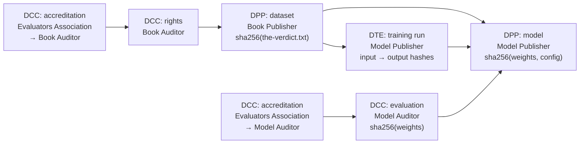
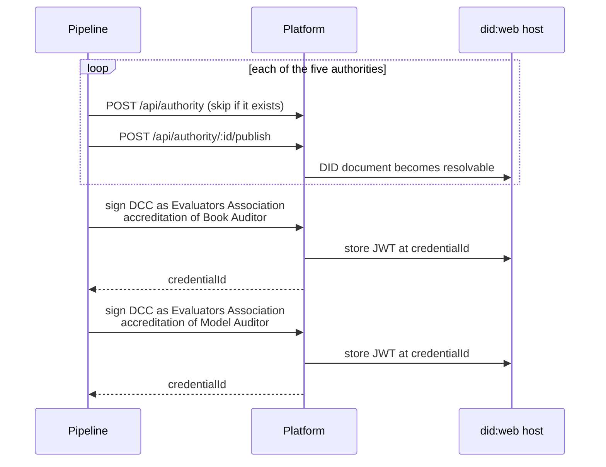
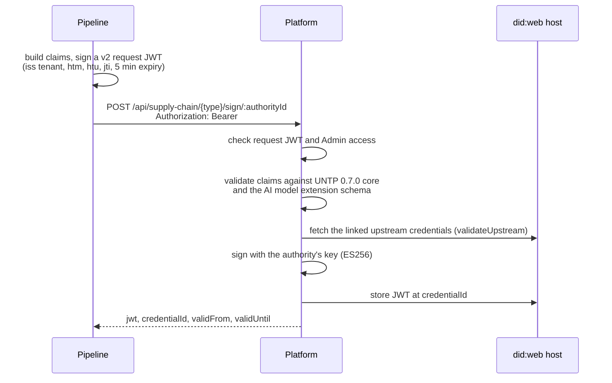
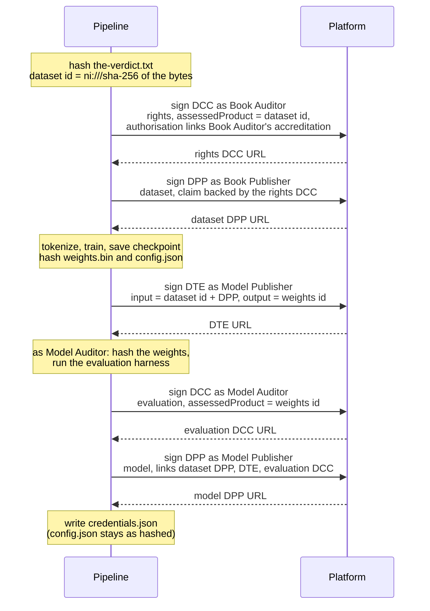
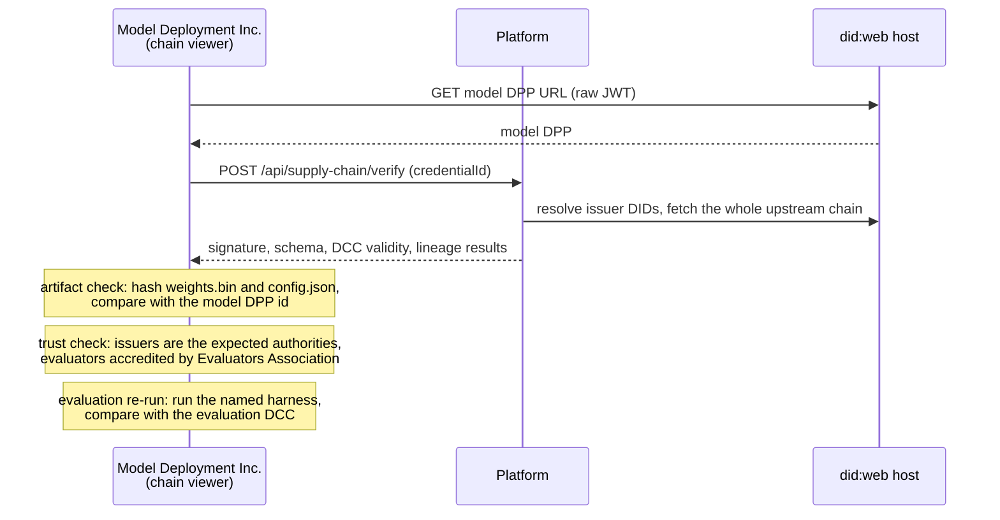

# Credential demo: supply-chain credentials for a training pipeline

**Status:** design agreed; implementation in progress (2026-11-03). Branch `credential-demo`, off `companion`. The detailed plan is in [implementation-plan.md](implementation-plan.md).

This demo issues UNTP supply-chain credentials (DPP, DCC, DTE) for each step of training a model, using the AffinitiQuest platform. Then it verifies the model against them. Its first audience is the CTO; later it will be shown more widely to get feedback on the product idea. It is demo ware and will be labelled as such, so authorities may carry real organization names.

The questions behind it are in the working paper [Supply-Chain Credentials for AI Models](https://claude.ai/artifact/S2dLnbKf17Vtjn3kHB7FJe). Its "Next steps" ask for this: a model passport for the toy GPT-2, and a DTE linking it to its inputs.

## Contents

- [Phases](#phases)
- [What the platform provides](#what-the-platform-provides)
- [Phase 1: pretraining on The Verdict](#phase-1-pretraining-on-the-verdict)
- [Parties](#parties)
- [Credentials](#credentials)
- [Sequences](#sequences)
- [Mapping onto the UNTP schemas](#mapping-onto-the-untp-schemas)
- [Standards position](#standards-position)
- [Verification](#verification)
- [Packaging and viewing](#packaging-and-viewing)
- [Configuration](#configuration)
- [Open questions](#open-questions)
- [Decisions](#decisions)

## Phases

1. **Pretraining.** Train a next-token model from scratch on `fixtures/the-verdict.txt` (chapter 5), and issue credentials for the dataset, the training run and the model.
2. **Derivation.** Fine-tune the phase 1 model, and issue a second DTE and passport. This shows which claims carry over to a derived model (data rights do; evaluations don't) and how weight comparison can check a claimed derivation.
3. **Retrieval (RAG).** Credentials for source documents, the embedding model and the index, and a provenance record for each answer (chapter 7's `ch07:rag`).

The rest of this document covers phase 1 unless it says otherwise.

## What the platform provides

The platform repo is `devops/realtime`. The API is `src/app/controllers/supply-chain.controller.ts`, and the request schemas are in `@aq/aq-server-common` (`src/entities/supply-chain-schemas.ts`).

| Capability | Endpoint | Notes |
| --- | --- | --- |
| Create and publish an authority | `POST /api/authority`, `POST /api/authority/:id/publish` | Each authority is an organization with its own `did:web` and signing key (`ES256`, `jwt_vc_json`). See `getOrCreateAuthority` in `src/scripts/create-supply-chain-demo-assets.ts` |
| Sign a DPP, DCC or DTE | `POST /api/supply-chain/{dpp,dcc,dte}/sign/:authorityId` | Needs an Admin API key. Returns `{ jwt, credentialId, issuer, type, validFrom, validUntil }` |
| Publish a credential | (automatic) | `credentialId` is `https://{did-domain}/credentials/{type}/{year}/{uuid}`. The JWT is stored there and anyone can read it |
| Verify a credential | `POST /api/supply-chain/verify` (and per-type variants) | No authentication. Checks the signature (resolving `did:web`), VC structure, UNTP schema, DCC validity at a point in time, and linked upstream credentials **one level deep** |

Not built yet: revocation and status lists ("Phase 4" in the service), and upstream validation at issuance (a TODO).

The "UNTP schema validation" check uses simplified, UNTP-inspired schemas embedded in the service (`getFallbackSchema`), not the official UNTP JSON schemas.

Before the `untp-0.7` work, the schemas follow UNTP 0.6.1 for physical goods, and AI-specific data could only go in free-form slots (DPP `characteristics`, DTE `transformationDetails` and `extensions`). The upgrade replaces this with 0.7.0 and the AI model extension (see [Mapping onto the UNTP schemas](#mapping-onto-the-untp-schemas)).

## Phase 1: pretraining on The Verdict

| Step | What happens | Artifact | Identified by |
| --- | --- | --- | --- |
| Source | "The Verdict", Edith Wharton (1908, public domain), as used in Raschka's book | `fixtures/the-verdict.txt`, 20,479 bytes | SHA-256 `b41e41a6…5b31f` |
| Tokenize | `r50k_base`, GPT-2's encoding, from the `gpt-tokenizer` package | Token ids | Package name, version and a digest of the encoding |
| Train | 90/10 train/validation split, the next-token loss, AdamW. A small config (2 layers, 128 dimensions, as in `ch05-training/train.ts`) trains in under a minute, so it can run live | `weights.bin`, `config.json` | SHA-256 of each file |
| Evaluate | An independent party measures the validation loss of the exact weights | A score and the harness version | The weights hash it evaluated |

### Reproducibility (checked 2026-11-02)

**Short answer:** with a fixed seed, training reproduces the weights bit for bit on the same machine with the same thread count. Change the thread count and the hash changes, though the model is the same to every printed digit of loss.

**This is not an audit check for real models.** Re-running pre-training is possible here only because the model is toy-sized. At any useful scale, a re-run is ruled out three ways: the compute (weeks on thousands of GPUs), the training data (builders don't release it), and determinism (large distributed GPU runs are far less reproducible than one laptop). So a training DTE is an attestation, accountable to whoever signed it, not a recipe an auditor re-runs. The checks an auditor can actually make are listed under [Verification](#verification). Seeding still matters for two smaller reasons: the DTE's record is complete, and demo runs are repeatable.

**Randomness in the code.** None of the random sources take a seed today:
- weight initialization (`tf.randomNormal`, `tf.randomUniform`);
- dropout (`tf.dropout`);
- batch shuffling (`Math.random` in `DataLoader`).

When an op has no seed, tfjs seeds its generator from `Math.random()` (`rand_util.js`: `seed ? seed : Math.random()`). So replacing `Math.random` with a seeded generator at the start of a script seeds every one of these without changing `packages/core`.

**Test.** A throwaway script ran the tiny configuration from `ch05-training/train.ts`: 2 layers, 128 dimensions, dropout 0.1, 10 epochs, about 23 s. `Math.random` was replaced by a seeded generator (mulberry32). The script hashed all the weights before and after training. Setup: Apple M2 (8 cores), tfjs-node `tensorflow` backend, Node 22.

| Run | Seed | Threads | Initial weights | Trained weights | Final validation loss |
| --- | --- | --- | --- | --- | --- |
| 1 | 42 | default (8) | `fe083fa8…` | `de24e3f3…` | 6.37278938293457 |
| 2 | 42 | default (8) | `fe083fa8…` | `de24e3f3…` | 6.37278938293457 |
| 3 | 43 | default (8) | `9eda4b1a…` | `dccd0346…` | 6.444502353668213 |
| 4 | 42 | 1 (`TF_NUM_INTRAOP_THREADS=1`, 55 s) | `fe083fa8…` | `82b3e745…` | 6.37278938293457 |

What follows for the demo:

- **The DTE records the run's settings:** the seed and the PRNG, the thread count, the tfjs-node and libtensorflow versions, the CPU, the code commit, and the `gpt-tokenizer` version. Initialization doesn't depend on threads (run 4's initial hash matches), but training does: parallel floating-point sums round differently.
- **The demo doesn't present re-training as a check.** Shown on a toy model, it would suggest an audit step that doesn't exist for real models.
- **Seeding lives in the demo, not in `packages/core`.** The pipeline replaces `Math.random` at startup. The chapter code stays as the book has it.
- **Not tested:** other machines and CPU architectures, and the 124M configuration. Bit-for-bit matches across different CPUs are unlikely.

## Parties

Each issuing party is an authority on the platform, with its own `did:web` and signing key. The names describe each party's role, so the credential chain reads plainly in the demo.

| Role | Authority name | Issues |
| --- | --- | --- |
| Data curator | Book Publisher | Dataset DPP |
| Rights evaluator | Book Auditor | Rights DCC on the dataset |
| Model builder | Model Publisher | Training DTE, model DPP |
| Model evaluator | Model Auditor | Evaluation DCC on the model |
| Accreditor | Evaluators Association | Accreditation of Book Auditor and of Model Auditor |
| Buyer / deployer | Model Deployment Inc. | Nothing in phase 1; verifies |

Both evaluators are third parties whose claims a buyer relies on, so both are accredited, by the one accrediting body. A DCC is issued to a single party (`issuedToParty`), so this is two accreditation credentials.

Verification needs no authentication, so Model Deployment Inc. doesn't need an authority in phase 1. It would need one later if it presents credentials of its own, for example a deployment restriction tied to the deployer's credentials.

## Credentials

Issue order matters. A signed credential can't be edited, so a link can only point to a credential that already exists. Making each product's `id` its content hash gets around this: the DTE can name its output model by hash before the model's passport exists, and the passport then links back to the DTE.

| Order | Credential | Issuer | Subject | Links to |
| --- | --- | --- | --- | --- |
| 1 | DCC: accreditation | Evaluators Association | Book Auditor | |
| 2 | DCC: accreditation | Evaluators Association | Model Auditor | |
| 3 | DCC: rights | Book Auditor | Dataset, by hash | Book Auditor's accreditation |
| 4 | DPP: dataset | Book Publisher | `the-verdict.txt`, by hash | Rights DCC |
| 5 | DTE: training run | Model Publisher | Dataset → model (by hash) | Dataset DPP |
| 6 | DCC: evaluation | Model Auditor | Model weights, by hash | Model Auditor's accreditation |
| 7 | DPP: model | Model Publisher | `weights.bin` + `config.json`, by hash | Dataset DPP, DTE, evaluation DCC, rights claim inherited from the dataset |

Arrows point from the earlier credential to the one that references it.

Putting the evaluation before the model passport lets the platform's DCC validity check run when the passport is verified. In practice a passport usually comes first and evaluations follow, which would mean issuing a new passport version. That is a question for the paper, not for this demo.

## Sequences

In the demo, one pipeline plays every party. It runs under a single tenant and names the party's authority in each sign call. In a real deployment each party would hold its own tenant and key, and the calls would come from different organizations.

The participants are:

- **Pipeline**: the demo CLI in `packages/chapters/src/credential-demo/`.
- **Platform**: `realtime`.
- **did:web host**: `aq-did-web-server`. It serves DID documents and the stored credential JWTs.

### Setup (once per environment)

The accreditation URLs are saved with the authority IDs, so later runs reuse them.

### One sign call

Every "sign" arrow in these diagrams expands to this:

### Pipeline run

### Buyer verification

## Mapping onto the UNTP schemas

The demo issues UNTP 0.7.0 credentials. Each sign request carries the 0.7.0 `credentialSubject` as is. AI-specific properties come from the AI model extension (`untp/ai-model/0.1.0`, see the [implementation plan](implementation-plan.md#wp2-the-ai-model-extension)), whose context is appended to each credential's `@context`. Links between credentials are UNTP `Link` objects whose `linkType` is `…/linkTypes/dpp`, `dcc` or `dte`. Each link also carries a `digestMultibase` of the linked credential's JWT, so a verifier can tell whether the credential behind the link has been replaced.

Some shared values:

- **Product ids:** RFC 6920 named-information URIs, `ni:///sha-256;<digest>`, where the digest is base64url without padding (the hex form belongs to the separate `nih:` scheme). For The Verdict that is `ni:///sha-256;tB5Bpo8DmKMVSuaeLkwOJpThf-DWZzBTaDfxsBk1sx8`. `idScheme` names RFC 6920, and `idGranularity` is `"item"`, because one exact file is meant.
- **Product category:** a `Classification` from a small scheme the extension defines (`dataset`, `model`). It isn't clear that any UN CPC code fits.
- **Facilities and country:** each party's facility, and its country in `countryOfProduction`.

**Dataset DPP** (`credentialSubject` is a `Product`)

| Field | Value |
| --- | --- |
| `id` | `ni:///sha-256;tB5Bpo8DmKMVSuaeLkwOJpThf-DWZzBTaDfxsBk1sx8` (SHA-256 `b41e41a6…5b31f`) |
| `name`, `description` | "The Verdict (Edith Wharton, 1908)", the plain-text corpus |
| `productCategory` | `dataset` |
| `producedAtFacility`, `countryOfProduction`, `productionDate` | Book Publisher's facility and country, and the date the corpus was prepared |
| `materialProvenance` | The source work: "The Verdict", `originCountry` `US`, `massFraction: 1` |
| `characteristics` | Extension `DatasetCharacteristics`: byte length, media type and encoding, source URL, licence (public domain), and the token count with the tokenizer that produced it (`r50k_base`, from `gpt-tokenizer` at a given version) |
| `performanceClaim` | "Training use permitted": `claimedPerformance` is a score (`permitted`); `evidence` links the rights DCC |

**Training DTE** (`credentialSubject` is one `MakeEvent`)

| Field | Value |
| --- | --- |
| `activityType` | GS1 CBV business step `commissioning`, the code used for manufacturing |
| `eventDate`, `madeAtFacility` | When and where training ran (Model Publisher's facility) |
| `inputProduct` | The dataset: `product.id` = dataset hash, `quantity` 20,479 `AD` (bytes), `disposition: "active"`. The dataset is not used up |
| `outputProduct` | The model: `product.id` = weights hash, `quantity` = parameter count in `C62` ("one"), `disposition: "new"`. The model DPP doesn't exist yet; the hash id is enough |
| `relatedDocument` | Links to the dataset DPP and the rights DCC |
| `trainingRun` (extension) | `processType: "Pretraining (next-token prediction)"`; model config, hyperparameters, epochs, train/validation split, final losses; code repository and commit; duration; what the output quantity counts (`parameter`); and reproduction details: seed and PRNG, thread count, tfjs-node, libtensorflow and Node versions, CPU (see [Reproducibility](#reproducibility-checked-2026-11-02)) |

**Model DPP**: built like the dataset DPP, with these differences:

| Field | Value |
| --- | --- |
| `id` | The weights hash (`weights.bin`) |
| `productCategory` | `model` |
| `characteristics` | Extension `ModelCharacteristics`: architecture, parameter count, tokenizer, and each file (`weights.bin`, `config.json`) with its byte length and digest |
| `materialProvenance` | The dataset as the one material (`massFraction: 1`) |
| `relatedDocument` | Links to the training DTE and the dataset DPP |
| `performanceClaim` | (1) "Training use permitted", carried over from the dataset, with evidence linking the same rights DCC. (2) "Validation loss", whose `claimedPerformance` gives the metric and value, with evidence linking the evaluation DCC |

**Evaluation DCC** (`credentialSubject` is a `ConformityAttestation`)

| Field | Value |
| --- | --- |
| `assessorLevel`, `assessmentLevel`, `attestationType` | `3rdParty`, `scheme-cab`, `testing` |
| `issuedToParty` | Model Publisher |
| `referenceScheme` | The model-evaluation scheme run by Evaluators Association |
| `authorisation` | One `Endorsement`: issued by Evaluators Association, with `endorsementEvidence` linking Model Auditor's accreditation DCC |
| `conformityAssessment[0]` | `assessmentCriteria` "validation loss on the held-out split"; `assessedPerformance` = cross-entropy loss, with value; `assessedProduct` = the weights hash with `idVerifiedByCAB: true`; `conformance: true` |
| `evaluationRun` (extension, on the assessment) | Harness name and version, split, dataset id |

**Rights DCC**: built the same way, with these differences:

- Book Auditor issues it, to Book Publisher.
- `attestationType` is `verification`.
- The assessed product is the dataset hash, and the assessed performance is a score (`permitted`, public domain).
- `authorisation` links Book Auditor's accreditation.

**Accreditation DCCs**: Evaluators Association issues one to each evaluator.

- `issuedToParty` and `assessedOrganisation` are the evaluator.
- `attestationType` is `certification`.
- `referenceScheme` is Evaluators Association's accreditation scheme.

The evaluators' DCCs point to these through `authorisation[].endorsementEvidence`. That is 0.7.0's place for "issued under this accreditation", so no accreditation credential type is needed.

**`assessedProduct` in UNTP (checked 2026-11-02).** UNTP has the field the platform lacks, and it fits models well. In the 0.7.0 Core Vocabulary, each `ConformityAssessment` names its subject with one of three fields:

- `assessedProduct`, of type `ProductVerification`. That holds:
  - `product` (a `Product`): "the product, serial or batch that is the subject of this assessment";
  - `idVerifiedByCAB` (boolean): whether the conformity assessment body verified the product's identity.
- `assessedFacility` (`FacilityVerification`: `facility` + `idVerifiedByCAB`).
- `assessedOrganisation` (`Party`).

The field has been there since 0.5.0, where it was a list of `Product`. 0.6.0 used the same `ConformityAssessment.assessedProduct` path. 0.7.0 wraps the product in `ProductVerification`.

For models this maps closely:
- `product.id` is the weights' `ni:` hash;
- `idVerifiedByCAB: true` says the evaluator hashed the exact artifact it tested, rather than taking the publisher's word;
- `Product.idGranularity` (`model`, `batch` or `item`) separates a claim about a model family ("GPT-2 124M", `model`) from one about one exact set of weights (`item`).

`Product` has no link to its DPP; the link runs the other way, from the DPP to its `Product` subject. A verifier finds a DCC's passport by matching `product.id`.

Schema gaps found so far (findings for the paper, once agreed):

- **The platform's 0.6.1 `DccClaims` had no `assessedProduct`**, so the model's hash would have gone in attestation text. UNTP has the field (above). This was a gap in the platform, not in UNTP, and the 0.7.0 upgrade fixes it.
- **Accreditation** has no credential type of its own in the platform or in UNTP. In 0.7.0, a DCC about the evaluator, referenced from `authorisation[].endorsementEvidence`, covers it. The demo uses that.
- **Units.** `quantity` units are UN/CEFACT Recommendation 20 codes, made for physical goods, and there is no code for tokens or parameters. The demo uses existing codes (`AD` byte, `C62` one). In 0.7.0, `Measure` and `EventProduct` don't allow extra properties, so what a `C62` quantity counts can't be stated next to it. The extension says it on the event instead (`trainingRun`). A token count also needs its tokenizer named, because the same text gives different counts under different tokenizers.
- **Product category.** UNTP expects a `productCategory` classification, typically UN CPC. No CPC code clearly fits a dataset or a model, so the extension defines its own small scheme.

## Standards position

**Short answer:** UNTP has no standard for digital or virtual goods (as of 2026-11), and no settled standard exists elsewhere for credentials about AI models. UNTP's extensions mechanism fits this case, so the proposal is to extend the existing DPP, DTE and DCC types with an "AI model" extension rather than invent new credential types.

### What exists (as of 2026-11)

- **UNTP versions.** The platform implements 0.6.1. Version 0.7.0 finished public review in July 2026. Version 1.0 was planned for 1 September 2026 and slipped by about a month; it is due for discussion at the UN/CEFACT plenary in November. No 1.0 release was found.
- **The DPP is shaped around shipped physical goods.** In 0.7.0 it is "issued by the shipper of goods" and carries dimensions, material mass fractions, packaging and labels. It never actually limits itself to physical goods, and it has an open `characteristics` object.
- **The field names changed in 0.7.0.** `countryOfProduction` replaces `countryOfOrigin`, and `producedAtFacility` replaces `producedAt`. Products gain `productCategory`, `idGranularity`, and `performanceClaim` with structured `claimedPerformance` (metric, measure, unit). The platform's schemas follow the older names.
- **Extensions.** The register lists sector extensions (a Copper Passport, the Responsible Business Alliance's protocol, a built-environment passport) but none for software, data or AI. Under the extensions methodology, an extension:
  - may define its own variants of the core credentials, add properties and JSON-LD terms, and define identifier schemes and conformity criteria;
  - must not redefine core properties or core `@context` terms;
  - must produce credentials that validate against both the extension schema and the UNTP core schema;
  - to be registered, needs an open process, a permissive licence and versioned releases, and must nominate a member to the UNTP working group.
- **Outside UNTP**, efforts on AI passports are drafts or vendor products: MPAI's AI Passport functional requirements (May 2026), the IETF individual draft ATEP (about agents' work history, not models), and ServiceNow's "AI Passport". None is a standard to build on yet.

### Options

| Option | Assessment |
| --- | --- |
| New AI-specific credential types and endpoints | Not recommended. It leaves UNTP, which is the standard to influence, and generic UNTP verifiers couldn't read the credentials |
| A UNTP "AI model" extension, with the platform able to accept extensions | Recommended. The three sign endpoints stay the same; each request also names an extension `@context` and schema, and the platform validates against both core and extension. This support helps any sector extension, not only AI |
| AI fields as undeclared extra properties on open UNTP objects (`characteristics` and others) | Valid core UNTP, and needs no extension. A fallback for any field the extension doesn't cover yet; the fields used this way become the extension's first draft vocabulary |

### Platform changes this implies

There are no active customers for the supply-chain credentials, so breaking changes are acceptable, as long as all four repos stay consistent with each other and the existing coffee demo keeps working.

Sources for `assessedProduct`: [Core Vocabulary 0.7.0](https://untp.unece.org/docs/0.7.0/specification/CoreVocabulary/), [Conformity Credential 0.6.0](https://spec-untp-fbb45f.opensource.unicc.org/docs/0.6.0/specification/ConformityCredential/), [Conformity Credential 0.5.0 readme](https://jargon.sh/user/unece/ConformityCredential/v/0.5.0/artefacts/readme/render).

| Repo | Supply-chain code | Likely change |
| --- | --- | --- |
| `aq-server-common` | `src/entities/supply-chain-schemas.ts` (Zod request and result schemas), `src/services/supply-chain-credential-version-mappings.ts` (reads links across UNTP versions) | Move the schemas to 0.7.0 field names. Add `assessedProduct` to the DCC. Add extension context and schema references to requests. Add version mappings for the new version |
| `realtime` | `supply-chain-credential.service.ts` (envelopes, `UNTP_VERSION = '0.6.1'`, embedded schemas), `supply-chain-credential-verification.service.ts`, `status-list-checker.service.ts`, `scripts/create-supply-chain-demo-assets.ts` (coffee demo) | Build envelopes for the new version. Validate against the official UNTP schemas plus any extension schema. Make the verifier recognise extension contexts. Follow upstream links through the whole chain rather than one level, and implement `validateUpstream` at issuance. Port the coffee demo. Revocation comes later (`status-list-checker.service.ts` may be a starting point) |
| `aq-did-web-server` | `app.controller.ts`, `templates/{dpp,dte,dcc}.html` | Render `credentialSubject` behind a disclosure (collapsed by default), and link upstream credentials to their own pages. Possibly an extension-aware section for known extensions |
| `aq-common-typescript` | `Authority` and `DefaultAqioPlatformSettings` only | Probably none |

### Proposed sequence

The platform changes are made as phase 1 is built, not before or after it:

1. Upgrade the platform to UNTP 0.7.0 across the four repos, and port the coffee demo. Move to 1.0 once it is released.
2. Fix schema fit: `assessedProduct` on the DCC, a way to express accreditation, and extension support (validation against core and extension schemas).
3. Fix upstream checks: verification follows the whole chain, and `validateUpstream` works at issuance.
4. Draft the "AI model" extension (`@context`, schema, vocabulary) from the fields phase 1 needs.
5. Later: revocation and status lists.
6. Decide whether to register the extension with UNTP. That is a strategy question for the working paper.

Sources: [About the UNTP](https://untp.unece.org/docs/about/), [UNTP general updates](https://untp.unece.org/docs/governance/meetings/generalUpdates/), [UNTP 0.7.0 DPP](https://spec-untp-fbb45f.opensource.unicc.org/docs/0.7.0/specification/DigitalProductPassport), [Extensions methodology (0.6.0)](https://spec-untp-fbb45f.opensource.unicc.org/docs/0.6.0/extensions/ExtensionsMethodology), [Extensions register](https://uncefact.github.io/spec-untp/docs/extensions/ExtensionsRegister), [MPAI AI Passport requirements](https://mpai.community/wp-content/uploads/2026/05/N2992-Functional-Requirements-AI-Passport-MPAI-AIP.docx), [IETF draft ATEP](https://datatracker.ietf.org/doc/html/draft-stone-atep-01).

## Verification

The platform checks that each credential is genuine. It doesn't check that the files the buyer holds are the ones the credentials describe. The demo has to show both:

| Layer | Check | Done by |
| --- | --- | --- |
| Credential | Signature, structure, schema (core and extension), DCC validity, upstream links through the whole chain | Platform `/verify`, after the upgrade |
| Artifact | Hash `weights.bin`, `config.json` and the dataset, and compare with the passports | Demo |
| Lineage | Walk the whole chain: DTE input hash = dataset DPP `id`; DTE output hash = model DPP `id`; evaluated hash = model hash | Platform, once upstream checks follow the whole chain; the demo shows the result |
| Trust | Each issuer is the expected organization; the evaluator holds an accreditation from the expected accreditor | Demo |
| Evaluation re-run | Run the evaluation harness named in the DCC on the hashed weights, and compare with the DCC's claimed result. Far cheaper than training, so a buyer or auditor can realistically do it | Demo |

Re-running training is deliberately not in this table. It is infeasible for real models (see [Reproducibility](#reproducibility-checked-2026-11-02)). For pre-training, the DTE is an attestation. Phase 2 adds the checks that do work for derivations: re-running deterministic steps such as quantization, and weight-difference forensics.

Failure cases worth showing:

- Change one weight → artifact check fails.
- Train on a different text → the lineage check fails at the DTE input.
- A passport signed by an unexpected authority, or an evaluation from an unaccredited evaluator → trust check fails.
- Revocation (withdrawn rights) comes later, with the platform's status support.

## Packaging and viewing

Every credential already has a public URL. The pipeline writes a manifest next to the checkpoint (for example `checkpoints/verdict-demo/credentials.json`: type, URL and JWT for each credential). `config.json` is left unchanged: it is one of the hashed files, so writing the passport URL into it would change the hash the passport names.

**One page per credential already exists.** The `did:web` host serves each credential URL (`devops/aq-did-web-server`, `src/app/app.controller.ts`, routes `/credentials/{dpp,dte,dcc}/*`):

- A browser gets an HTML page (`src/app/templates/{dpp,dte,dcc}.html`) with an "Unverified" banner, the credential's metadata (ID, issuer name and DID, validity, types), a link to download the raw JWT, and a **Verify** button. The button calls the platform's `/api/supply-chain/{type}/verify` and shows each check, including upstream credentials.
- `?raw=true`, or an `Accept` header without `text/html`, returns the JWT itself (`application/vc+ld+jwt`). So the same URL works for people and for scripts.

What those pages don't show, and the demo needs:

- **The claims.** The templates render metadata only, not `credentialSubject`. So hashes, the training recipe, losses and attestations are not visible.
- **Links.** Upstream passports, the DTE and DCCs appear only inside the JWT, not as links to their own pages.
- **The chain as a whole.** No graph, no walk beyond one level, no artifact hash check.

Interfaces:

- **Pipeline (CLI):** trains, hashes, issues the credentials in order, writes the manifest. The code lives in `packages/chapters/src/credential-demo/`.
- **Per-credential pages:** the `did:web` server's pages, linked from the viewer and from QR codes, as the coffee demo did. Their templates are extended to render `credentialSubject` behind a disclosure and to link upstream credentials. That changes the platform rather than this repo, and helps every UNTP customer, not only this demo.
- **Chain viewer and verifier (web page):** the parts the per-credential pages lack. It draws the credential graph from the manifest or a passport URL, links each node to its `did:web` page, calls `/verify`, hashes a dropped file in the browser and compares it with the passport, and shows the lineage result. The coffee demo's static HTML report with QR codes could be a starting point.

## Configuration

The demo reads its settings from the environment, never from committed files:

- `AQ_API_URL`: the demo environment's base URL
- `AQ_TENANT_ID`
- `AQ_API_KEY`: a v2 API key

v2 keys sign a fresh JWT for each request (see `devops/aq-api-v2-sample/index.ts`): HS256 with the hex-decoded key, `kid` = SHA-256 of the key string, claims `iss` (tenant), `jti`, `htm` (method) and `htu` (URL without query string), 5-minute expiry. It is sent as `Authorization: Bearer <jwt>`. This replaces the coffee demo's Basic auth.

These can go in a `.env` file at the repo root, which `.gitignore` excludes.

## Open questions

None right now. Unit codes have a proposal under [Decisions](#decisions) awaiting agreement.

Answered: reproducibility ([Reproducibility](#reproducibility-checked-2026-11-02)), `assessedProduct` ([Mapping onto the UNTP schemas](#mapping-onto-the-untp-schemas)), and the earlier questions recorded under [Decisions](#decisions).

## Decisions

| Date | Decision |
| --- | --- |
| 2026-11-02 | Phase 1 is pretraining on The Verdict; derivation and RAG follow |
| 2026-11-02 | Credentials are issued and verified through the AffinitiQuest platform over REST, using a v2 API key |
| 2026-11-02 | Authorities may use real organization names; the demo is labelled as demo ware |
| 2026-11-02 | Phase 1 authorities: Book Publisher, Book Auditor (rights evaluator), Model Publisher, Model Auditor (model evaluator), Evaluators Association (accredits both evaluators). The buyer is Model Deployment Inc. |
| 2026-11-02 | `countryOfProduction` and `producedAtFacility` (0.6.1: `countryOfOrigin`, `producedAt`) are meaningful for models (where data was prepared, where training ran) and are filled in |
| 2026-11-02 | Work happens on `credential-demo`, branched from `companion` |
| 2026-11-02 | Breaking changes to the supply-chain capability are allowed (no active customers), provided `aq-common-typescript`, `aq-server-common`, `realtime` and `aq-did-web-server` stay consistent and the coffee demo keeps working |
| 2026-11-02 | The rights DCC and both accreditations are in the first version. A later version may pause the demo at that step to show it explicitly, with a yes/no authorization |
| 2026-11-02 | The `did:web` templates are extended to show claims (behind a disclosure) and link upstream credentials |
| 2026-11-02 | Upstream checks and schema fit are fixed in the platform up front; revocation comes later |
| 2026-11-02 | Code lives in `packages/chapters/src/credential-demo/` |
| 2026-11-02 | A v2 API key works for the sign endpoints and for creating authorities |
| 2026-11-02 | The platform targets UNTP 0.7.0, upgraded as phase 1 is built; 1.0 follows when released |
| 2026-11-02 | Phase 1 issues its credentials under a first draft of the AI model extension; the free-form slots are only a fallback |
| 2026-11-02 | Accreditation stays a DCC about the evaluator for now |
| 2026-11-02 | The demo does the trust check (expected issuers, accredited evaluators) |
| 2026-11-02 | *Proposed:* quantities use existing UN/CEFACT codes (`AD` byte, `C62` one); the extension says what is counted (on the event, because 0.7.0 `Measure` is closed) and names the tokenizer for token counts |
| 2026-11-03 | Sign requests carry the 0.7.0 `credentialSubject` as is, plus request-level fields (option A in the plan) |
| 2026-11-02 | *Proposed:* extend UNTP with an "AI model" extension rather than create new credential types |
