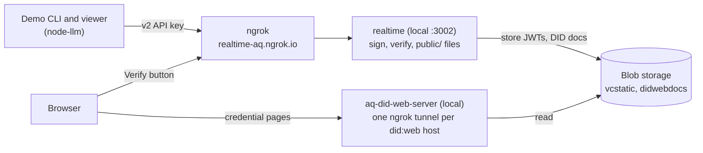
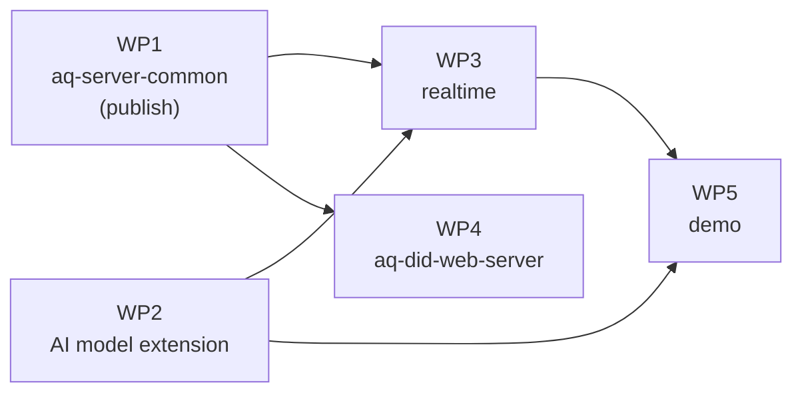

# Credential demo: implementation plan

**Status:** approved 2026-11-03; M1 done; M2 in progress. See [Progress](#progress) for where work stands and how to pick it up.

This plan builds phase 1 of the [credential demo](credential-demo.md), which serves as the high-level design. It splits the work into packages, puts them in dependency order, and groups them into milestones that each end in something that can be run.

## Contents

- [Progress](#progress)
- [Environment](#environment)
- [Branches and releases](#branches-and-releases)
- [Work packages](#work-packages)
- [WP1: aq-server-common](#wp1-aq-server-common)
- [WP2: the AI model extension](#wp2-the-ai-model-extension)
- [WP3: realtime](#wp3-realtime)
- [WP4: aq-did-web-server](#wp4-aq-did-web-server)
- [WP5: the demo (this repo)](#wp5-the-demo-this-repo)
- [Milestones](#milestones)
- [Testing](#testing)
- [Follow-ups](#follow-ups)
- [Risks](#risks)
- [To confirm before starting](#to-confirm-before-starting)

## Progress

Kept current as work happens, so a new session can resume from here. Read this section first, then the work package being worked on.

**How to resume:**

- Repos and branches:
  - this repo, branch `credential-demo`;
  - `untp-0.7` in `devops/aq-server-common`, `devops/realtime` and `devops/aq-did-web-server`.
- Commit only when the user says so. Each work package gets its own commits.
- The user publishes `aq-server-common` and runs the local servers. Don't read or print `.env`.
- Use Node 22 in this repo: `export PATH=$HOME/.nvm/versions/node/v22.23.4/bin:$PATH`.

| Milestone | State |
| --- | --- |
| M1 | Done (aq-server-common 0.82.0 published) |
| M2 | Done 2026-11-04: the full coffee demo runs on 0.7.0 on the local stack (`realtime` and the did:web server) |
| M3 | Done 2026-11-04: all seven credentials issued and verified on the local stack |
| M4a | Done 2026-11-04: whole-chain verification, link integrity, lineage and `validateUpstream` in `realtime`; checked against `demo:run` and the coffee demo |
| M4b | Done 2026-11-04: `demo:verify` accepts the latest run, and `demo:tamper` catches each case with the expected check |
| M5 | M5a written 2026-11-05 (aq-did-web-server uncommitted); M5b not started |

**Log** (newest last):

- 2026-11-03: Plan approved. Created `untp-0.7` from `main` in `aq-server-common` (`f8e2f5a`), `realtime` (`25e4259`, after fast-forwarding local `main` by two commits) and `aq-did-web-server` (`8c18148`). Nothing committed. The design and plan docs in this repo are not committed yet either.

- 2026-11-03: WP1 item 1 done. Downloaded the 0.7.0 schemas and samples (to a scratch folder, not committed) and checked that they compile and validate with Ajv 2020. Recorded the differences from the current shapes under [What the 0.7.0 schemas change](#what-the-070-schemas-change-found-2026-11-03). The design doc's "Mapping onto the UNTP schemas" section still describes 0.6.1 shapes and needs updating to match.

- 2026-11-03: Request shape A chosen: the request body is `{ credentialSubject, name?, validFrom?, validUntil?, extensions?, issuerName? }`, and `credentialSubject` is the 0.7.0 subject. `extensions` is a list of JSON-LD context URLs; `realtime` maps each to its schemas through an allow-list, so requests don't carry schema URLs.
- 2026-11-03: WP1 items 2–5 done in `aq-server-common` (uncommitted, on `untp-0.7`):
  - `src/entities/supply-chain-schemas.ts`:
    - The 0.7.0 request schemas `DppClaimsSchema`, `DccClaimsSchema` and `DteClaimsSchema` keep their names, so imports don't change.
    - Open UNTP objects use `z.looseObject`, so extension properties pass through; closed ones use `z.strictObject`.
    - New exports: the constants `VC_V2_CONTEXT`, `UNTP_0_7_0_CONTEXT` and `UNTP_LINK_TYPES`; the schemas `ProductSchema`, `ConformityAttestationSchema`, `ConformityAssessmentSchema`, `LifecycleEventSchema` and `Make`/`Move`/`ModifyEventSchema`; and the result types `VerificationLink`/`VerificationLinkSchema`.
    - `VerificationResult` gains `checks.lineage`, `checks.linkIntegrity` and `link` (how the parent linked to the result). `VerifyCredentialOptionsSchema` gains `maxDepth`.
    - The 0.6.1 sub-schemas are removed; nothing outside the file used them.
  - `src/services/supply-chain-credential-version-mappings.ts`:
    - 0.7.0 mappings, all keyed by the shared context `https://vocabulary.uncefact.org/untp/0.7.0/context/`.
    - Links are found by `linkType` anywhere in the subject.
    - New entities: `credential_links`, `accreditation_links`, `assessed_product_ids`, `input_product_ids` and `output_product_ids`.
    - `detectUntpContext` now also matches the 0.7.0 URL form; before, it would have missed it.
  - Tests:
    - new files `test/entities/supply-chain-schemas.spec.ts`, `test/entities/untp-0.7.0.fixtures.ts` and `test/services/supply-chain-credential-version-mappings-0.7.0.spec.ts`;
    - the context-count tests in the existing mappings spec now expect two contexts per type.
  - Checks:
    - The full suite passes: 1,936 (was 1,897), using Node 24, which the package requires: `export PATH=$HOME/.nvm/versions/node/v24.11.0/bin:$PATH`.
    - ESLint and Prettier are clean on the changed files.
    - The official 0.7.0 samples parse with the new Zod schemas with no data lost (only key order differs).
    - The fixtures validate against the official JSON schemas.
  - Not done: the version bump and publish (user). `package.json` says 0.78.2, but `realtime` depends on `^0.81.33`, so the published version is set somewhere else. A breaking change suggests 0.82.0, and `realtime` and `aq-did-web-server` would then need `^0.82.0`.

- 2026-11-03: The design doc's "Mapping onto the UNTP schemas" section now describes 0.7.0 shapes, field by field, for all seven credentials. Its status, sequence diagram, decisions and gaps are updated to match.
- 2026-11-03: WP2 first draft written in `realtime/public/untp/ai-model/0.1.0/` (uncommitted): `context.jsonld`, `defs.schema.json`, `dpp.schema.json`, `dte.schema.json`, `dcc.schema.json`, `categories.json` and `README.md`.
  - Term IRIs use `https://affinitiquest.io/vocab/untp/ai-model/0.1.0#`. They are fixed and don't depend on the server host. *To confirm with the user.*
  - Checked with scratch scripts, which are not kept:
    - credentials shaped like the demo's (dataset DPP, model DPP, training DTE, evaluation DCC) validate against both the official 0.7.0 core schemas and the extension schemas;
    - the extension schema rejects a model without `parameterCount`;
    - all four expand as JSON-LD in safe mode, with the extension terms in the extension namespace;
    - the official samples also expand cleanly.
  - Found: event products need `type: ["Product"]`, or `idGranularity` has no JSON-LD definition. This is recorded as WP3 item 7.
- 2026-11-03: Zod 4 conventions. The user converted `z.string().url()` to `z.url()` and `z.string().date()` to `z.iso.date()` in `supply-chain-schemas.ts`. I converted the rest of the new code: `z.iso.datetime()` (including `{ offset: true }` on `eventDate`) and `z.int()`. The tests pass (1,936). Rule: new or modified Zod code uses Zod 4 forms; untouched code is left as is.
- 2026-11-03: The user set `minor: 82` in `aq-server-common/.pipelines/azure-pipelines.yml`. The patch counter restarts for each major.minor, so the next build publishes as 0.82.0. When `realtime` (WP3) and `aq-did-web-server` (WP4) move to the new library, their dependency becomes `"@aq/aq-server-common": "^0.82.0"`. A `^0.81.x` range won't pick it up, because caret ranges below 1.0 don't cross minor versions.
- M1 is complete except for the user's review and the `aq-server-common` publish.

- 2026-11-03: The user reviewed M1, committed `aq-server-common` (`3af097f`, "Move supply-chain credential schemas to UNTP 0.7.0 (breaking)") and published 0.82.0. `realtime` and `aq-did-web-server` now depend on `^0.82.0`; the user made that edit.
- 2026-11-03: Licensing: the UNTP repository is GPL-3.0, so the official schemas are **not** copied into `realtime`. `UntpSchemaService` loads them from `supplyChain.untpSchemas.{dpp,dcc,dte}` in config (default: the `untp.unece.org` URLs, fetched with `safeFetch`) and keeps them in memory. A config value can also be a local file path, if the user later decides copying is fine.
- 2026-11-03: M2 in `realtime` (uncommitted, on `untp-0.7`):
  - New `src/app/services/untp-schema.service.ts`, which:
    - validates against the official 0.7.0 schema plus each known extension's schema (Ajv 2020, `strict: false`);
    - reports unknown extension contexts;
    - fills in default `type` arrays (`applyDefaultTypes`) by walking the official schema's `type` defaults, resolving `$ref` and choosing the `oneOf` branch by type or required fields;
    - provides `setCoreSchema()` for tests.
  - The extension allow-list is in config: `supplyChain.extensions` in `config/default.json`, with `contextPath` resolved against `aqio.apiUrl` and a `schemaDir`.
  - `supply-chain-credential.service.ts` builds the envelope in one `buildCredentialEnvelope`:
    - `@context` is VC v2, UNTP 0.7.0, then the request's extensions;
    - `type` is `[<UNTP type>, 'VerifiableCredential']`;
    - `name` is the request's, or a default "<label>: <subject name>";
    - `credentialSubject` is the request's, with default types filled in.
  - Its `validateUntpSchema` uses the new service and throws `BadRequestException` on schema errors or unknown extensions. `getFallbackSchema`, `getUntpSchema` and the Ajv imports are removed.
  - `supply-chain-credential-verification.service.ts`:
    - Step 7 uses the new service for 0.7.0 credentials. A known extension that fails is an error; an unknown extension is a warning (`WARN-UNKNOWN-UNTP-EXTENSION`).
    - 0.6.x credentials keep the old basic checks (`validateLegacyUntpSchema`) and get `status: 'warning'`, `SCHEMA-LEGACY-BASIC-ONLY`.
    - Subject, upstream and DCC extraction now use the version mappings (`subject_id`, `upstream_dpp_links`, `traceability_events`, `conformity_credentials`), so both versions work. It is still one level deep; the full chain is M4.
  - Specs:
    - new `_unitTests/untp-schema.service.spec.ts` and `_unitTests/untp-0.7.0-fixtures.ts`;
    - the two supply-chain specs are ported to 0.7.0, with new tests for envelopes, extensions and schema failures.
    - Because the official schemas aren't in the repo, tests use stub schemas (`useStubUntpSchemas`). One test runs the official schemas when `UNTP_0_7_0_SCHEMA_DIR` points at a local copy; it passes.
  - Checks: the full `realtime` suite passes (3,251 tests, 0 failures, with Node 24); ESLint and Prettier are clean on the changed files.
- 2026-11-03: WP3 item 6 done. The coffee demo's four claim builders in `src/scripts/create-supply-chain-demo-assets.ts` now produce 0.7.0 requests:
  - the Fairtrade DCC has three `conformityAssessment`s, built by `buildFairTradeAssessment`;
  - the green-bean DPP has a `performanceClaim` whose evidence links the DCC;
  - the roasting DTE is a `MakeEvent` that links the green-bean DPP;
  - the roasted-coffee DPP has `materialProvenance`, links to the DTE and the green-bean DPP, and a carried-forward claim.

  The builders are exported. The new spec `src/scripts/_unitTests/create-supply-chain-demo-assets.spec.ts` checks them against the Zod request schemas, and against the official schemas when `UNTP_0_7_0_SCHEMA_DIR` is set; both pass. The script still uses Basic auth with `SUPPLY_CHAIN_DEMO_API_KEY`, `keyVault.secrets.tenantId` and `aqio.apiUrl`.
- 2026-11-03: Checks:
  - `realtime`: the app and test typechecks are clean, ESLint on `src` is clean, and the full suite passes (3,251 passing, 35 pending, including the two official-schema tests that skip without `UNTP_0_7_0_SCHEMA_DIR`).
  - `aq-did-web-server`: compiles against 0.82.0 with no code changes.
- 2026-11-03: The coffee demo now uses a v2 API key. `src/scripts/create-supply-chain-demo-assets.ts`:
  - the new exported `buildApiV2BearerToken` follows `aq-api-v2-sample`: HS256 with the hex-decoded key, `kid` = SHA-256 of the key string, claims `iss`, `jti`, `htm`, `htu` (no query), 5-minute expiry;
  - one `httpRequest` replaces the two Basic-auth functions;
  - `SUPPLY_CHAIN_DEMO_API_KEY` must now be a hex v2 key, which is checked at startup;
  - help text and `docs/SUPPLY-CHAIN-DEMO-PLAN.md` are updated (auth, script flow, and the sample-claims section, now a table of the 0.7.0 builders).

  Two new spec tests verify the token with `jose` (header, claims, `htu` without the query, a new `jti` per call). The full suite passes: 3,253.
- ~~**Open issue: `htu` behind ngrok.**~~ This was a prediction, and it turned out to be wrong (see the next two entries). It was resolved on 2026-11-03 by the hook fix, so no workaround is needed.
- 2026-11-03: UNTP schema licensing discussed. The site footer says "All UN/CEFACT standards are free to use under CC By 4.0 license". The spec repository (now on UNICC GitLab, holding the website, `artefacts` and registers) has a repo-wide GPL-3.0-or-later `LICENSE`, and the schema files have no licence header. The leaning is CC BY 4.0, but the user chose to leave the schemas fetched at runtime for now. Recorded under [Follow-ups](#follow-ups).
- 2026-11-03: `aq-api-v2-sample` works against both the dev cluster and local `realtime` through ngrok. The cause is that `ValidateApiKeyJwtBinding` never runs its checks (hook order); see the security item in [Follow-ups](#follow-ups). For the demos, v2 requests through ngrok work as things stand.
- M2's code is complete. The remaining M2 step is the user's: run the local `realtime` and `aq-did-web-server` behind ngrok, then run the coffee demo against them.
- 2026-11-03: The user committed M2 in `realtime` (`b1fe02d`, "Move supply-chain credentials to UNTP 0.7.0, with extension support and v2 API keys in the coffee demo").
- 2026-11-03: The user fixed `ValidateApiKeyJwtBinding` on `main` (PR 3343, `f26980c`) and merged `main` into `untp-0.7` (`b77f160`). Changes:
  - the hook reads the `Authorization` header directly;
  - `htm` and `htu` are required on v2 API key JWTs;
  - `htu` is compared with `realtimeUrl` plus the request path (origin and path only, normalized; query ignored);
  - `htm` and `htu` are checked before the `jti` is recorded.

  `realtimeUrl` and the coffee demo's `aqio.apiUrl` both come from `AQIO_API_URL`, and the demo already signs `htu` as origin plus path. So the demo matches as it is, through ngrok too. Rule for M3: the node-llm demo must sign `htu` with the same public URL that `realtime` has as `AQIO_API_URL` (the ngrok URL locally), not `localhost`.

- 2026-11-04: The coffee demo ran end to end against the local `realtime`. It created the authorities and credentials and generated the HTML report. The user changed `create-supply-chain-demo-assets.ts` to use a Foal API for loading the environment and to change how authorities are created.
  - The local did:web server was dropped. ngrok can't resolve sub-subdomains, so did:web identifiers under `dids-aq.ngrok.io` don't resolve. The demo uses the deployed did:web server instead (see [Environment](#environment)).
  - On the roasted-coffee DPP page, "Verify Credential" fails with `SCHEMA-DPP-INVALID`: `DPP missing "product" in credentialSubject`. The cause is that the page posts to the did:web server's `realtimeUrl`, which is the deployed `realtime`. That runs `main`, whose verifier requires the 0.6.1 `credentialSubject.product`. The credential itself is fine: the same verify request sent to the local `realtime` (`https://realtime-aq.ngrok.io/api/supply-chain/dpp/verify`) returns `SCHEMA-VALID`, "UNTP 0.7.0 DPP schema is valid". Recorded under [Follow-ups](#follow-ups).
- M2's end check passes against the local `realtime`. The page's verify button will work once `realtime` `untp-0.7` is deployed.
- 2026-11-04 (later): The local `aq-did-web-server` works again. Each did:web host that must resolve needs its own ngrok tunnel to the local server. With that in place, the full coffee demo works on the local stack, including the pages' verify button, which now posts to the local `realtime`. The deployed-server workaround above and its follow-up no longer apply to the demo.

- 2026-11-04: M3 scope agreed; see [M3 decisions](#m3-decisions-2026-11-04). The docs in this repo are committed before the M3 code.

- 2026-11-04: The user committed the docs (`d0fc0cb`).
- 2026-11-04: M3 code written in `packages/chapters/src/credential-demo/` (uncommitted):
  - Modules: `env.ts`, `client.ts`, `hashing.ts`, `parties.ts`, `claims.ts`, `seeded.ts` and `state.ts`. Entry points: `setup.ts` (`pnpm demo:setup`) and `run.ts` (`pnpm demo:run`), with scripts in the root and chapters `package.json`.
  - No new dependencies. The request JWT is HS256 through `node:crypto`. Platform settings for a new authority are written out (`identity-credential`, `ndts`, `dev`, ES256, did:web, `vc+jwt`, internal keys), matching `DefaultIdentityCredentialPlatformSettings.defaults`, because this repo doesn't depend on `aq-common-typescript`.
  - **Correction to the design: `ni` URIs use base64url, not hex.** RFC 6920 encodes the digest of an `ni` URI in base64url without padding; the hex form is the separate `nih:` scheme. The Verdict is `ni:///sha-256;tB5Bpo8DmKMVSuaeLkwOJpThf-DWZzBTaDfxsBk1sx8`. The design doc, this plan and the extension README in `realtime` are corrected; the README change in `realtime` is uncommitted. `aq-server-common`'s test fixtures still use a hex form, which is a valid URI, so they pass; changing them is optional.
  - Links between credentials carry `digestMultibase` = the multibase SHA-256 multihash of the linked credential's JWT, as returned by the sign call. M4's link-integrity check must hash the same bytes (the JWT published at `credentialId`).
  - Names that the parties define (schemes, criteria, topics, facilities, claim and attestation ids) are https URLs on the party's own did:web host, for example `https://<Evaluators Association host>/schemes/model-evaluation`. They are identifiers and don't resolve.
  - Choices not in the design: the accreditations use `assessorLevel: 3rdParty` and `assessmentLevel: scheme-self` (the schema gives no definitions for these codes); loss is a `Measure` in `C62`, since Recommendation 20 has no unit for nats per token; `Book Publisher` is in the US and `Model Publisher` in Canada.
  - Training uses `ch05-training/train.ts`'s configuration and `evalEvery: 10`. Evaluation shuffles the training loader, which draws on the seeded generator, so `evalEvery` changes the weights. The Model Auditor step reloads the checkpoint from disk, checks the weights' hash, and measures the validation loss with `evaluateLoss`.
  - Checks:
    - 31 tests pass in `packages/chapters`, 27 of them new (`tests/credential-demo/`); the typecheck is clean; Biome is clean on the new files.
    - All seven requests, built from the test fixtures, pass `realtime`'s `UntpSchemaService` (the official 0.7.0 schemas fetched from untp.unece.org, plus the extension schemas) after `applyDefaultTypes`. This was checked with a scratch script, which is not kept.
    - Not yet run against the platform.

- 2026-11-04: the user's ngrok plan allowed only 4 tunnels, and the demo needs 6 (`realtime` plus one per authority). The user upgraded the plan and moved `AQIO_DID_WEB_BASE_DOMAIN` to `ngrok.io`, so each authority's host is `verdict-demo-<role>-<word>.ngrok.io`, each with its own tunnel.
- 2026-11-04: `pnpm demo:setup` and `pnpm demo:run` ran to completion. Setup created and published the five authorities and issued the two accreditations. Run `2026-11-04T17-24-19Z` issued the rights DCC, the dataset DPP, the training DTE, the evaluation DCC and the model DPP. Validation loss 6.3728; weights sha256 `de24e3f3e2ca58ad2222e9f24bf54b344fecdc868204a830a780a37b08001072`. The manifest is in `checkpoints/verdict-demo/credentials.json` (git-ignored).
- 2026-11-04: `demo:run` verified the five credentials it issued, and all five passed (proof, structure, 0.7.0 schema). How `realtime`'s verifier follows links (`aq-server-common` `supply-chain-credential-version-mappings.ts`, and `realtime` `supply-chain-credential.service.ts`):
    - For a DPP or DTE, `upstreamCredentials` verifies the `dpp` and `dte` links found anywhere in the subject. `dccValidity` checks separately that each `dcc` link was valid when the credential was issued. So the dataset DPP has 0 upstream credentials (its only link is to the rights DCC), the DTE has 1 (the dataset DPP), and the model DPP has 2 (the DTE and the dataset DPP). Every DCC link went through `dccValidity`.
    - `/dcc/verify` always passes `checkUpstream: false`, so DCCs report "Upstream validation was not requested" and a warning, even though the demo asks for the check. Nothing checks a DCC's `authorisation[].endorsementEvidence`, so the accreditation behind the rights and evaluation DCCs is never verified. The `accreditation_links` mapping exists, but nothing uses it.
    - `demo:run` doesn't verify the two accreditations, because `demo:setup` issues them.
- 2026-11-04: Decided: `realtime` checks a DCC's accreditations, but only when the DCC links any. This delivers the "follow links from DCCs" part of WP3 item 4 ahead of the rest of M4. Committed in all three repos; `aq-server-common` republished, and `realtime` and `aq-did-web-server` updated to it:
    - `realtime` (`untp-0.7`):
        - In `supply-chain-credential-verification.service.ts`, a new step 9b runs for DCCs when `checkUpstream` isn't `false`. For each `authorisation[].endorsementEvidence` link, the linked credential must verify, be a DCC, come from the endorsement's `issuingAuthority`, be issued to the DCC's issuer, and have been valid when the DCC was issued. The result goes in `checks.accreditation` (`ACCREDITATION-VALID` or `ACCREDITATION-INVALID`), with an `ACCREDITATION_NOT_VALID` error giving the reason, or a `WARN-ACCREDITATION-SINCE-EXPIRED` warning. A DCC with no links gets no check and no warning. An accreditation's own accreditations are not followed. The time check is now shared with the DCC validity check (`validityAtTime`).
        - `/dcc/verify` takes `checkUpstream` (default `true`) instead of always passing `false`. When a DPP or DTE checks the DCCs it links, it still passes `false`, so it doesn't fetch their accreditations.
        - 10 new specs. The full unit suite passes (3297).
    - `aq-server-common`: `VerificationResultSchema` gains the optional `checks.accreditation`. This only changes the shared type and the OpenAPI docs, because response schemas aren't enforced at runtime. Published 2026-11-04.
    - `aq-did-web-server`: `dcc.html` shows an "Accreditation" row when the check is present.
    - Found along the way: the `checkUpstream` and `checkDccValidity` query parameters use `z.coerce.boolean()`, which turns the string `"false"` into `true`. So `?checkUpstream=false` has no effect on any verify endpoint. Zod 4's `z.stringbool()` parses it correctly. Not fixed yet.

- 2026-11-04: M3 done. The user reviewed the credentials, and the code and docs are committed.

- 2026-11-04: M4 scope agreed; see [M4 decisions](#m4-decisions-2026-11-04).
- 2026-11-04: M4a written in `realtime` (`untp-0.7`), uncommitted:
    - `supply-chain-credential-verification.service.ts`: verification is now one walk over the chain. Each linked credential is verified with the caller's options, down to `maxDepth` (default 10). Each credential is verified once per request, and a link back to a credential on the current path is skipped with `WARN-LINK-CYCLE`. Every followed credential appears in `upstreamResults` with its `link` (URL, link type, name, digest and JSON path), so DCCs and accreditations are in the tree as well as passports and events. Beyond the depth limit, links aren't followed, and the result carries `WARN-MAX-DEPTH-REACHED`.
    - The checks on each credential's links: `upstreamCredentials`, `dccValidity` and `accreditation` as before, but computed from the linked credentials' own results, which now cover their whole chains. `linkIntegrity` compares each `digestMultibase` (a base64url SHA-256 multihash) with the hash of the stored JWT; a digest in another encoding gets a warning. `lineage` applies three rules to UNTP 0.7.0 credentials: an event's linked passports describe products among its inputs and outputs; a passport's linked events involve its product; and a DCC that a passport or event cites assesses a product in that credential's chain. The last rule differs from the plan's wording ("the passport that cites the DCC"), because the model DPP cites the rights DCC, which assesses the dataset; the dataset is in the model's chain through the DTE.
    - `supply-chain-credential.service.ts`: `validateUpstream` runs the same link checks on the unsigned credential, as if issued now by the signing authority, and refuses to sign with a 400 naming each failure. The verify methods take an options object.
    - `supply-chain.controller.ts`: boolean query parameters use `z.union([z.boolean(), z.stringbool()])`. `z.stringbool()` alone isn't enough: Foal's ajv hook runs after the Zod hook and coerces the parsed boolean back to a string. The DCC sign endpoint gains `validateUpstream`, and the verify endpoints gain `maxDepth`.
    - Specs: 14 for chains, integrity, lineage and signing, and 6 HTTP tests for the query parameters. The full unit suite passes (3317).
    - `aq-server-common` needs no change; it already had `lineage`, `linkIntegrity`, `link` and `maxDepth`.

- 2026-11-04: M4a committed in `realtime`. The user reran `demo:run` and the coffee demo against it, and both checked out. The second training run's weights hash matched the first run's exactly (`de24e3f3…1072`).
- 2026-11-04: M4b written in `packages/chapters/src/credential-demo/` (uncommitted):
    - `checks.ts` holds the buyer's checks as pure functions, in four groups. **Credentials:** the dataset passport and evaluation that were read match the digests in the model passport's links. **Claims:** the evaluation assessed the model in the passport, used the dataset in the dataset passport, and measured the loss the passport claims. **Artifact:** `weights.bin`, `config.json` and the dataset file hash to what the passports list. **Evaluation:** rerunning `evaluateLoss` on the buyer's files gives the claimed loss, within 1e-4. It also holds the two tampering helpers.
    - `buyer.ts` asks the platform to verify the model passport (the whole chain), reads the three credentials from their did:web URLs as raw JWTs, hashes the files, and reruns the evaluation. `EVALUATION_BATCH_SIZE` (8) is shared with `run.ts`, because `evaluateLoss` averages per batch.
    - `demo:verify [runId]` prints the platform's tree (a credential linked from several places is printed once), then the buyer's checks, then ACCEPTED or NOT ACCEPTED, and notes that trust isn't checked. On the local stack, the latest run is ACCEPTED, with a rerun loss identical to the claimed one.
    - `demo:tamper [runId]` runs the buyer's checks on altered copies under `checkpoints/verdict-demo/tamper/`, and prints which check group catches each case. The cases are untampered (accepted), one weight changed (caught by the artifact check), and one name changed in the training part of the dataset (caught by the artifact check). In both tampered cases, the platform verifies and the evaluation rerun gives exactly the claimed loss, so only the hashes catch them.
    - `client.ts` gains `fetchCredential`, and `link` on nested verification results.
    - 10 new tests (`checks.test.ts`); 37 in all for the demo.

- 2026-11-05: M4 done. Issuer trust discussed: UNTP's Digital Identity Anchor is the direction. The platform side is written up in `realtime` `docs/SUPPLY-CHAIN-FUTURES.md`, and the AI side in the credential-strategy Claude Doc ("Trusting the issuers").
- 2026-11-05: M5 scope agreed; see [M5 decisions](#m5-decisions-2026-11-05).
- 2026-11-05: M5a.
    - `VerificationResultSchema` in `aq-server-common` gains `name`, and its type is now inferred from the schema, except the recursive `upstreamResults` (see [Follow-ups](#follow-ups)). This is committed and published, and `realtime` sets `name` on every node (committed).
    - `aq-did-web-server` (uncommitted): `dpp.html`, `dte.html` and `dcc.html` are replaced by one `credential.html`. The controller passes the per-type settings (`CREDENTIAL_PAGES`: title, colours, verify path) and the credential as JSON, with every `<` escaped so no claim can close the script element. The page shows the credential's name, a Linked Credentials table (name linked to the page, type, digest), the claims as a collapsible key/value tree, and the Verify result as a tree with every check shown generically and repeats marked. Everything taken from the credential or from the verifier is set as text, not HTML. 4 new specs (38 in all).
    - Checked by rendering the real model passport page in headless Chrome, with a verification tree built by hand from the manifest (the local `realtime` wasn't running).

**Next:** the user reviews and commits M5a, then checks the pages against a live `realtime`. Then M5b (`demo:viewer`). Still open with the user: the extension vocabulary namespace (`https://affinitiquest.io/vocab/untp/ai-model/0.1.0#`), the UNTP schema licence (see [Follow-ups](#follow-ups)).

## Environment

| Piece | Where it runs | Notes |
| --- | --- | --- |
| `realtime` | Local, `http://localhost:3002`, exposed as `https://realtime-aq.ngrok.io` | Runs the `untp-0.7` branch. Provisioned by hand with a tenant and a v2 API key |
| `aq-did-web-server` | Local, behind ngrok | Runs the `untp-0.7` branch. `AQIO_DID_WEB_BASE_DOMAIN` is `ngrok.io` in both servers (it was `dids-aq.ngrok.io` until 2026-11-04). **Each did:web host that must resolve needs its own ngrok tunnel** to the local server. A single wildcard tunnel doesn't work, because ngrok doesn't resolve the sub-subdomains on its own (found 2026-11-04). So every new authority the demo creates (M3: dataset publisher, trainer, evaluator, accreditation body, and so on) needs a tunnel before its DID resolves. The server's `realtimeUrl` is the local `realtime`, so the pages' "Verify Credential" button uses the `untp-0.7` verifier |
| Blob storage | Shared by the two local servers | The local `realtime` writes credentials and DID documents there, and the local did:web server serves them |
| Extension files | `realtime/public/untp/ai-model/0.1.0/`, served at `${AQ_API_URL}/untp/ai-model/0.1.0/` (today `https://realtime-aq.ngrok.io/untp/ai-model/0.1.0/`) | Foal serves `public/` as static files |
| The demo | This repo, Node 22 | Reads `AQ_API_URL`, `AQ_TENANT_ID` and `AQ_API_KEY` from `.env` using Node's built-in `process.loadEnvFile`, so no new dependency is needed |

## Branches and releases

- `untp-0.7` in `aq-server-common`, `realtime` and `aq-did-web-server`. `aq-common-typescript` needs no change (only `Authority` and `DefaultAqioPlatformSettings` are used), so it gets no branch.
- `credential-demo` in this repo.
- **One `aq-server-common` release.** Every change that package needs (0.7.0 schemas, extension points, `assessedProduct`, the verification result tree) is designed in WP1 and published once, as a new minor version: breaking, and pre-1.0. While WP3 and WP4 are developed, `realtime` and `aq-did-web-server` use a local link (`npm link`) to the unpublished package. A second release is needed only if something was missed.
- Each work package gets its own commits. Nothing is committed without your go-ahead.

## Work packages

WP2 can be drafted alongside WP1, because WP1 only needs to know where the extension points are, not what they contain.

## WP1: aq-server-common

Files: `src/entities/supply-chain-schemas.ts` (428 lines) and `src/services/supply-chain-credential-version-mappings.ts` (376 lines), with their tests in `test/services/`.

1. **Get the official UNTP 0.7.0 JSON schemas and context**, for DPP, DCC and DTE. These are the reference for the Zod schemas here and for validation in `realtime` (WP3).
2. **Move the request schemas to 0.7.0**:
   - renamed fields: `countryOfProduction`, `producedAtFacility`;
   - new `Product` fields: `productCategory`, `idGranularity`, `performanceClaim`;
   - `ConformityAssessment.assessedProduct` (`ProductVerification`: `product` plus `idVerifiedByCAB`), `assessedFacility` and `assessedOrganisation`.
3. **Add extension points:**
   - an optional `extensions` list on each sign request, giving the extension's JSON-LD context URLs (`realtime` looks up the matching schemas);
   - extra properties allowed on `Product`, the DPP subject, the DTE, and `ConformityAssessment`. Zod lets them through; `realtime` checks them against the extension's schema.
4. **Version mappings:** add 0.7.0 readers for the cross-credential links (passport, DTE, DCC and accreditation links), and keep the 0.6.1 readers so older stored credentials still read.

Items 1–5 are done; see [Progress](#progress).
5. **Verification result:** let `VerificationResultSchema` carry the whole upstream tree, where each node holds its own checks, plus a `lineage` check section (see WP3).
6. Update the specs, build, and publish (you).

### What the 0.7.0 schemas change (found 2026-11-03)

Sources: the schemas are published at `https://untp.unece.org/artefacts/schema/v0.7.0/`:

- `dpp/DigitalProductPassport.json`
- `dcc/ConformityCredential.json`
- `dte/DigitalTraceabilityEvent.json`
- the per-class files beside them

Samples are under `artefacts/samples/v0.7.0/`. The JSON-LD context is `https://vocabulary.uncefact.org/untp/0.7.0/context/`.

The schemas are JSON Schema draft 2020-12. They compile with Ajv's 2020 build (`ajv/dist/2020`, already a `realtime` dependency) once the `example` keyword is registered or strict mode is off, and the official samples validate. So the risk that the official schemas were missing or unusable is closed.

0.7.0 differs from both the platform's current request shapes and UNTP 0.6.1 in ways that matter here:

| Topic | 0.7.0 | Consequence |
| --- | --- | --- |
| DPP subject | `credentialSubject` **is** the `Product` (no `product` wrapper). Required: `id`, `name`, `idScheme`, `idGranularity`, `productCategory`, `producedAtFacility`, `countryOfProduction` | The dataset and model need a product category (a `Classification`: code, name, scheme) |
| DTE | `credentialSubject` is a list of `LifecycleEvent`s: `MakeEvent` (inputs to outputs at `madeAtFacility`), `MoveEvent` or `ModifyEvent`. Replaces the EPCIS event types, `action`, `bizStep` and `readPoint`; the activity is an `activityType` classification | Training is a `MakeEvent`: input `product` = dataset, output `product` = model, each with `quantity` |
| Links between credentials | One generic `Link` (`linkURL`, `linkName`, `linkType`, `mediaType`, optional `digestMultibase`). Link types come from `https://test.uncefact.org/vocabulary/linkTypes/{dpp,dcc,dte,…}`. Links appear in `relatedDocument` (Product, events), `evidence` (claims, assessments), `conformityCertificate`, `auditableEvidence` and `authorisation[].endorsementEvidence` | The verifier's link extraction becomes one walk over `Link` objects, filtered by `linkType`, instead of field-by-field lists. `digestMultibase` can pin the exact bytes of a linked credential |
| Material provenance | `materialProvenance[]` (singular) has no link to a source product or passport | The model's link to its dataset goes in `relatedDocument` (type `dpp`), and the DTE carries the lineage |
| Claims | `performanceClaim[]` with `claimedPerformance` (metric, measure, score), `conformityTopic`, and `evidence` links. Replaces `sustainabilityClaims` and `inheritedFrom` | The rights claim is a performance claim whose evidence is the rights DCC; the inherited claim on the model links the same DCC |
| Accreditation | `ConformityAttestation.authorisation[]` (`Endorsement`: `name`, `issuingAuthority`, `endorsementEvidence` link, `trustmark`). Replaces `issuerAccreditation` | The evaluator DCCs link to their accreditation DCC through `authorisation[].endorsementEvidence`. This is the standard place for it, so the accreditation can stay a DCC (as decided) with no extension type |
| Assessments | `conformityAssessment[]` with `assessedProduct[]` (`ProductVerification`), `assessedPerformance` (metric and measure), `assessmentCriteria`, `conformityTopic`, `conformance` | Evaluation result = `assessedPerformance` (validation loss); the evaluated weights = `assessedProduct[].product.id` with `idVerifiedByCAB: true` |
| Envelope | `@context` must start with the VC v2 and UNTP 0.7.0 contexts, and may add more after them (`prefixItems`). Objects mostly allow extra properties | Extension contexts are appended after the two required ones. Extra properties already validate against the core schema |

**Request shape (needs a decision).** The current request bodies are platform-specific shapes that the service maps into credentials. Two options for 0.7.0:

- **A (recommended):** the request body is the 0.7.0 `credentialSubject` itself (a `Product`, a `ConformityAttestation` or a list of events), plus request-level fields (`name`, `validFrom`, `validUntil`, `extensions`). The Zod schemas mirror the core required fields and let extra properties through; the official JSON schema in `realtime` is the authority. There is one model to maintain, and the API reads like the standard.
- **B:** keep simplified request shapes, and map them to 0.7.0 in the service. This is friendlier for simple cases, but it means two models, and every 0.7 to 1.0 change has to be made in both.

## WP2: the AI model extension

Location: `realtime/public/untp/ai-model/0.1.0/`. Each file is dereferenced relative to `${AQ_API_URL}/untp/ai-model/0.1.0/`, for example `${AQ_API_URL}/untp/ai-model/0.1.0/context.jsonld`. The demo builds these URLs from `AQ_API_URL` rather than hard-coding a host. The path is versioned because the URLs are embedded in signed credentials.

| File | Content |
| --- | --- |
| `context.jsonld` | JSON-LD terms for the new properties, in their own namespace. Core terms are not redefined |
| `dpp.schema.json`, `dte.schema.json`, `dcc.schema.json` | JSON Schemas for the extension properties. A credential must validate against both core and extension (`allOf`) |
| `README.md` | The vocabulary, one line per term, plus the identifier scheme |

The first draft is written; see [Progress](#progress). The vocabulary, which covers only what phase 1 uses, is documented in the extension's `README.md`:

- **Identifier scheme:** RFC 6920 `ni:///sha-256;<base64url digest>` for datasets and weights.
- **Dataset:** `DatasetCharacteristics` in the DPP's `characteristics`. It holds the byte length, media type and encoding, source URL and licence; token counts, each with its tokenizer; and files.
- **Model:** `ModelCharacteristics` in the DPP's `characteristics`. It holds the architecture, parameter count, config and tokenizer, plus each file with its byte length and digest.
- **Training:** `trainingRun` on the DTE's `MakeEvent`. It holds the process type, hyperparameters, epochs, split, final losses, code repository and commit, duration, `quantityBasis`, and the reproduction details.
- **Quantities:** `quantityBasis` on the training run says what each `C62` quantity counts. It can't go on the quantity itself, because 0.7.0 `Measure` and `EventProduct` don't allow extra properties.
- **Evaluation:** `evaluationRun` on the DCC's `ConformityAssessment`. It holds the harness name and version, the dataset id, the split and the metric. The value itself goes in the core `assessedPerformance`.
- **Product categories:** `categories.json`, with the codes `dataset` and `model`.

## WP3: realtime

Files:

- `src/app/services/supply-chain-credential.service.ts` (729 lines)
- `supply-chain-credential-verification.service.ts` (975 lines)
- their specs in `_unitTests/`
- `src/scripts/create-supply-chain-demo-assets.ts` (1,138 lines)

1. **Envelopes:** set `UNTP_VERSION = '0.7.0'`, and use the 0.7.0 `@context` and types. Append extension contexts from the request.
2. **Schema validation:**
   - Replace `getFallbackSchema` with the official 0.7.0 schemas, kept in the repo and compiled once with Ajv.
   - Validate against each named extension schema as well. Extensions come from a configured allow-list that maps the context URL to a schema file. For the extension in `public/`, the allow-list entry is the path `/untp/ai-model/0.1.0/` relative to `realtime`'s own public URL (`AQIO_API_URL`), so it moves with the host. The extension in `public/` is read from disk, not over the network, and an unknown extension is rejected with a clear error.
   - Apply the same validation on sign and on verify.
3. **`validateUpstream` at issuance:** verify each credential the claims link to before signing. Fail if a link doesn't verify, and report which one failed.
4. **Full-chain verification.** `checkUpstream` defaults to `true` on `/verify`, and the top-level credential's links are checked. The limit is in the nested calls (`supply-chain-credential-verification.service.ts`):
   - Step 9 (around line 365) collects the top-level credential's upstream links and verifies each one with `checkUpstream: false` and `checkDccValidity: false`. The linked credentials are verified, but their own links are not followed.
   - Step 10 (around line 426) verifies the linked DCCs the same way (`verifyDccValidityAtIssuanceTime`, with `checkUpstream: false`).
   - Both steps run only when the top-level credential is a DPP or a DTE. A DCC's own links are never followed, even at the top level.
   - `extractUpstreamCredentialIds` reads only some link fields:
     - from a DPP: `traceabilityEvents` and `relatedDTE`, but not `materialsProvenance[].sourceProduct` or the upstream passports;
     - from a DTE: the `productPassport` of each input and output.

   For this demo, verifying the model DPP today checks:

   | Credential | Checked? |
   | --- | --- |
   | Model DPP | Yes |
   | Training DTE | Yes, through `traceabilityEvents` |
   | Evaluation DCC | Yes, through the DCC validity check |
   | Model Auditor's accreditation | No: DCC links are not followed |
   | Dataset DPP | No: it is linked from the DTE, which is one level down, and the DPP's `materialsProvenance` link isn't read |
   | Rights DCC | No: it is linked from the dataset DPP |
   | Book Auditor's accreditation | No |

   The change:
   - recurse, passing `checkUpstream` and `checkDccValidity` down, with a visited set and a depth limit;
   - follow links from DCCs (`issuerAccreditation`);
   - read the 0.7.0 link fields, including `materialsProvenance[].sourceProduct`;
   - return the tree (WP1, item 5).
5. **Lineage checks**, which are generic and not AI-specific:
   - a DTE input's `productID` matches the `id` of the DPP it links;
   - the DTE output matches the DPP that links back to the DTE;
   - a DCC's `assessedProduct.product.id` matches the passport that cites the DCC.
6. **Port the coffee demo** to the 0.7.0 field names, and run it against the local `realtime`. It keeps its Basic auth.
7. **Default `type` arrays.** Fill in UNTP's default `type` arrays (`Product`, `Party`, `Facility` and so on) when a request leaves them out. UNTP's JSON-LD context scopes its terms by type, so without them some core properties have no definition. For example, `idGranularity` on an event product is dropped when JSON-LD expands it.
8. **JSON-LD check (optional).** Expand each credential in safe mode, which fails if any term is undefined, using copies of the VC v2, UNTP 0.7.0 and extension contexts kept in the repo. Report the result as part of `schemaValidation`.
9. Update the unit specs. Then run the coffee demo through the did:web pages to confirm nothing regressed.

Revocation is not in this plan.

## WP4: aq-did-web-server

Files: `src/app/templates/{dpp,dte,dcc}.html` (about 450 lines each).

1. Render `credentialSubject` inside a `
` disclosure, collapsed by default, as a readable key/value tree. It is generic, so extension properties render with no extension-specific code.
2. Turn any value that is a credential URL (`/credentials/{dpp,dte,dcc}/…`) into a link to that credential's page.
3. Show the Verify result as the upstream tree, with the lineage checks.
4. The Verify button calls the `realtime` configured as the did:web server's `realtimeUrl`, which is the local `realtime`.

The three templates are nearly identical. If the template setup allows it, the shared rendering goes in one place, to avoid writing the same change three times. If not, it is repeated, and the templates are not restructured otherwise.

## WP5: the demo (this repo)

Location: `packages/chapters/src/credential-demo/`. Scripts go in `packages/chapters/package.json`.

| Module | Role |
| --- | --- |
| `env.ts` | Loads `.env` and checks that the three variables are set |
| `client.ts` | `AqClient`: v2 request signing (HS256 with `node:crypto`; claims as in `aq-api-v2-sample`), `getOrCreateAuthority`, `publishAuthority`, `sign(type, authorityId, claims)`, `verify(url)` |
| `hashing.ts` | SHA-256 of a file, its RFC 6920 `ni` form (base64url) and its `digestMultibase` |
| `parties.ts` | The five authorities: names, facilities and countries |
| `claims.ts` | Pure functions that build each credential's claims from hashes and earlier URLs: `accreditationDcc`, `rightsDcc`, `datasetDpp`, `trainingDte`, `evaluationDcc`, `modelDpp` |
| `seeded.ts` | mulberry32, and the `Math.random` override used for the seeded training run |
| `checks.ts` | The demo's own checks: artifact (hash the files and compare with the passport) and the evaluation re-run. The trust check is deferred (see [M4 decisions](#m4-decisions-2026-11-04)) |
| `state.ts` | Reads and writes `checkpoints/verdict-demo/credentials.json`, the manifest. `checkpoints/` is already git-ignored |

| Script | Does |
| --- | --- |
| `demo:setup` | Creates and publishes the authorities and issues both accreditations. Saves the authority IDs and accreditation URLs so later runs reuse them |
| `demo:run` | Runs the pipeline sequence: hash the dataset, issue the rights DCC and the dataset DPP, train (the small `ch05-training/train.ts` config, seeded), save the checkpoint, issue the DTE, evaluate with `evaluateLoss` from `@node-llm/core`, then issue the evaluation DCC and the model DPP, and write the manifest |
| `demo:verify` | Runs the buyer's check: the platform's `/verify` of the model DPP, then the artifact and evaluation re-run checks, and prints a report |
| `demo:tamper` | Copies the checkpoint, applies each failure case (change one weight, swap in another dataset), and shows which check catches each one |
| `demo:viewer` | Starts a small local server that serves the viewer page and the manifest, and forwards `/verify` to `realtime` (so no CORS change is needed). The page draws the credential graph, links each node to its did:web page, and hashes a dropped file in the browser |

The demo reuses `loadVerdict`, `makeLoaders` and `saveCheckpoint` from `ch05-training/shared.ts`, and doesn't change chapter files.

### M3 decisions (2026-11-04)

- **Authority names** have the prefix "Verdict Demo: " (for example "Verdict Demo: Book Publisher"), so a lookup by name in a shared tenant can't match an unrelated authority. Model Deployment Inc. issues nothing, so it gets no authority.
- **Setup can be rerun safely.** For each authority, it uses the ID saved in the manifest, then looks it up by exact name, and creates it only if both fail. It publishes the authority if it isn't published yet. The random part of a did:web is only known after publishing, so setup prints a table of role, name, DID and the hostname to tunnel (the DID's domain segment). Each hostname needs its own ngrok tunnel.
- **Setup stops if a DID doesn't resolve.** It fetches `https://<host>/.well-known/did.json` for each authority. If any fail, it stops and lists the hosts that still need a tunnel; you rerun it once they're up. Accreditation DCCs are issued only after every DID resolves, and only if the manifest doesn't already have them.
- **Dataset credentials are reused.** `demo:run` reuses the rights DCC and the dataset DPP when the manifest has them for the same dataset hash, and issues new ones only when the hash changes. Each run issues a new DTE, evaluation DCC and model DPP.
- **`AQ_API_URL` is `realtime`'s public URL** (its `AQIO_API_URL`), because the server checks the request token's `htu` against it.
- `demo:run` ends by calling the platform's `/verify` on each credential it issued. The demo's own checks (`checks.ts`) are in M4.
- Training records the git repository and commit, and prints a warning if the working tree has uncommitted changes.

`config.json` is never edited after it is hashed.

### M4 decisions (2026-11-04)

- **Two steps.** M4a is the `realtime` work (WP3 items 3–5), and M4b is the demo. Each is reviewed and committed before the next starts, because `demo:verify` reads the tree that `realtime` returns.
- **M4a:**
    - Full-chain verification: recurse through every link, with a visited set and a `maxDepth` limit (default 10), and return the nested tree (`upstreamResults`, with `link` on each node). DCCs found on the way get the accreditation check.
    - Link integrity: when a link has a `digestMultibase`, compare it with the hash of the JWT that was fetched (`checks.linkIntegrity`).
    - `validateUpstream` at signing time: verify every credential the claims link to, and refuse to sign if one fails.
    - Lineage checks (`checks.lineage`): a DTE input's product ID equals the ID of the DPP it links; a DTE output's product ID equals the ID of the DPP that links back to it; a DCC's `assessedProduct` equals the ID of the passport that cites it.
    - Boolean query parameters use `z.stringbool()` on every sign and verify endpoint (see [Follow-ups](#follow-ups)).
- **`demo:tamper`** has two cases: one weight changed, and a different dataset file. The swapped-credential case is left out; link integrity is covered by `realtime`'s unit specs. The unexpected-issuer case is left out with the trust check.
- **The trust check is deferred.** It is recorded as a shortcoming in the design ([Shortcoming: trust](credential-demo.md#shortcoming-trust)). How trust should be established is to be discussed once M4 works.

### M5 decisions (2026-11-05)

- **Two steps.** M5a is the did:web pages (WP4) plus the `name` change below, and M5b is `demo:viewer`. Each is reviewed before the next starts.
- **Credential names in verification results.** `realtime` adds `name` (the credential's own name) to every node of the verification result, and `VerificationResultSchema` in `aq-server-common` gains it. The pages and the viewer can then label credentials without fetching them, which a browser page couldn't do across did:web hosts without CORS. `demo:verify` drops its extra fetches.
- **One template.** `dpp.html`, `dte.html` and `dcc.html` differ only in title, colours, verify path and check rows. They become one `credential.html`, with a small map per type in the controller.
- **Pages:** the claims as a collapsed key/value tree, rendered generically; links to other credentials shown by name and linked to their pages, with digests; the Verify result as a tree, one line per credential, every check shown generically, repeats marked.
- **Viewer:** a hand-laid-out SVG graph (columns by depth, no dependency) built from the verification tree, with each node linked to its did:web page; files dropped on the page are hashed in the browser and compared with the passports. A local server serves the page and forwards `/verify` to `realtime`. The evaluation rerun stays in `demo:verify`, and the page says that trust isn't checked.

## Milestones

| Milestone | Work | Ends with | Your step |
| --- | --- | --- | --- |
| M1 | WP1, WP2 draft | `aq-server-common` built and its specs passing; extension files in `public/` | Review, then publish `aq-server-common` |
| M2 | WP3 items 1, 2, 6 | Local `realtime` signs and validates 0.7.0 with the extension; the coffee demo runs on 0.7.0 | Run the local did:web server; provision the tenant and key; start ngrok for both servers; update `.env` |
| M3 | WP5: `env`, `client`, `hashing`, `claims`, `demo:setup`, `demo:run` | The training run issues all seven credentials end to end | Review the credentials |
| M4a | WP3 items 3–5 in `realtime`, and the boolean query parameter fix | Full-chain, link-integrity and lineage verification, with unit specs | Review, commit |
| M4b | WP5: `checks`, `demo:verify`, `demo:tamper` | Each failure case caught by the expected check | Review, commit |
| M5 | WP4, WP5: `demo:viewer` | Claims and links on the did:web pages; the viewer working | |

The demo can be shown to the CTO from M4, as a CLI demo. M5 makes it visual.

## Testing

- **aq-server-common:** Zod specs for valid and invalid 0.7.0 claims and for extension pass-through; version-mapping specs for both 0.6.1 and 0.7.0.
- **realtime:**
  - unit specs for core and extension validation, and for an unknown extension;
  - unit specs for `validateUpstream` (a link that is missing, and one that doesn't verify);
  - unit specs for recursion (depth limit, cycles) and for each lineage mismatch;
  - the coffee demo run end to end.
- **The demo** (vitest, `packages/chapters/tests/credential-demo/`, no network):
  - `ni` hashing against the known hash of `the-verdict.txt`;
  - the v2 request JWT (header, claims, `htu` without the query, `kid`);
  - each claim builder's links;
  - `checks.ts` against small fixture checkpoints;
  - the client against a stubbed `fetch`.
- **By hand:** `demo:run`, then `demo:verify`, then `demo:tamper`, against local `realtime`. Then the did:web pages in a browser.

## Follow-ups

Items deliberately deferred. Review this list at each milestone, and before the demo is shown outside the company.

| Item | State | What to do |
| --- | --- | --- |
| **Licence of the official UNTP 0.7.0 schemas** | Deferred by the user (2026-11-03). `realtime` fetches them at runtime from `untp.unece.org` and does not copy them | Confirm which licence applies to the published schemas. The site states CC BY 4.0 for UN/CEFACT standards, and the spec repository (`opensource.unicc.org/un/unece/uncefact/spec-untp`) is GPL-3.0-or-later; ask UNTP (GitLab issue or Slack) or counsel. If CC BY 4.0 is confirmed: copy the DPP, DCC and DTE schemas unmodified into `realtime/src/app/schemas/untp/0.7.0/` with a `NOTICE.md` (source URLs, UNECE as author, download date, CC BY 4.0 link); point the `supplyChain.untpSchemas` defaults at the local files; make the official-schema tests in `untp-schema.service.spec.ts` and `create-supply-chain-demo-assets.spec.ts` run always instead of only with `UNTP_0_7_0_SCHEMA_DIR` |
| **Runtime dependency on `untp.unece.org`** | Follows from the item above | Until the schemas are local, signing and verifying need `untp.unece.org` to be reachable the first time each schema is used after a restart. If it isn't, the first sign or verify call fails |
| **Security: v2 API key binding hook never runs** | **Fixed 2026-11-03** by the user (PR 3343, `f26980c`, merged into `untp-0.7`). The hook reads the header directly and compares `htu` with `realtimeUrl`. Found 2026-11-03; the hook order was confirmed with a minimal Foal app using `realtime`'s Foal | `ValidateApiKeyJwtBinding` (a class-level hook on `ApiController` in `realtime`) reads `ctx.state['authorizationHeader']`. Only `ValidateAuthenticatedAccess` sets that, and it runs later as a method-level hook on the sub-controllers; Foal runs parent-controller hooks first. So the hook returns early and the `jti` replay, `htm` and `htu` checks never run. The unit spec sets `ctx.state` itself, which hides this. Quick confirmation: send the same v2 JWT twice; the second should get 401 "Token already used". Fix: read `ctx.request.headers['authorization']` directly (as `ValidateDpopDowngrade` does), add a test through a real request, **and** derive the expected `htu` from `X-Forwarded-Proto`/`X-Forwarded-Host` or a configured public URL. Without that, turning the check on breaks the dev cluster (`upstream-vhost` replaces `Host`) and ngrok (scheme `http`) |
| **`htu` behind ngrok** | **Resolved 2026-11-03** by the fix above: the expected `htu` comes from `realtimeUrl` (`AQIO_API_URL`). Clients must sign with that public URL | v2 requests through ngrok and the dev cluster both succeed (checked 2026-11-03 with `aq-api-v2-sample`) only because the `htu` check isn't running. Once the hook is fixed, the expected scheme and host must come from the forwarded headers or config, as described above |
| **did:web page verifies through the deployed `realtime`** | Found 2026-11-04; **no longer affects the demo**, which runs a local did:web server again. It still applies to anyone viewing 0.7.0 credentials on the deployed server until `untp-0.7` is deployed | The deployed did:web server's credential pages post "Verify Credential" to their own `realtimeUrl` (the deployed `realtime`, on `main`). That verifier rejects 0.7.0 DPPs with `DPP missing "product" in credentialSubject`. Options: deploy `realtime` `untp-0.7` (which fixes it, and keeps 0.6.x on the legacy path), point that server's `realtimeUrl` at the local `realtime` for a while (this affects everyone using it), or have the page choose the verifier from the credential's issuer (WP4). The local did:web server can't stand in, because ngrok doesn't resolve sub-subdomains |
| **Boolean query parameters** | Found 2026-11-04; fixed in M4a for the supply-chain endpoints. Nine other uses of `z.coerce.boolean()` remain in `realtime` and `aq-server-common` | `checkUpstream`, `checkDccValidity` and `validateUpstream` on the sign and verify endpoints use `z.coerce.boolean()`, which turns the string `"false"` into `true`. So `?checkUpstream=false` is ignored, and once `validateUpstream` is implemented, `?validateUpstream=false` would turn it on. Use Zod 4's `z.stringbool()` |
| **Extension vocabulary namespace** | Waiting on the user | Confirm `https://affinitiquest.io/vocab/untp/ai-model/0.1.0#`, or choose another |
| **`VerificationResultSchema` recursion** | Done 2026-11-05 in `aq-server-common` (uncommitted, with `name`) | The fields are inferred from a base schema; only `upstreamResults` is written out, and the recursion uses a Zod 4 getter. A fully inferred type isn't possible in a published package: TypeScript cuts the recursive type short in the emitted `.d.ts`, so consumers saw the second level of `upstreamResults` as `{}` |
| **OpenAPI for recursive response schemas** | Found 2026-11-05; not checked against `realtime`'s generated document | For a recursive schema, zod-openapi's `createSchema` returns a `$ref` plus its definition in `components`. `calculateResponseObject` in `aq-server-common`'s `aq-api-decorator.ts` keeps only `.schema`, so the verify endpoints' response schemas probably point at a definition the document doesn't have. Fix: name the schema (`.meta({ id: 'VerificationResult' })`) and register the returned components with the document (Foal's `@ApiDefineSchema`). It affects every endpoint whose response schema is recursive |

## Risks

| Risk | Mitigation |
| --- | --- |
| The official 0.7.0 JSON schemas may be missing, incomplete, or differ from the vocabulary page | Check this first in M1. If needed, write the schemas from the vocabulary and note where they differ |
| Extension URLs, DIDs and credential URLs embed the ngrok domains, so they resolve only while the tunnels are up | The domain is static. The demo re-issues credentials on every run, so moving to a permanent host later costs one re-run |
| The two local servers must agree on blob storage and the did:web base domain; a mismatch shows up as DIDs or credentials that don't resolve | Check with the coffee demo in M2, before any demo credentials are issued |
| Porting the coffee demo (1,138 lines) takes longer than expected | It is mostly field renames. Do it in M2, so a regression shows up early |
| A missed `aq-server-common` change forces a second publish | Design all of WP1 before publishing, including the result tree that M4 needs |
| Training gives different hashes on different machines | Expected, and covered in the design (the DTE is an attestation). The demo compares hashes with the passports, never with a re-run of training |

## To confirm before starting

Nothing open.

Resolved:

- Running `aq-did-web-server` locally next to `realtime` removes the questions about shared blob storage and about which `realtime` the Verify button calls.
- `aq-common-typescript` is left out.
