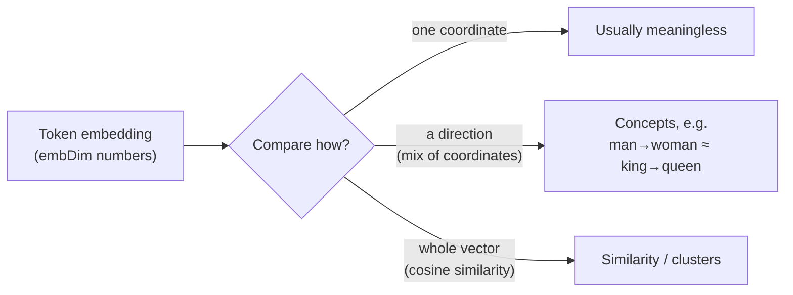
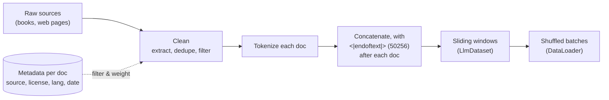
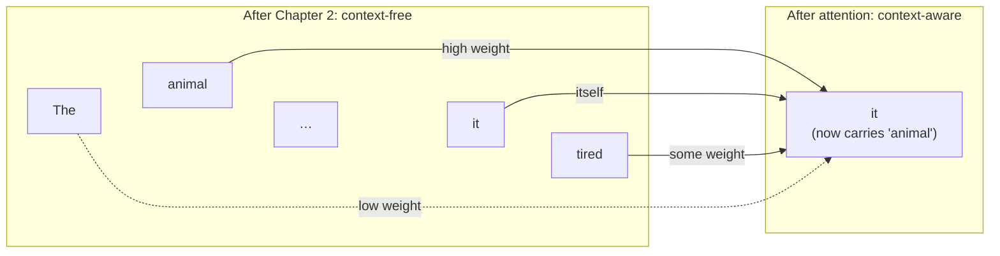
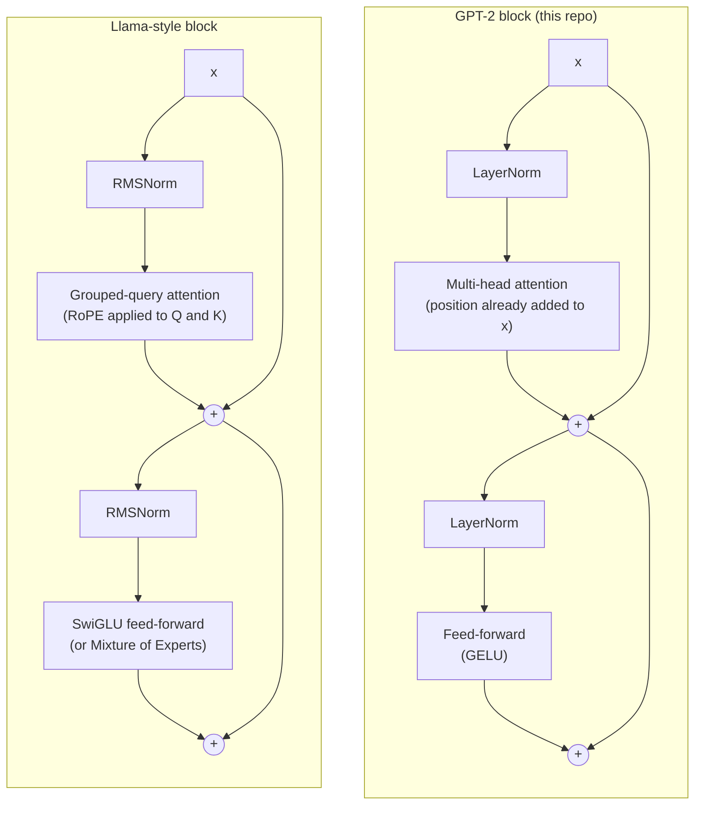
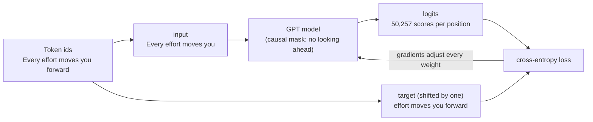
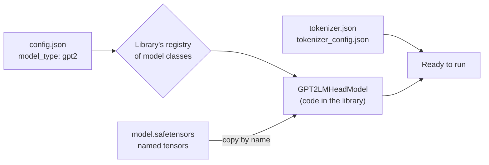

# Reader Notes

Questions that came up while working through [*Building an LLM in NodeJS*](https://book.humanexperiences.io) and this repo's chapter demos, with answers. These notes add to the book: they connect the small demo values to real models, explain design choices, and cover background the chapters assume.

Entries follow the book's chapter order. Each entry links to the code it discusses. Figures about real-world models are dated because they go out of date.

## Contents

- [Chapter 2: Tokenizer, data, and embeddings](#chapter-2-tokenizer-data-and-embeddings)
  - [Why do the chapters import `gpt-tokenizer/encoding/r50k_base` and not plain `gpt-tokenizer`?](#why-do-the-chapters-import-gpt-tokenizerencodingr50k_base-and-not-plain-gpt-tokenizer)
  - [What do `vocabSize` and `embDim` look like in modern LLMs?](#what-do-vocabsize-and-embdim-look-like-in-modern-llms)
  - [When embeddings "cluster", is that in one dimension, a few, or all of them?](#when-embeddings-cluster-is-that-in-one-dimension-a-few-or-all-of-them)
  - [How would I train on a whole book or web articles, and what metadata matters?](#how-would-i-train-on-a-whole-book-or-web-articles-and-what-metadata-matters)
- [Chapter 3: Attention](#chapter-3-attention)
  - [Why do we need attention, beyond the RNN bottleneck?](#why-do-we-need-attention-beyond-the-rnn-bottleneck)
  - [Are grammar rules programmed in, or does the model learn them?](#are-grammar-rules-programmed-in-or-does-the-model-learn-them)
  - [Why does each piece of attention exist (Q/K/V, √d, causal mask, heads)?](#why-does-each-piece-of-attention-exist-qkv-d-causal-mask-heads)
- [Chapter 4: The GPT model](#chapter-4-the-gpt-model)
  - [Are modern LLMs still built this way?](#are-modern-llms-still-built-this-way)
- [Chapter 5: Training](#chapter-5-training)
  - [Where is "predict the next token" actually written down?](#where-is-predict-the-next-token-actually-written-down)
  - [Is GPT-2's training data available, and could this repo train on it?](#is-gpt-2s-training-data-available-and-could-this-repo-train-on-it)
- [General](#general)
  - [How does software know how to load a model file? Are formats self-describing, and do names matter?](#how-does-software-know-how-to-load-a-model-file-are-formats-self-describing-and-do-names-matter)
  - [Is there a Python version of this material?](#is-there-a-python-version-of-this-material)

---

## Chapter 2: Tokenizer, data, and embeddings

### Why do the chapters import `gpt-tokenizer/encoding/r50k_base` and not plain `gpt-tokenizer`?

**Context:** Every chapter file, starting with [`02-byte-pair-encoding.ts`](../packages/chapters/src/ch02-tokenizer/02-byte-pair-encoding.ts), imports `encode`/`decode` from `gpt-tokenizer/encoding/r50k_base`. The book and its code are built around GPT-2, with a 50,257-token vocabulary.

**Short answer:** The package's default export isn't GPT-2's tokenizer. In `gpt-tokenizer` v3, `import { encode } from "gpt-tokenizer"` gives you **`o200k_base`**, GPT-4o's tokenizer, with about 200k tokens (checked against v3.4.0). GPT-2's tokenizer is **`r50k_base`**, and you have to import it by path.

`gpt-tokenizer` ships several OpenAI encodings. Each one splits text differently and numbers its tokens differently:

| Encoding | Used by | Vocabulary size |
| --- | --- | --- |
| `r50k_base` | GPT-2, GPT-3 | 50,257 |
| `p50k_base` | Codex, `text-davinci-002/003` | ~50k |
| `cl100k_base` | GPT-3.5, GPT-4 | ~100k |
| `o200k_base` (package default) | GPT-4o and later | ~200k |

Using the default with a GPT-2-sized model causes several problems:

- **The ids don't match the book.** "Hello world" is `[15496, 995]` in GPT-2 but `[13225, 2375]` in `o200k_base`, so the demo's output won't match examples printed with GPT-2 ids.
- **Ids can be larger than the embedding table.** The embedding has `vocabSize = 50257` rows. Short demo sentences happen to produce small ids, but real text eventually produces one ≥ 50,257, and `tf.gather` throws `GatherV2: the index value … is not in [0, 50256]`.
- **Special tokens are in different places.** Id 50256 is `<|endoftext|>` in GPT-2 but `" Pokemon"` in `o200k_base`.

The [chapter smoke test](../packages/chapters/tests/smoke.test.ts) pins GPT-2 ids (`encode("Hello world")` → `[15496, 995]`, `decode([50256])` → `<|endoftext|>`), so a change back to the default import fails the test.

In general, the tokenizer and the model must match. A model's embedding table is indexed by one specific tokenizer's ids. With a different tokenizer, every id points at the wrong row, or past the end of the table.

### What do `vocabSize` and `embDim` look like in modern LLMs?

**Context:** [`05-embedding.ts`](../packages/chapters/src/ch02-tokenizer/05-embedding.ts) uses `vocabSize = 50257` (GPT-2's BPE vocabulary) and `embDim = 8`, which is kept small so the output stays readable.

**Short answer:** Current open models use vocabularies of about 128k–256k tokens and embedding dimensions (called `d_model` or `hidden_size` in configs) from about 3k to 16k, depending on model size.

Values from published model configs (as of 2026-10):

| Model | `vocabSize` | `embDim` |
| --- | --- | --- |
| GPT-2 small | 50,257 | 768 |
| GPT-2 XL | 50,257 | 1,600 |
| GPT-3 175B | 50,257 | 12,288 |
| Llama 2 7B / 70B | 32,000 | 4,096 / 8,192 |
| Mistral 7B | 32,000 (v0.3: 32,768) | 4,096 |
| Llama 3 / 3.1 8B / 70B / 405B | 128,256 | 4,096 / 8,192 / 16,384 |
| Qwen2.5 7B / 72B | 152,064 (padded) | 3,584 / 8,192 |
| Gemma 2 9B / 27B | 256,000 | 3,584 / 4,608 |
| DeepSeek-V3 (671B MoE) | 129,280 | 7,168 |
| GPT-4o | ~200k (`o200k_base` tokenizer) | not published |

OpenAI and Anthropic don't publish these values for their current frontier models.

**Why the values look like this:**

- **Vocabularies have grown.** A bigger vocabulary means fewer tokens per sentence, especially for code and non-English text, so each forward pass covers more text. The cost is a larger embedding table and output layer. Many models round the size up to a multiple of 64 or 128 because GPUs run faster on those shapes, which is why Qwen's number looks odd.
- **The embedding dimension grows with model size.** It's roughly 2k–4k for 1–8B models, 8k for ~70B models, and 12k–16k+ for the largest dense models. It also has to divide evenly by the number of attention heads (see Chapter 3). Llama 3 8B, for example, has 32 heads of size 128: 32 × 128 = 4,096.
- **The embedding table is a large share of the parameters.** It holds `vocabSize × embDim` values. For Llama 3 8B that's 128,256 × 4,096 ≈ 525M parameters, about 1 GB in bf16. Many models reuse the same matrix for the output layer to save that memory ("tied embeddings"). GPT-2 does this; Llama 3 8B does not, so it stores the table twice.

**Trying it in the demo:** Setting `vocabSize = 128256` and `embDim = 4096` runs, but the table takes about 2 GB as `float32` and the printed output is no longer useful. That's why the demo uses `embDim = 8`.

### When embeddings "cluster", is that in one dimension, a few, or all of them?

**Context:** The book's embeddings section says that during training, "words with similar meaning tend to cluster together in vector space", with examples like "King" and "Queen" or "cat" and "kitten". The embedding table is built in [`05-embedding.ts`](../packages/chapters/src/ch02-tokenizer/05-embedding.ts).

**Short answer:** Across all dimensions. "Close together" means close as whole vectors, measured with cosine similarity or Euclidean distance, and both sum over every dimension:

```
cos(a, b) = (a₁b₁ + a₂b₂ + … + a_d b_d) / (‖a‖ ‖b‖)
```

So "king" being near "queen" is a statement about all `embDim` numbers (768 in GPT-2 small) taken together, not about any single coordinate.

**Single dimensions usually don't mean anything.** Training only rewards embeddings that make the next token easier to predict. Nothing pushes it to line meanings up with the axes, so there is no "royalty" dimension or "plural" dimension. Each concept is spread across many dimensions, and each dimension takes part in many concepts. In principle the whole space could be rotated without losing anything, because the next layer's weights would rotate to match. Real transformers aren't perfectly rotation-invariant: LayerNorm and the optimizer favor some axes a little, and a few "outlier" dimensions become unusually large. These effects still aren't readable as meanings.

**Concepts tend to be directions, which are combinations of dimensions.** The well-known example comes from word2vec: `king − man + woman ≈ queen`. The difference from "man" to "woman" points in roughly the same direction as the difference from "king" to "queen", so there is a "gender" direction. That direction is a mix of many coordinates, not one axis. Techniques such as linear probes and PCA can find these directions, and some properties live in fairly low-dimensional subspaces. Models can also store more concepts than they have dimensions by using nearly perpendicular directions, which researchers call "superposition".

**Clusters are a pattern across the whole space.** 2D plots of embeddings, with animals in one corner and countries in another, are projections (PCA, t-SNE, or UMAP) squeezed down from hundreds of dimensions. They help with intuition, but the true distances only exist in the full space.



**A caveat about the classic examples:** `king`/`queen` and `cat`/`kitten` come from word-level models like word2vec. A GPT's input embedding table is per token, and BPE splits some words into several tokens. Much of a word's meaning in context (a river "bank" vs. a bank that holds money) is also built up by the attention layers in later chapters, not stored in the input embedding. GPT input embeddings still cluster by meaning, just less cleanly than the classic examples suggest.

### How would I train on a whole book or web articles, and what metadata matters?

**Context:** The demos tokenize single sentences, such as `gptEncode("Life is like box of chocolate ...")`. The sliding-window dataset is built in [`dataset.ts`](../packages/core/src/data/dataset.ts) and batched by [`dataLoader.ts`](../packages/core/src/data/dataLoader.ts). Chapter 5's [`train.ts`](../packages/chapters/src/ch05-training/train.ts) will train on a short story.

**Short answer:** You give the tokenizer the whole text, but the model only ever sees one context-length window at a time. Web pages need cleaning first. Then each one becomes another document in the same token stream. During pretraining the model receives no metadata, only token ids. Metadata is stored per document and used to filter, weight, and audit the data.

#### A whole book

`LlmDataset` takes one long array of token ids and slides a window of `maxLength` tokens over it, moving `stride` tokens each step. It works the same for a sentence or a novel:

```ts
import { readFileSync } from "node:fs";
import { encode } from "gpt-tokenizer/encoding/r50k_base"; // GPT-2's encoding (see note below)

const ids = encode(readFileSync("book.txt", "utf8")); // ~130k tokens for a 100k-word novel
const dataset = new LlmDataset(ids, 1024, 1024); // GPT-2 context length, no overlap
```

The model never takes in "the book". It takes in about 130 separate 1,024-token windows, which `DataLoader` shuffles. The model can only learn connections between tokens that fall in the same window, which is one reason context length matters.

A single book is tiny, so the model will mostly memorize it. That's fine for learning how training works. Real pretraining uses trillions of tokens: Llama 3 used about 15T (as of 2026-10).

#### Many documents

Join the documents into one stream, with GPT-2's `<|endoftext|>` special token between each one. It marks the point where one text ends and an unrelated one begins. Without it, the model learns to continue the end of one article with the start of the next.

In GPT-2's vocabulary, `<|endoftext|>` is token id **50256**, the last id in the 50,257-token vocabulary. `gpt-tokenizer` uses the same id. The simplest approach is to append the id directly instead of putting the string into the text:

```ts
const END_OF_TEXT = 50256; // <|endoftext|> in GPT-2's vocabulary

const ids = docs.flatMap((doc) => [...encode(doc), END_OF_TEXT]);
```

Appending the id directly also avoids two problems with `gpt-tokenizer` (checked against v3.4.0):

- By default, `encode` throws `Disallowed special token found` when the text contains `<|endoftext|>`. This protects against user-supplied text injecting control tokens.
- With `{ allowedSpecial: new Set([EndOfText]) }`, the token is recognized only at the very start of the string. In the middle of a string, it's encoded as ordinary characters (`<`, `|`, `end`, …).

Windows can still cross a document boundary. Large training setups either accept this or mask attention so tokens can't attend across documents. Split training and validation data **by document**, not by position in the joined stream, so the two halves of one article don't end up in different sets.

#### Web articles need cleaning

Raw HTML is mostly navigation, ads, cookie banners, and markup. The usual cleanup steps:

1. **Extract the main text.** Tools such as Trafilatura and Mozilla's Readability do this.
2. **Remove duplicates.** This includes both exact copies and near-copies. The web repeats itself a lot, and duplicated text gets memorized.
3. **Filter.** Detect the language, score quality (drop spam, keyword stuffing, and page fragments), and remove personal information.

Public datasets such as FineWeb and C4 are the result of applying these steps to Common Crawl.

#### Metadata

Metadata isn't fed to the model during pretraining. It's stored per document, alongside the text:

| Metadata | What it's used for |
| --- | --- |
| Source / URL, domain | Weighting the data mix (e.g. books 2×, forums 0.5×), tracing problems back to a source |
| License / copyright status | Deciding what may be used; Project Gutenberg is a public-domain source |
| Language | Filtering and balancing across languages |
| Date (published / crawled) | Knowing the data's cutoff date, choosing time ranges |
| Quality score, dedup hash | Filtering and deduplication |
| Token count | Planning dataset size and mix proportions |

There are two cases where metadata-like information does reach the model:

- **Metadata conditioning (research).** Some work prepends each document's source URL as plain text, which helps the model learn different styles faster (Wikipedia-style vs. forum-style text). The prefix is dropped near the end of training. This is an experiment, not standard practice.
- **Fine-tuning.** Instruction data has a structure the model sees, such as `### Instruction:` / `### Response:` templates or chat role markers. That structure is part of the text itself, not a separate field.

#### Scaling beyond the demo

`LlmDataset` builds every window up front as JavaScript `number[]` arrays. That's fine for a book, but too much for a real corpus. At scale, you tokenize once and write the ids to a binary file of 16-bit integers (every GPT-2 id fits in `uint16`). Training then reads random windows straight from that file. nanoGPT's `train.bin` works this way.



---

## Chapter 3: Attention

### Why do we need attention, beyond the RNN bottleneck?

**Context:** The book's [Self-attention lesson](https://book.humanexperiences.io/chapters/03-attention/01-self-attention/) gives the historical motivation. An encoder-decoder RNN compresses the whole input into one final state, so the decoder "has no access to the full input context". The rest of the chapter explains *how* attention works. This entry covers two further reasons *why*: what attention does to the vectors from Chapter 2, and why it beat the alternatives.

**Short answer:** After Chapter 2, every token's vector is context-free. Attention is the step that mixes information between positions, so each token's vector can reflect the tokens around it. It does this in a way that depends on the content, connects any two tokens directly, and runs over all positions in parallel. No earlier approach had all three properties.

#### Chapter 2's vectors don't know their context

Each input vector is `token embedding + position embedding`. That vector is the same whatever the surrounding tokens are. "bank" has one vector in "river bank" and in "bank account". "it" has one vector whatever it refers to:

> The animal didn't cross the street because **it** was too tired.

Here, "it" must pick up meaning from "animal". Change "tired" to "wide" and it must pick up meaning from "street" instead. A model that predicts the next token one position at a time, using only that position's vector, can't do this. Something has to move information between positions, and that is attention's job. Each token's output is a weighted mix of the other tokens' vectors, and the weights are computed from the tokens themselves.



See also the caveat at the end of [the clustering entry](#when-embeddings-cluster-is-that-in-one-dimension-a-few-or-all-of-them): much of a word's meaning in context is built here, not in the input embedding.

#### Why attention, and not another way of mixing

| Approach | Mixing depends on content? | Path between distant tokens | Parallel across positions? |
| --- | --- | --- | --- |
| Fixed averaging / convolution | No: same weights for every sentence | Short, but blind to content | Yes |
| RNN | Yes | Long: steps through every token in between, and the signal fades | No: one token at a time |
| **Attention** | **Yes: weights computed from the tokens** | **1 step between any two tokens** | **Yes: all positions at once** |

The last column is the main practical reason transformers replaced RNNs. An RNN must finish token 499 before starting token 500. Attention is a few matrix multiplications over the whole sequence, which is exactly the work GPUs do quickly. That made training on trillions of tokens practical.

**The cost:** every token scores every other token, so the work grows with the **square** of the context length. This is why context windows have limits, and why so much research goes into making long contexts cheaper.

Nothing in the attention code knows that "it" should attend to "animal". That behavior is learned; see the next entry.

### Are grammar rules programmed in, or does the model learn them?

**Context:** The previous entry describes "it" taking meaning from "animal". Nothing in the [attention code](../packages/core/src/model/attention/) refers to nouns, pronouns, or grammar.

**Short answer:** The model learns them. Nobody writes grammar rules, parts of speech, or a coreference algorithm. The only instruction the model gets is the training objective: predict the next token, scored by cross-entropy loss (Chapter 5). Knowing what "it" refers to makes the next token easier to predict, so gradient descent strengthens whatever weights do that. Grammar-like behavior is a side effect of getting better at prediction.

#### Evidence that models learn this

- **Grammar can be read out of trained models.** Researchers train small "probe" classifiers on a model's internal vectors and can recover parse trees, parts of speech, and which noun a pronoun refers to. None of this was labeled in the training data. Hewitt & Manning's structural probe (2019) is the classic example.
- **Attention heads specialize.** Clark et al. (2019, "What Does BERT Look At?") found individual heads in BERT that track direct objects, determiners attaching to their nouns, and coreference. Olsson et al. (2022) describe *induction heads*, which learn the pattern "if A was followed by B earlier, predict B after A again". They are behind much in-context copying.
- **The same architecture works for any sequence.** The same code learns English, Japanese, Python, and DNA or protein sequences. Nothing in the architecture is specific to one language.

#### Caveats

1. **What the model learns isn't explicit rules.** It's spread across many weights and is statistical. It's often right, and sometimes wrong in ways a rule-based system wouldn't be. Sentences that need real-world knowledge ("The trophy didn't fit in the suitcase because *it* was too big/small") tripped up models for years.
2. **The architecture still shapes what can be learned.** Position embeddings, the causal mask, multiple heads, and the tokenizer don't encode grammar. They do make some patterns easier to learn than others. Researchers call these built-in tendencies *inductive biases*. Designing an architecture is choosing which ones the model gets, without writing rules.
3. **It takes a lot of data.** A GPT-2-sized model trained on one book, like the Chapter 5 demo, learns local patterns such as spelling, common word pairs, and punctuation. It doesn't learn reliable coreference. These abilities appear gradually as data and model size grow.
4. **"Emergent" has a narrower technical meaning.** In the research literature, "emergent abilities" (Wei et al., 2022) means abilities that seem to appear suddenly at a certain model scale. Whether they're really sudden is debated: Schaeffer et al. (2023) argue the jump mostly comes from how the abilities are measured. The broader sense, behavior that arises from training instead of being programmed in, is uncontroversial.

### Why does each piece of attention exist (Q/K/V, √d, causal mask, heads)?

**Context:** The chapter adds pieces one at a time, from [simplified attention](../packages/core/src/model/attention/simplifiedAttention.ts) to [self-attention with trainable weights](../packages/core/src/model/attention/selfAttention.ts) to [multi-head attention](../packages/core/src/model/attention/multi-head/multiHeadAttention.ts). This entry gives the reason for each addition.

**Short answer:** Each piece fixes a specific problem with the step before it:

- Dot products measure relevance.
- Softmax turns relevance into mixing weights.
- Q/K/V separate "relevant" from "similar".
- √d keeps softmax trainable.
- The causal mask prevents looking at the answer.
- Multiple heads track several relationships at once.

| Piece | Code | Why it's there |
| --- | --- | --- |
| Dot-product scores | [`simplifiedAttention.ts:23`](../packages/core/src/model/attention/simplifiedAttention.ts#L23) | A dot product is a cheap measure of how well two vectors line up. It serves as "how relevant is token j to token i?" for every pair at once (a `[seqLen, seqLen]` matrix). |
| Softmax | [`simplifiedAttention.ts:28`](../packages/core/src/model/attention/simplifiedAttention.ts#L28) | Turns scores into weights that are positive and sum to 1, so each output is a weighted average of the other tokens' vectors. |
| Separate Q, K, V projections | [`selfAttention.ts:63-65`](../packages/core/src/model/attention/selfAttention.ts#L63-L65) | In simplified attention, a token scores highest against tokens with *similar meaning*, including itself. But relevance isn't similarity: "it" should find a noun, not another pronoun. The **query** encodes what a token is looking for, the **key** what each token offers, and the **value** what is passed along when a token is attended to. All three are learned. |
| Divide by √d | [`selfAttention.ts:68`](../packages/core/src/model/attention/selfAttention.ts#L68) | Dot products get larger as vectors get longer. Large scores push softmax toward one-hot weights (all weight on one token), which makes the gradients nearly zero. Scaling by √d keeps scores in a range where the model can still learn. This repo applies it in simplified attention too. |
| Causal mask | [`utils.ts:34`](../packages/core/src/model/attention/utils.ts#L34) | The model is trained to predict the next token, so it must not see that token. The mask adds −1e9 to scores for later positions, so their softmax weight becomes about 0. |
| Multiple heads | [`multiHeadAttention.ts:59-65`](../packages/core/src/model/attention/multi-head/multiHeadAttention.ts#L59-L65) | One softmax gives one weighted average. Several heads can track different relationships at once, such as grammar, which noun a pronoun refers to, or nearby position. Each head works in `embDim / numHeads` dimensions, so the total cost stays about the same as one full-width head. This is why `embDim` must be divisible by `numHeads` (see [the `vocabSize`/`embDim` entry](#what-do-vocabsize-and-embdim-look-like-in-modern-llms)). |

Chapter 4 stacks attention with feed-forward layers into transformer blocks. Each layer's attention works on vectors the previous layers have already made context-aware, so later layers can model more abstract relationships.

---

## Chapter 4: The GPT model

### Are modern LLMs still built this way?

**Context:** [`gpt.ts`](../packages/core/src/model/gpt.ts) and [`block.ts`](../packages/core/src/model/block.ts) describe GPT-2's design (2019): token and position embeddings, a stack of transformer blocks, a final normalization and an output head.

**Short answer:** Mostly, yes. Nearly every major LLM is still a decoder-only stack of transformer blocks, pre-trained to predict the next token. What has changed is several components inside each block, the scale of the models and their training data, and above all how much happens after pre-training. Architectures that replace attention exist, but they are a minority and usually appear in hybrids that keep some attention layers.

#### What has not changed

- Tokens go in, pass through a stack of identical blocks, and come out as one score (logit) for every token in the vocabulary.
- Each block has causal self-attention and a feed-forward layer, each with a shortcut connection and normalization before it (pre-norm, as in GPT-2).
- Pre-training is still next-token prediction with cross-entropy loss.

#### What changed inside the block (as of 2026-10)

This applies to models that publish their architecture.

| GPT-2 (this repo) | Common now | Examples |
| --- | --- | --- |
| Learned position embeddings: one vector per position, up to 1,024 | **RoPE** (rotary position embedding): positions are applied as a rotation of each query and key, so attention depends on how far apart tokens are | Llama, Qwen, Mistral, DeepSeek |
| LayerNorm (subtracts the mean, divides by the standard deviation, then scale and shift) | **RMSNorm**: divides by the root mean square, with only a scale; cheaper and works as well | Most open models |
| Feed-forward layer: expand, GELU, contract | **SwiGLU**: a gated feed-forward layer, where one projection decides how much of another passes through | Llama, Qwen, Mistral |
| Multi-head attention: every head has its own keys and values | **Grouped-query attention (GQA)**: groups of query heads share one key/value head, which shrinks the memory used during generation | Llama 3, Qwen, Gemma; DeepSeek uses a related idea, multi-head latent attention (MLA) |
| Every layer attends to the whole context | Some layers use **sliding-window** attention over only the most recent tokens | Mistral 7B, Gemma 2 and 3 |
| One feed-forward layer per block | **Mixture of Experts (MoE)**: many feed-forward "experts" per block, with a small router choosing a few for each token, so only part of the model runs per token | Mixtral, DeepSeek-V3 (671B parameters in total, about 37B used per token), Llama 4, Qwen3, gpt-oss |
| Biases on most linear layers | Often no biases | Llama (Qwen2 keeps biases on Q, K and V) |
| 50,257-token vocabulary, 1,024-token context | Vocabularies of 128K–200K+ tokens; contexts of 128K tokens or more | Llama 3, GPT-4o's `o200k_base` tokenizer |

Each of these changes swaps one component; none changes the overall design. A Llama-style block is a GPT-2 block with its parts swapped:



Raschka's repository includes a notebook that converts this GPT architecture to Llama step by step ([`ch05/07_gpt_to_llama`](https://github.com/rasbt/LLMs-from-scratch/tree/main/ch05/07_gpt_to_llama)). His article [The Big LLM Architecture Comparison](https://magazine.sebastianraschka.com/p/the-big-llm-architecture-comparison) surveys the variations across recent open models.

#### What changed most: scale and post-training

- **Data.** GPT-2 was trained on about 40 GB of web text. Llama 3 was trained on about 15 trillion tokens.
- **Post-training.** Most of a modern assistant's behavior comes after pre-training. Supervised fine-tuning on instruction-and-response examples comes first. Preference tuning (RLHF or DPO) follows, using human or AI judgments of which answers are better. Since 2024, reinforcement learning on tasks whose answers can be checked automatically (OpenAI's o1, DeepSeek-R1) has produced "reasoning" models that write a long chain of thought before answering.
- **Multimodality.** Images and audio are usually handled by a separate encoder whose outputs enter the same transformer as extra "tokens".
- **Inference.** Generation uses a KV cache (the keys and values of earlier tokens are kept instead of recomputed) and weights quantized to 8, 4 or fewer bits.

#### Alternatives to attention

- **State-space and linear-attention layers** (Mamba, Gated DeltaNet) keep a fixed-size state instead of attending to every earlier token. This avoids attention's cost growing with the square of the context length. They mostly appear in **hybrids** that interleave them with ordinary attention layers, for example AI21's Jamba, NVIDIA's Nemotron-H and Qwen3-Next.
- **Diffusion language models** generate a whole draft and refine it over several steps, rather than producing one token at a time. Examples are Inception's Mercury and Google's experimental Gemini Diffusion.

#### Closed models, and where design details are published (as of 2026-10)

OpenAI (GPT-4 onward), Anthropic and Google don't publish their flagship models' architectures. They are widely understood to be transformer-based, and Mixture of Experts is widely reported for several of them, but these details are not confirmed by the vendors.

This changed in 2023. Earlier, the large labs published their main models in detail: Google's Transformer (2017), BERT, T5 and PaLM (2022, with architecture, size, data mixture and compute), and DeepMind's Chinchilla (2022), which set the ratio of training data to model size that most labs followed. OpenAI's GPT-4 technical report (2023) explicitly withheld the architecture, model size, compute, dataset and training method, citing competition and safety. Google's PaLM 2 and Gemini reports followed the same pattern: mostly evaluation results, with few details of how the models were built.

The labs still publish a lot, just less about their flagship models. Google, for example, publishes:

- technical reports for its open-weight Gemma models;
- research on alternative architectures (Griffin and RecurrentGemma, Infini-attention, Titans);
- a large share of the papers at NeurIPS and ICML.

Detailed accounts of training large models now come mostly from elsewhere:

- **Chinese labs.** DeepSeek's V3 and R1 papers give the architecture, training cost and reinforcement-learning recipe. Qwen, Moonshot (Kimi K2) and MiniMax publish technical reports.
- **Meta.** "The Llama 3 Herd of Models" (2024) is a thorough account of training at frontier scale. Llama 4 came with less.
- **Fully open projects.** They release training data, code and intermediate checkpoints as well as weights: AI2's OLMo, Hugging Face's SmolLM, NVIDIA's Nemotron.
- **OpenAI's open-weight gpt-oss models (2025).** They were released with a model card describing their architecture.

The architecture is now the least secret part of a model, because open models cover the same design space. What labs keep undisclosed is mainly the training data and its mixture, the post-training recipe (preference data, reinforcement-learning environments, reward design), and the scale and cost of training.

---

## Chapter 5: Training

### Where is "predict the next token" actually written down?

**Context:** Chapter 5 trains the model with [`trainModel`](../packages/core/src/train/trainer.ts) on samples built by [`dataset.ts`](../packages/core/src/data/dataset.ts). Nothing in [`gpt.ts`](../packages/core/src/model/gpt.ts) mentions "next", yet the trained model predicts the next token.

**Short answer:** The objective is not part of the architecture and is not stated as a rule. It exists in two places: **the training targets**, which are the input shifted by one token, and **the loss function**, which scores the model's output against those targets. The architecture contributes one thing, the causal mask, which stops the model from solving the task by looking ahead.



#### 1. The data: targets are the input shifted by one

[`dataset.ts:30-31`](../packages/core/src/data/dataset.ts#L30-L31) cuts the token stream into windows. Each window is an input, and the same window moved one token later is its target:

```text
input:   Every   effort  moves  you
target:  effort  moves   you    forward
```

At every position, the correct answer is the token that follows. That one-token offset is the whole definition of the task.

#### 2. The loss: score the output against the target

The model outputs `vocabSize` scores (logits) at every position. Cross-entropy (`crossEntropyLoss` in [`trainer.ts`](../packages/core/src/train/trainer.ts), which the book's Chapter 5 completes with `softmaxCrossEntropy`) turns them into probabilities and measures how little probability went to the target token. Training adjusts every weight to make that probability higher.

The model has no built-in idea of "next". Its output at position *t* is only a vector of scores. It comes to mean "the token at *t* + 1" because, across all of training, that output was always compared with the token at *t* + 1.

#### 3. The structure: the causal mask makes it a real task

The causal mask ([`utils.ts:37-38`](../packages/core/src/model/attention/utils.ts#L37-L38)) stops each position from attending to later ones. Without it, the model could attend to position *t* + 1 and copy it: the loss would fall to nearly zero and nothing useful would be learned. The mask doesn't define the objective, but the objective would be meaningless without it.

Generation depends on the objective too. The generation loop reads the scores at the **last** position, picks a token, appends it and repeats. That produces sensible text only because training gave the last position's output the meaning "what comes next".

#### Same blocks, different objectives

Change the targets, the mask or the loss, and the same kind of transformer learns a different task:

| Objective | What the targets are | Mask | Example |
| --- | --- | --- | --- |
| Next-token prediction | The input shifted by one | Causal | GPT, Llama |
| Masked-token prediction | The roughly 15% of tokens hidden in the input | None (sees both directions) | BERT |
| Classification | One label per text, predicted by a small new output head | Causal | Raschka, chapter 6 (spam detection) |
| Instruction tuning (SFT) | The next token, with the loss counted only on the response, not the prompt | Causal | Raschka, chapter 7 |
| Preference tuning and reinforcement learning | No fixed target: a preferred and a rejected answer, or a reward score | Causal | RLHF, DPO, reasoning models |

Setting `target = input` (no shift) would train the same model to copy its input.

Because the objective lives in the training code and data preparation, it leaves no label in the weights file. Two models with the same architecture and file format can have been trained for quite different purposes. Only documentation of how they were trained says which.

### Is GPT-2's training data available, and could this repo train on it?

**Context:** Chapter 5 trains on a single short story, using the training loop in [`trainer.ts`](../packages/core/src/train/trainer.ts). OpenAI's pretrained GPT-2 weights are freely available, which raises the question of whether the data they were trained on is too.

**Short answer:** No. OpenAI described GPT-2's dataset, WebText, but never released it. Open recreations built from the same recipe exist and work well. Training on one in this repo is possible in principle, but would take years on a CPU.

#### The original: WebText

The [GPT-2 paper](https://cdn.openai.com/better-language-models/language_models_are_unsupervised_multitask_learners.pdf) (2019) describes WebText. OpenAI collected the pages linked from Reddit posts with at least 3 karma, as a rough human quality filter, from posts made before December 2017. They removed duplicates and all Wikipedia pages. The result was about 8 million documents, or 40 GB of text. The recipe was published; the dataset was not.

The closest release is the [gpt-2-output-dataset](https://github.com/openai/gpt-2-output-dataset), made for research on detecting machine-generated text. It includes 250,000 documents from WebText's test split alongside GPT-2's own outputs. That's a sample of the original, not enough to train on.

#### Open substitutes (as of 2026-10)

| Dataset | What it is | Size |
| --- | --- | --- |
| [OpenWebText](https://huggingface.co/datasets/Skylion007/openwebtext) (2019) | An independent recreation of WebText from the paper's recipe | About 8 million documents, 38 GB, about 9 billion GPT-2 tokens |
| OpenWebText2 (EleutherAI) | A larger, newer recreation, released as part of *The Pile* | About 65 GB |
| [FineWeb](https://huggingface.co/datasets/HuggingFaceFW/fineweb) (2024) | Common Crawl with extensive filtering and deduplication | Trillions of tokens, with 10-billion-token samples |

These recreations work. Karpathy's [nanoGPT](https://github.com/karpathy/nanoGPT) trains GPT-2 124M from scratch on OpenWebText and matches the original's loss. His later `llm.c` project did the same on 10 billion FineWeb tokens in about 90 minutes on 8 H100 GPUs, slightly beating the original thanks to cleaner data.

#### Could this repo train on it?

The code would be the same as Chapter 5's. The hardware is the problem. Training GPT-2 small on a laptop CPU with this repo processes about 512 tokens every 5 seconds, roughly 100 tokens per second. One pass over OpenWebText's 9 billion tokens would take nearly **3 years**. That's why the chapter trains on one short story, and why loading pretrained weights is the practical way to get a capable model here.

#### Nobody can check what GPT-2 saw

Without WebText, there's no way to confirm whether a particular text, *The Verdict* or anything else, was in GPT-2's training data, and the weights can't reveal it either. So GPT-2's low loss on a text is not proof that it generalizes to unseen writing: it may have seen that text. Later models disclose even less. GPT-3's paper described its mix of data sources; GPT-4's technical report declined to describe its training data at all.

#### Available is not the same as licensed

OpenWebText and similar datasets are scraped web pages. The datasets are freely downloadable, but most of the pages in them are copyrighted by their authors. Recording each document's source and license (see [training on whole books and web articles](#how-would-i-train-on-a-whole-book-or-web-articles-and-what-metadata-matters)) is what makes questions about training data answerable later.

---

## General

### How does software know how to load a model file? Are formats self-describing, and do names matter?

**Context:** This repo's model is configured by [`GptConfig`](../packages/core/src/model/gpt.ts) (`embDim`, `numLayers`, …) and builds its layers in code. Loading someone else's trained weights, such as OpenAI's GPT-2, means knowing which tensor in their file belongs to which layer here, and with what configuration.

**Short answer:** A loader combines three things: a **tensor file**, a **configuration** describing the architecture, and **code** that implements that architecture. Formats differ in how much of the first two travels inside the file. The file extension only selects the parser. Model names are mostly for people; software reads metadata, not names.

#### What a loader needs

1. **The tensors:** named arrays of numbers (the container format's job).
2. **The architecture:** which layers, in what order, with what sizes, and which tensor name goes where (a config plus code).
3. **What surrounds the model:** the tokenizer, the chat template, and default generation settings.

#### How self-describing the formats are (as of 2026-10)

| Format | Tensors (names, shapes, types) | Architecture | Tokenizer / chat template | Used by |
| --- | --- | --- | --- | --- |
| PyTorch pickle (`.bin`, `.pt`) | Yes, but loading can **run arbitrary Python code** | No | No | Older Hugging Face models |
| **safetensors** | Yes, data only, so it's safe to load | No (only an optional string map, e.g. `{"format": "pt"}`) | No | Hugging Face |
| **GGUF** | Yes, with per-tensor quantization types | **Yes, as metadata**: `general.architecture = "llama"`, layer count, head counts, context length… | **Yes**: token list, merges, chat template | llama.cpp, Ollama, LM Studio |
| ONNX, TF SavedModel, Core ML | Yes | **Yes, as a computation graph** of operations | Usually separate | Cross-platform and mobile runtimes |

GPT-2's [Hugging Face repository](https://huggingface.co/openai-community/gpt2/tree/main) shows the spread. The same weights are published as `model.safetensors`, `pytorch_model.bin`, `tf_model.h5`, `flax_model.msgpack`, `rust_model.ot`, three `.tflite` variants and an `onnx/` folder, one container per runtime.

#### Hugging Face: a folder, not a file

safetensors describes only the tensors. The rest lives in sibling files with agreed names. GPT-2's `config.json` (abridged):

```json
{
  "architectures": ["GPT2LMHeadModel"],
  "model_type": "gpt2",
  "activation_function": "gelu_new",
  "n_embd": 768, "n_layer": 12, "n_head": 12, "n_positions": 1024,
  "vocab_size": 50257, "layer_norm_epsilon": 1e-05,
  "eos_token_id": 50256
}
```

This is `GptConfig` under other names: `n_embd` is `embDim`, `n_layer` is `numLayers`, `n_head` is `numHeads`, `n_positions` is `contextLength`. `gelu_new` is the tanh-approximation GELU that GPT-2 uses. The `transformers` library reads `model_type`, looks up `"gpt2"` in a registry of model classes it ships, and builds a `GPT2LMHeadModel`. That class names its parameters to match the tensor names in the file, so loading is a direct name-to-name copy. Alongside sit `tokenizer.json`, `tokenizer_config.json` (which holds the chat template, written in the Jinja template language) and `generation_config.json`. Large models are split into numbered shards (`model-00001-of-00004.safetensors`, …) with an index file mapping each tensor to its shard.

So the *description* is data, but the *architecture* is code that must already exist in the library. A new architecture won't load until the library supports it, or until the model ships its own Python code and the user opts in with `trust_remote_code=True`, which means running code downloaded with the model. vLLM works the same way, keyed on the `architectures` field.



#### GGUF: one self-contained file

GGUF puts the configuration, tokenizer and chat template inside the file as typed key-value metadata, and uses standardized tensor names (`blk.0.attn_q.weight`). That's why a single `.gguf` file runs in Ollama or LM Studio with no other files. The runtime still needs built-in code for the architecture it names, so a new model family works only after llama.cpp adds support. ONNX goes furthest: the file contains the computation graph itself, so a runtime only needs to implement the individual operations (matrix multiply, softmax, …), not know the architecture.

#### File extensions

The extension tells software which parser to try. The first bytes usually confirm it: GGUF files begin with the magic bytes `GGUF`, and current PyTorch files are zip archives beginning with `PK`. safetensors has no magic bytes; its first 8 bytes are simply the header length. No extension says anything about the architecture.

#### Model names

| Part of `Meta-Llama-3.1-8B-Instruct-Q4_K_M.gguf` | Meaning |
| --- | --- |
| `Meta-Llama-3.1` | Publisher, family, version |
| `8B` | About 8 billion parameters |
| `Instruct` | Fine-tuned to follow instructions; a "base" model only continues text |
| `Q4_K_M` | llama.cpp's 4-bit quantization scheme ("K-quant, medium") |
| `.gguf` | Container format |

Other common parts are context length (`128k`), other quantization schemes (`AWQ`, `GPTQ`, `fp8`, `bf16`), and specialization (`Coder`, `Vision`).

Names are almost entirely for people. Software reads metadata. The exceptions are heuristics: for example, text-generation-webui has long matched model names against patterns to guess a prompt template when a file didn't include one. Registry tags such as Ollama's `llama3.1:8b-instruct-q4_K_M` look parsed but are lookup keys for a stored manifest, and API model ids such as `gpt-4o-2024-08-06` are routing keys on the provider's side.

Nothing verifies a name, or most metadata. A file called `…-8B-Instruct-…` can contain anything, GGUF metadata can be edited, and `config.json` is a text file beside the weights. Formats describe *what* a file claims to contain; they don't prove who produced it or whether the claims are true.

### Is there a Python version of this material?

**Context:** [`GPT_CONFIG_124M`](../packages/core/src/model/gpt.ts) "mirrors the book's `GPT_CONFIG_124M`", and the Chapter 5 stub in [`train.ts`](../packages/chapters/src/ch05-training/train.ts) points at `the-verdict.txt`. Both come from an earlier book that this one follows closely.

**Short answer:** Yes. Sebastian Raschka's [*Build a Large Language Model (From Scratch)*](https://www.manning.com/books/build-a-large-language-model-from-scratch) (Manning, 2024) builds the same GPT in Python with PyTorch. The book is paid; its code, as Jupyter notebooks with their outputs, is free at [rasbt/LLMs-from-scratch](https://github.com/rasbt/LLMs-from-scratch). It follows the same chapter order, the same 124M configuration and the same training text, and it continues past pre-training into fine-tuning.

#### How the chapters line up

| Raschka's book | This repo |
| --- | --- |
| 1. Understanding large language models | Background only |
| 2. Working with text data | [`ch02-tokenizer`](../packages/chapters/src/ch02-tokenizer/) |
| 3. Coding attention mechanisms | [`ch03-attention`](../packages/chapters/src/ch03-attention/) |
| 4. Implementing a GPT model from scratch to generate text | [`ch04-gpt`](../packages/chapters/src/ch04-gpt/) |
| 5. Pretraining on unlabeled data (ends by loading OpenAI's GPT-2 weights) | [`ch05-training`](../packages/chapters/src/ch05-training/) |
| 6. Fine-tuning for classification | No equivalent yet |
| 7. Fine-tuning to follow instructions | No equivalent yet |
| Appendix A: Introduction to PyTorch | Not needed; this repo uses TensorFlow.js |
| Appendix D: Extras for the training loop (learning-rate warmup, cosine decay, gradient clipping) | No equivalent yet |
| Appendix E: Parameter-efficient fine-tuning with LoRA | No equivalent yet |

Chapters 6 and 7 and Appendix E cover post-training: adapting a pre-trained model to a task or to follow instructions. The GitHub repository also has bonus material outside the book. Examples include a KV cache for faster generation, converting the GPT-2 architecture to Llama-style models, and preference tuning with DPO.

#### Using the two together

- **Reference results.** The notebooks show their outputs (parameter counts, losses, generated text), so results here can be checked against them without installing Python. The unofficial companion chapters on this fork's `companion` branch are checked this way.
- **Translating the code.** The PyTorch and TensorFlow.js code map closely. PyTorch's `nn.Linear` corresponds to a weight matrix plus bias here, `nn.Module` to a class with a `weights` array, and `torch.no_grad()` roughly to `tf.tidy()` outside a gradient computation. Two differences catch people out. PyTorch stores linear weights as `[dOut, dIn]` while this repo uses `[dIn, dOut]`. PyTorch's default initialization is a uniform range of ±1/√dIn, and matching it matters for training to behave like the book's.
- **Going further.** Readers who want the fine-tuning chapters before this book publishes them can switch to the Python book from Chapter 6. The concepts from Chapters 2–5 carry over unchanged. Most of the tooling around real models (Hugging Face, safetensors, model cards) is also Python-first.
