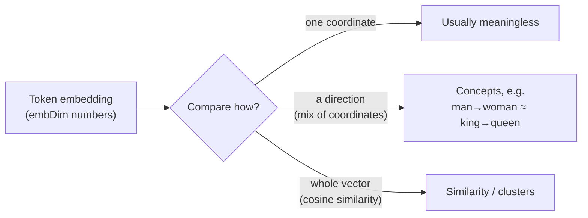
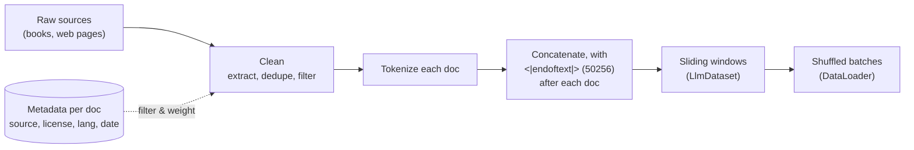

# Reader Notes

Questions that came up while working through [*Building an LLM in NodeJS*](https://book.humanexperiences.io) and this repo's chapter demos, with answers. These notes add to the book: they connect the small demo values to real models, explain design choices, and cover background the chapters assume.

Entries follow the book's chapter order. Each entry links to the code it discusses. Figures about real-world models are dated because they go out of date.

## Contents

- [Chapter 2: Tokenizer, data, and embeddings](#chapter-2-tokenizer-data-and-embeddings)
  - [Why do the chapters import `gpt-tokenizer/encoding/r50k_base` and not plain `gpt-tokenizer`?](#why-do-the-chapters-import-gpt-tokenizerencodingr50k_base-and-not-plain-gpt-tokenizer)
  - [What do `vocabSize` and `embDim` look like in modern LLMs?](#what-do-vocabsize-and-embdim-look-like-in-modern-llms)
  - [When embeddings "cluster", is that in one dimension, a few, or all of them?](#when-embeddings-cluster-is-that-in-one-dimension-a-few-or-all-of-them)
  - [How would I train on a whole book or web articles, and what metadata matters?](#how-would-i-train-on-a-whole-book-or-web-articles-and-what-metadata-matters)

---

## Chapter 2: Tokenizer, data, and embeddings

### Why do the chapters import `gpt-tokenizer/encoding/r50k_base` and not plain `gpt-tokenizer`?

**Context:** Every chapter file, starting with [`02-byte-pair-encoding.ts`](../packages/chapters/src/ch02-tokenizer/02-byte-pair-encoding.ts), imports `encode`/`decode` from `gpt-tokenizer/encoding/r50k_base`. The book and its code are built around GPT-2, with a 50,257-token vocabulary.

**Short answer:** The package's default export isn't GPT-2's tokenizer. In `gpt-tokenizer` v3, `import { encode } from "gpt-tokenizer"` gives you **`o200k_base`**, GPT-4o's tokenizer, with about 200k tokens (checked against v3.4.0). GPT-2's tokenizer is **`r50k_base`**, and you have to import it by path.

`gpt-tokenizer` ships several OpenAI encodings. Each one splits text differently and numbers its tokens differently:

| Encoding | Used by | Vocabulary size |
| --- | --- | --- |
| `r50k_base` | GPT-2, GPT-3 | 50,257 |
| `p50k_base` | Codex, `text-davinci-002/003` | ~50k |
| `cl100k_base` | GPT-3.5, GPT-4 | ~100k |
| `o200k_base` (package default) | GPT-4o and later | ~200k |

Using the default with a GPT-2-sized model causes several problems:

- **The ids don't match the book.** "Hello world" is `[15496, 995]` in GPT-2 but `[13225, 2375]` in `o200k_base`, so the demo's output won't match examples printed with GPT-2 ids.
- **Ids can be larger than the embedding table.** The embedding has `vocabSize = 50257` rows. Short demo sentences happen to produce small ids, but real text eventually produces one ≥ 50,257, and `tf.gather` throws `GatherV2: the index value … is not in [0, 50256]`.
- **Special tokens are in different places.** Id 50256 is `<|endoftext|>` in GPT-2 but `" Pokemon"` in `o200k_base`.

The [chapter smoke test](../packages/chapters/tests/smoke.test.ts) pins GPT-2 ids (`encode("Hello world")` → `[15496, 995]`, `decode([50256])` → `<|endoftext|>`), so a change back to the default import fails the test.

In general, the tokenizer and the model must match. A model's embedding table is indexed by one specific tokenizer's ids. With a different tokenizer, every id points at the wrong row, or past the end of the table.

### What do `vocabSize` and `embDim` look like in modern LLMs?

**Context:** [`05-embedding.ts`](../packages/chapters/src/ch02-tokenizer/05-embedding.ts) uses `vocabSize = 50257` (GPT-2's BPE vocabulary) and `embDim = 8`, which is kept small so the output stays readable.

**Short answer:** Current open models use vocabularies of about 128k–256k tokens and embedding dimensions (called `d_model` or `hidden_size` in configs) from about 3k to 16k, depending on model size.

Values from published model configs (as of 2026-10):

| Model | `vocabSize` | `embDim` |
| --- | --- | --- |
| GPT-2 small | 50,257 | 768 |
| GPT-2 XL | 50,257 | 1,600 |
| GPT-3 175B | 50,257 | 12,288 |
| Llama 2 7B / 70B | 32,000 | 4,096 / 8,192 |
| Mistral 7B | 32,000 (v0.3: 32,768) | 4,096 |
| Llama 3 / 3.1 8B / 70B / 405B | 128,256 | 4,096 / 8,192 / 16,384 |
| Qwen2.5 7B / 72B | 152,064 (padded) | 3,584 / 8,192 |
| Gemma 2 9B / 27B | 256,000 | 3,584 / 4,608 |
| DeepSeek-V3 (671B MoE) | 129,280 | 7,168 |
| GPT-4o | ~200k (`o200k_base` tokenizer) | not published |

OpenAI and Anthropic don't publish these values for their current frontier models.

**Why the values look like this:**

- **Vocabularies have grown.** A bigger vocabulary means fewer tokens per sentence, especially for code and non-English text, so each forward pass covers more text. The cost is a larger embedding table and output layer. Many models round the size up to a multiple of 64 or 128 because GPUs run faster on those shapes, which is why Qwen's number looks odd.
- **The embedding dimension grows with model size.** It's roughly 2k–4k for 1–8B models, 8k for ~70B models, and 12k–16k+ for the largest dense models. It also has to divide evenly by the number of attention heads (see Chapter 3). Llama 3 8B, for example, has 32 heads of size 128: 32 × 128 = 4,096.
- **The embedding table is a large share of the parameters.** It holds `vocabSize × embDim` values. For Llama 3 8B that's 128,256 × 4,096 ≈ 525M parameters, about 1 GB in bf16. Many models reuse the same matrix for the output layer to save that memory ("tied embeddings"). GPT-2 does this; Llama 3 8B does not, so it stores the table twice.

**Trying it in the demo:** Setting `vocabSize = 128256` and `embDim = 4096` runs, but the table takes about 2 GB as `float32` and the printed output is no longer useful. That's why the demo uses `embDim = 8`.

### When embeddings "cluster", is that in one dimension, a few, or all of them?

**Context:** The book's embeddings section says that during training, "words with similar meaning tend to cluster together in vector space", with examples like "King" and "Queen" or "cat" and "kitten". The embedding table is built in [`05-embedding.ts`](../packages/chapters/src/ch02-tokenizer/05-embedding.ts).

**Short answer:** Across all dimensions. "Close together" means close as whole vectors, measured with cosine similarity or Euclidean distance, and both sum over every dimension:

```
cos(a, b) = (a₁b₁ + a₂b₂ + … + a_d b_d) / (‖a‖ ‖b‖)
```

So "king" being near "queen" is a statement about all `embDim` numbers (768 in GPT-2 small) taken together, not about any single coordinate.

**Single dimensions usually don't mean anything.** Training only rewards embeddings that make the next token easier to predict. Nothing pushes it to line meanings up with the axes, so there is no "royalty" dimension or "plural" dimension. Each concept is spread across many dimensions, and each dimension takes part in many concepts. In principle the whole space could be rotated without losing anything, because the next layer's weights would rotate to match. Real transformers aren't perfectly rotation-invariant: LayerNorm and the optimizer favor some axes a little, and a few "outlier" dimensions become unusually large. These effects still aren't readable as meanings.

**Concepts tend to be directions, which are combinations of dimensions.** The well-known example comes from word2vec: `king − man + woman ≈ queen`. The difference from "man" to "woman" points in roughly the same direction as the difference from "king" to "queen", so there is a "gender" direction. That direction is a mix of many coordinates, not one axis. Techniques such as linear probes and PCA can find these directions, and some properties live in fairly low-dimensional subspaces. Models can also store more concepts than they have dimensions by using nearly perpendicular directions, which researchers call "superposition".

**Clusters are a pattern across the whole space.** 2D plots of embeddings, with animals in one corner and countries in another, are projections (PCA, t-SNE, or UMAP) squeezed down from hundreds of dimensions. They help with intuition, but the true distances only exist in the full space.



**A caveat about the classic examples:** `king`/`queen` and `cat`/`kitten` come from word-level models like word2vec. A GPT's input embedding table is per token, and BPE splits some words into several tokens. Much of a word's meaning in context (a river "bank" vs. a bank that holds money) is also built up by the attention layers in later chapters, not stored in the input embedding. GPT input embeddings still cluster by meaning, just less cleanly than the classic examples suggest.

### How would I train on a whole book or web articles, and what metadata matters?

**Context:** The demos tokenize single sentences, such as `gptEncode("Life is like box of chocolate ...")`. The sliding-window dataset is built in [`dataset.ts`](../packages/core/src/data/dataset.ts) and batched by [`dataLoader.ts`](../packages/core/src/data/dataLoader.ts). Chapter 5's [`train.ts`](../packages/chapters/src/ch05-training/train.ts) will train on a short story.

**Short answer:** You give the tokenizer the whole text, but the model only ever sees one context-length window at a time. Web pages need cleaning first. Then each one becomes another document in the same token stream. During pretraining the model receives no metadata, only token ids. Metadata is stored per document and used to filter, weight, and audit the data.

#### A whole book

`LlmDataset` takes one long array of token ids and slides a window of `maxLength` tokens over it, moving `stride` tokens each step. It works the same for a sentence or a novel:

```ts
import { readFileSync } from "node:fs";
import { encode } from "gpt-tokenizer/encoding/r50k_base"; // GPT-2's encoding (see note below)

const ids = encode(readFileSync("book.txt", "utf8")); // ~130k tokens for a 100k-word novel
const dataset = new LlmDataset(ids, 1024, 1024); // GPT-2 context length, no overlap
```

The model never takes in "the book". It takes in about 130 separate 1,024-token windows, which `DataLoader` shuffles. The model can only learn connections between tokens that fall in the same window, which is one reason context length matters.

A single book is tiny, so the model will mostly memorize it. That's fine for learning how training works. Real pretraining uses trillions of tokens: Llama 3 used about 15T (as of 2026-10).

#### Many documents

Join the documents into one stream, with GPT-2's `<|endoftext|>` special token between each one. It marks the point where one text ends and an unrelated one begins. Without it, the model learns to continue the end of one article with the start of the next.

In GPT-2's vocabulary, `<|endoftext|>` is token id **50256**, the last id in the 50,257-token vocabulary. `gpt-tokenizer` uses the same id. The simplest approach is to append the id directly instead of putting the string into the text:

```ts
const END_OF_TEXT = 50256; // <|endoftext|> in GPT-2's vocabulary

const ids = docs.flatMap((doc) => [...encode(doc), END_OF_TEXT]);
```

Appending the id directly also avoids two problems with `gpt-tokenizer` (checked against v3.4.0):

- By default, `encode` throws `Disallowed special token found` when the text contains `<|endoftext|>`. This protects against user-supplied text injecting control tokens.
- With `{ allowedSpecial: new Set([EndOfText]) }`, the token is recognized only at the very start of the string. In the middle of a string, it's encoded as ordinary characters (`<`, `|`, `end`, …).

Windows can still cross a document boundary. Large training setups either accept this or mask attention so tokens can't attend across documents. Split training and validation data **by document**, not by position in the joined stream, so the two halves of one article don't end up in different sets.

#### Web articles need cleaning

Raw HTML is mostly navigation, ads, cookie banners, and markup. The usual cleanup steps:

1. **Extract the main text.** Tools such as Trafilatura and Mozilla's Readability do this.
2. **Remove duplicates.** This includes both exact copies and near-copies. The web repeats itself a lot, and duplicated text gets memorized.
3. **Filter.** Detect the language, score quality (drop spam, keyword stuffing, and page fragments), and remove personal information.

Public datasets such as FineWeb and C4 are the result of applying these steps to Common Crawl.

#### Metadata

Metadata isn't fed to the model during pretraining. It's stored per document, alongside the text:

| Metadata | What it's used for |
| --- | --- |
| Source / URL, domain | Weighting the data mix (e.g. books 2×, forums 0.5×), tracing problems back to a source |
| License / copyright status | Deciding what may be used; Project Gutenberg is a public-domain source |
| Language | Filtering and balancing across languages |
| Date (published / crawled) | Knowing the data's cutoff date, choosing time ranges |
| Quality score, dedup hash | Filtering and deduplication |
| Token count | Planning dataset size and mix proportions |

There are two cases where metadata-like information does reach the model:

- **Metadata conditioning (research).** Some work prepends each document's source URL as plain text, which helps the model learn different styles faster (Wikipedia-style vs. forum-style text). The prefix is dropped near the end of training. This is an experiment, not standard practice.
- **Fine-tuning.** Instruction data has a structure the model sees, such as `### Instruction:` / `### Response:` templates or chat role markers. That structure is part of the text itself, not a separate field.

#### Scaling beyond the demo

`LlmDataset` builds every window up front as JavaScript `number[]` arrays. That's fine for a book, but too much for a real corpus. At scale, you tokenize once and write the ids to a binary file of 16-bit integers (every GPT-2 id fits in `uint16`). Training then reads random windows straight from that file. nanoGPT's `train.bin` works this way.


