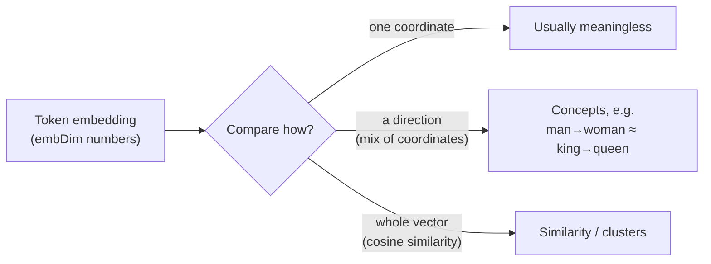

# Reader Notes

Questions that came up while working through [*Building an LLM in NodeJS*](https://book.humanexperiences.io) and this repo's chapter demos, with answers. These notes add to the book: they connect the small demo values to real models, explain design choices, and cover background the chapters assume.

Entries follow the book's chapter order. Each entry links to the code it discusses. Figures about real-world models are dated because they go out of date.

## Contents

- [Chapter 2: Tokenizer, data, and embeddings](#chapter-2-tokenizer-data-and-embeddings)
  - [What do `vocabSize` and `embDim` look like in modern LLMs?](#what-do-vocabsize-and-embdim-look-like-in-modern-llms)
  - [When embeddings "cluster", is that in one dimension, a few, or all of them?](#when-embeddings-cluster-is-that-in-one-dimension-a-few-or-all-of-them)

---

## Chapter 2: Tokenizer, data, and embeddings

### What do `vocabSize` and `embDim` look like in modern LLMs?

**Context:** [`05-embedding.ts`](../packages/chapters/src/ch02-tokenizer/05-embedding.ts) uses `vocabSize = 50257` (GPT-2's BPE vocabulary) and `embDim = 8`, which is kept small so the output stays readable.

**Short answer:** Current open models use vocabularies of about 128k–256k tokens and embedding dimensions (called `d_model` or `hidden_size` in configs) from about 3k to 16k, depending on model size.

Values from published model configs (as of 2026-10):

| Model | `vocabSize` | `embDim` |
| --- | --- | --- |
| GPT-2 small | 50,257 | 768 |
| GPT-2 XL | 50,257 | 1,600 |
| GPT-3 175B | 50,257 | 12,288 |
| Llama 2 7B / 70B | 32,000 | 4,096 / 8,192 |
| Mistral 7B | 32,000 (v0.3: 32,768) | 4,096 |
| Llama 3 / 3.1 8B / 70B / 405B | 128,256 | 4,096 / 8,192 / 16,384 |
| Qwen2.5 7B / 72B | 152,064 (padded) | 3,584 / 8,192 |
| Gemma 2 9B / 27B | 256,000 | 3,584 / 4,608 |
| DeepSeek-V3 (671B MoE) | 129,280 | 7,168 |
| GPT-4o | ~200k (`o200k_base` tokenizer) | not published |

OpenAI and Anthropic don't publish these values for their current frontier models.

**Why the values look like this:**

- **Vocabularies have grown.** A bigger vocabulary means fewer tokens per sentence, especially for code and non-English text, so each forward pass covers more text. The cost is a larger embedding table and output layer. Many models round the size up to a multiple of 64 or 128 because GPUs run faster on those shapes, which is why Qwen's number looks odd.
- **The embedding dimension grows with model size.** It's roughly 2k–4k for 1–8B models, 8k for ~70B models, and 12k–16k+ for the largest dense models. It also has to divide evenly by the number of attention heads (see Chapter 3). Llama 3 8B, for example, has 32 heads of size 128: 32 × 128 = 4,096.
- **The embedding table is a large share of the parameters.** It holds `vocabSize × embDim` values. For Llama 3 8B that's 128,256 × 4,096 ≈ 525M parameters, about 1 GB in bf16. Many models reuse the same matrix for the output layer to save that memory ("tied embeddings"). GPT-2 does this; Llama 3 8B does not, so it stores the table twice.

**Trying it in the demo:** Setting `vocabSize = 128256` and `embDim = 4096` runs, but the table takes about 2 GB as `float32` and the printed output is no longer useful. That's why the demo uses `embDim = 8`.

### When embeddings "cluster", is that in one dimension, a few, or all of them?

**Context:** The book's embeddings section says that during training, "words with similar meaning tend to cluster together in vector space", with examples like "King" and "Queen" or "cat" and "kitten". The embedding table is built in [`05-embedding.ts`](../packages/chapters/src/ch02-tokenizer/05-embedding.ts).

**Short answer:** Across all dimensions. "Close together" means close as whole vectors, measured with cosine similarity or Euclidean distance, and both sum over every dimension:

```
cos(a, b) = (a₁b₁ + a₂b₂ + … + a_d b_d) / (‖a‖ ‖b‖)
```

So "king" being near "queen" is a statement about all `embDim` numbers (768 in GPT-2 small) taken together, not about any single coordinate.

**Single dimensions usually don't mean anything.** Training only rewards embeddings that make the next token easier to predict. Nothing pushes it to line meanings up with the axes, so there is no "royalty" dimension or "plural" dimension. Each concept is spread across many dimensions, and each dimension takes part in many concepts. In principle the whole space could be rotated without losing anything, because the next layer's weights would rotate to match. Real transformers aren't perfectly rotation-invariant: LayerNorm and the optimizer favor some axes a little, and a few "outlier" dimensions become unusually large. These effects still aren't readable as meanings.

**Concepts tend to be directions, which are combinations of dimensions.** The well-known example comes from word2vec: `king − man + woman ≈ queen`. The difference from "man" to "woman" points in roughly the same direction as the difference from "king" to "queen", so there is a "gender" direction. That direction is a mix of many coordinates, not one axis. Techniques such as linear probes and PCA can find these directions, and some properties live in fairly low-dimensional subspaces. Models can also store more concepts than they have dimensions by using nearly perpendicular directions, which researchers call "superposition".

**Clusters are a pattern across the whole space.** 2D plots of embeddings, with animals in one corner and countries in another, are projections (PCA, t-SNE, or UMAP) squeezed down from hundreds of dimensions. They help with intuition, but the true distances only exist in the full space.



**A caveat about the classic examples:** `king`/`queen` and `cat`/`kitten` come from word-level models like word2vec. A GPT's input embedding table is per token, and BPE splits some words into several tokens. Much of a word's meaning in context (a river "bank" vs. a bank that holds money) is also built up by the attention layers in later chapters, not stored in the input embedding. GPT input embeddings still cluster by meaning, just less cleanly than the classic examples suggest.
